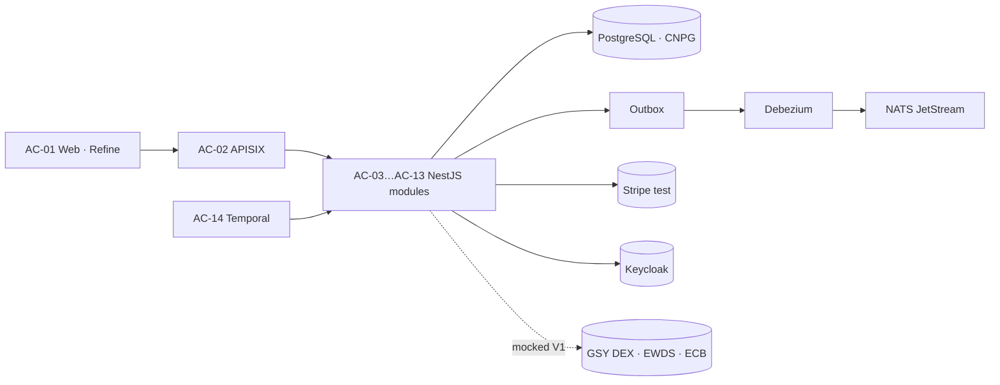

# INTELLIGENT — Billing & Payment Service

**Quality (SonarQube Community — [live dashboard](https://sonar.intelligent-eu-bp.blooo.dev/dashboard?id=blooo-io_intelligent-eu-billing-and-payment))**

**Validation (D5.5 V1)**

Billing and payment service of the Horizon Europe project **INTELLIGENT** ([GA 101160678](https://cordis.europa.eu/project/id/101160678)). It covers **Task T5.6** and **Deliverable D5.5**. The software is published under **Apache-2.0** so any organisation can run it on **their own** infrastructure.

**Start here for adopters:** [Public documentation (GitHub Pages)](https://blooo-io.github.io/intelligent-eu-billing-and-payment/) — introduction, deploy-your-own, configuration, adapters, contribute. Source for that site: [`apps/site`](apps/site) (VitePress).

The service turns energy trades settled on a local market into **peer-to-peer invoices and payments between community members**, then publishes results to a project data space (EWDS).

> **Status:** V1 — target D5.5 at M24 (**30/11/2026**). Every community runs in **virtual mode**. The only required real external integration is **Stripe in test mode** (or your PSP adapter). GSY DEX, EWDS and ECB rates ship with **mock adapters** ([assumption A32](docs/requirements/requirements.md)).

## Billing model — “the producer is the bank”

Documented in the [functional architecture](docs/architecture/01-functional-architecture.md) and [requirements](docs/requirements/requirements.md) (assumptions A19–A22, business rules BR-01…BR-13):

| Rule | Meaning |
|---|---|
| One invoice per pair | Each **consumer→producer** pair gets one invoice per period, issued **in the producer’s name** (self-billing) |
| Netting | Purchases and sales between the same pair are netted |
| Threshold | Amounts below a community threshold (e.g. 5 €/CHF) are carried forward; early settlement is possible |
| Direct payment | Money never transits through the platform — the consumer pays the producer’s **Stripe Connect** account |
| Off-invoice grid costs | Grid fees, taxes and levies stay on the supplier/DSO bill (**A20**) — not on P2P invoices |
| Market price is final | Billing never recomputes market results or changes a trade status |

## Architecture at a glance

Five validated views (iterative, each refining the previous):

| View | File | Answers |
|---|---|---|
| Functional | [`01-functional-architecture.md`](docs/architecture/01-functional-architecture.md) | Actors, processes, objects, **BR-01…BR-13** |
| Logical | [`02-logical-architecture.md`](docs/architecture/02-logical-architecture.md) | Blocks, data ownership, events, jobs |
| Application | [`03-application-architecture.md`](docs/architecture/03-application-architecture.md) | Modules **AC-01…AC-15**, APIs, adapters, mocks S1–S13 |
| Technical | [`04-technical-architecture.md`](docs/architecture/04-technical-architecture.md) | Decisions **TD-1…TD-13**, principles **TP-1…TP-8** |
| Physical | [`05-physical-architecture.md`](docs/architecture/05-physical-architecture.md) | Environments, Scaleway Kapsule (nl-ams), ops |

**Runtime stack (TD-4…TD-11):** TypeScript · NestJS · React/Refine · PostgreSQL (CloudNativePG) · NATS JetStream · Debezium · Temporal · Apache APISIX · Keycloak · OpenBao + External Secrets · OpenTelemetry · Argo CD on Kubernetes.

## Repository map

| Path | Content |
|---|---|
| [`docs/requirements/`](docs/requirements/) | Personas, user stories, **REQ/NFR**, **UAT** item notes + narrative [`requirements.md`](docs/requirements/requirements.md) |
| [`docs/architecture/`](docs/architecture/) | Architecture views 01→05; [`ewds-topics/`](docs/architecture/ewds-topics/) draft EWDS schemas |
| [`docs/testing/`](docs/testing/) | Test plan, UAT package, validation summary, e2e notes |
| [`docs/release/`](docs/release/) | SemVer / GitHub Releases ([VERSIONING.md](docs/release/VERSIONING.md)), release notes, **reference** deploy notes |
| [`docs/maintainers/`](docs/maintainers/) | Upstream-only process pointers |
| [`contracts/`](contracts/) | **Contract-first** OpenAPI 3.1 (REST) and AsyncAPI 3 (events) |
| [`services/`](services/) | NestJS modules — one database per module |
| [`apps/web/`](apps/web/) | AC-01 reference UI (participant portal + manager console) |
| [`apps/site/`](apps/site/) | **Public docs site** (VitePress → GitHub Pages) |
| [`apps/docs-portal/`](apps/docs-portal/) | Redocly public OpenAPI portal |
| [`packages/`](packages/) | Shared NestJS module template, generated clients |
| [`mocks/`](mocks/) | AC-15 mock suite and scenarios S1–S13 |
| [`deploy/`](deploy/) | Example Helm charts / GitOps manifests (adapt to your registry & DNS) |
| [`AGENTS.md`](AGENTS.md) | Detailed engineering rules (includes upstream notes) |
| [`CONTRIBUTING.md`](CONTRIBUTING.md) | Open contribution first; upstream process optional |

### Module map (AC → directory)

| Directory | Component | Logical block |
|---|---|---|
| `apps/web` | AC-01 Web app | — |
| `deploy/` (APISIX) | AC-02 API gateway | LB-12, LB-01 |
| `services/participants` | AC-03 | LB-02 |
| `services/trade-intake` | AC-04 | LB-03 |
| `services/settlement` | AC-05 | LB-04 |
| `services/invoicing` | AC-06 | LB-05 |
| `services/payments` | AC-07 | LB-06 |
| `services/reconciliation` | AC-08 | LB-07 |
| `services/reporting` | AC-09 | LB-14 |
| `services/publication` | AC-10 | LB-08 |
| `services/notification` | AC-11 | LB-09 |
| `services/compliance` | AC-12 | LB-10 |
| `services/reference-data` | AC-13 | LB-11 |
| `services/scheduler` | AC-14 Temporal workers | LB-13 |
| `mocks/` | AC-15 Mock suite | — |

Full map and non-negotiable rules: [`AGENTS.md`](AGENTS.md).

## Quality and CI

| Gate | What it enforces | Where |
|---|---|---|
| **GitHub Actions `ci`** | Secrets scan, contracts lint, every workspace `test` script, Helm charts, Sonar analysis | [`.github/workflows/ci.yml`](.github/workflows/ci.yml) |
| **Vitest coverage** | ≥ **80%** statements, branches, functions, lines per module | [`config/coverage-thresholds.json`](config/coverage-thresholds.json) |
| **Sonar “Intelligent V1”** | MQR Security / Reliability / Maintainability **A**, coverage ≥ 80%, duplication ≤ 10%, `new_violations = 0` | [`docs/release/sonarqube.md`](docs/release/sonarqube.md) |
| **Contract-first** | Spectral + Redocly + AsyncAPI validate; Schemathesis / oasdiff in the pipeline | [`contracts/`](contracts/), TD-13 |
| **UAT package** | In-scope UATs tracked to Pass in item notes | [`docs/testing/v1-validation-summary.md`](docs/testing/v1-validation-summary.md) |

Sonar badges above mirror the Community Build project `blooo-io_intelligent-eu-billing-and-payment` (ratings refresh when CI analyses `develop`). The dashboard is the source of truth.

## Working on this repository

**Adopters / operators:** follow the [public docs](https://blooo-io.github.io/intelligent-eu-billing-and-payment/) ([source](apps/site)) — especially [Deploy on Kubernetes](apps/site/guide/deploy.md).

**Contributors:** read [`CONTRIBUTING.md`](CONTRIBUTING.md) (open GitHub workflow first). Deep engineering rules: [`AGENTS.md`](AGENTS.md).

**Local quick start:** Node ≥ 22, pnpm 9 → `pnpm install` → `pnpm run contracts:lint` → `pnpm test`. Optional local cluster: TD-12 (k3d + Tilt) via `scripts/local-stack.mjs`. Docs site: `pnpm --filter @intelligent/site dev`.

Upstream reference cluster notes (example DNS / GitOps) live under [`docs/release/deployment.md`](docs/release/deployment.md) and [`docs/maintainers/`](docs/maintainers/) — not required for your own deployment.

## Documentation index

| Need | Start here |
|---|---|
| **Public operator docs** | [GitHub Pages](https://blooo-io.github.io/intelligent-eu-billing-and-payment/) · [`apps/site`](apps/site) |
| What / for whom | [Functional architecture](docs/architecture/01-functional-architecture.md) |
| REQ / UAT / assumptions | [requirements.md](docs/requirements/requirements.md) · [items/](docs/requirements/items/) |
| APIs & events | [`contracts/`](contracts/) · [API page](apps/site/reference/api.md) |
| How it is built | [Technical architecture](docs/architecture/04-technical-architecture.md) |
| Deploy your own | [apps/site/guide/deploy.md](apps/site/guide/deploy.md) |
| Reference (example) deploy | [docs/release/deployment.md](docs/release/deployment.md) |
| Validation evidence | [v1-validation-summary.md](docs/testing/v1-validation-summary.md) |

## Licence

Apache License 2.0 — see [`LICENSE`](LICENSE) and [`NOTICE`](NOTICE). Runtime and shipped dependencies are **MIT or Apache-2.0** only (**TP-2**); documented exceptions for separate unmodified services (OpenBao, SonarQube Community, DDHub Client Gateway) are in the [technical architecture](docs/architecture/04-technical-architecture.md).
