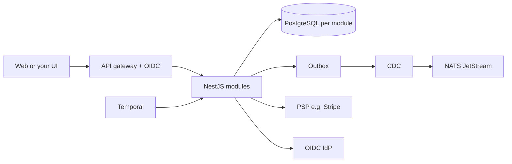

# Architecture

The design is documented in **five validated views**, published on this site from the repository’s `docs/architecture/` tree (INT-413). You do not need to open GitHub to read them.

| View | Question | On this site |
|---|---|---|
| Functional | What / for whom? | [1. Functional architecture](/architecture/01-functional-architecture) |
| Logical | Which blocks? | [2. Logical architecture](/architecture/02-logical-architecture) |
| Application | Modules & APIs | [3. Application architecture](/architecture/03-application-architecture) |
| Technical | Technologies | [4. Technical architecture](/architecture/04-technical-architecture) |
| Physical | Where it runs | [5. Physical architecture](/architecture/05-physical-architecture) |

Also published: [EWDS / DDHub Client Gateway](/architecture/ewds-client-gateway) and [EWDS topic schemas](/architecture/ewds-topics).

Start from the [architecture overview](/architecture/).

## Runtime shape

## Non-negotiable rules (summary)

1. **Contract-first** — change OpenAPI/AsyncAPI before code.
2. **Module boundaries** — no cross-module database access.
3. **Idempotent consumers** — deduplicate on `eventId`.
4. **Single master** — Stripe (or your PSP) owns payment objects.
5. **Permissive licences** — MIT / Apache-2.0 dependencies only.

Module directory map: [Modules](/reference/modules). Contributor rules stay in [`AGENTS.md`](https://github.com/blooo-io/intelligent-eu-bps-source/blob/develop/AGENTS.md) in the repository.
