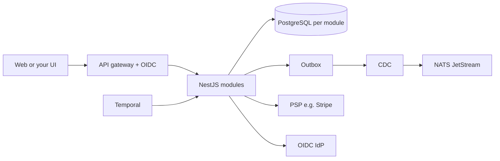

# Architecture

The design is documented in five validated views in the repository. This page is an entry point for operators and integrators.

| View | Question | Document |
|---|---|---|
| Functional | What / for whom? | [`docs/architecture/01-functional-architecture.md`](https://github.com/blooo-io/intelligent-eu-billing-and-payment/blob/develop/docs/architecture/01-functional-architecture.md) |
| Logical | Which blocks? | [`02-logical-architecture.md`](https://github.com/blooo-io/intelligent-eu-billing-and-payment/blob/develop/docs/architecture/02-logical-architecture.md) |
| Application | Modules & APIs | [`03-application-architecture.md`](https://github.com/blooo-io/intelligent-eu-billing-and-payment/blob/develop/docs/architecture/03-application-architecture.md) |
| Technical | Technologies | [`04-technical-architecture.md`](https://github.com/blooo-io/intelligent-eu-billing-and-payment/blob/develop/docs/architecture/04-technical-architecture.md) |
| Physical | Where it runs | [`05-physical-architecture.md`](https://github.com/blooo-io/intelligent-eu-billing-and-payment/blob/develop/docs/architecture/05-physical-architecture.md) |

## Runtime shape

## Non-negotiable rules (summary)

1. **Contract-first** — change OpenAPI/AsyncAPI before code.
2. **Module boundaries** — no cross-module database access.
3. **Idempotent consumers** — deduplicate on `eventId`.
4. **Single master** — Stripe (or your PSP) owns payment objects.
5. **Permissive licences** — MIT / Apache-2.0 dependencies only.

Full agent/contributor rules: [`AGENTS.md`](https://github.com/blooo-io/intelligent-eu-billing-and-payment/blob/develop/AGENTS.md) in the repo (includes upstream process notes).
