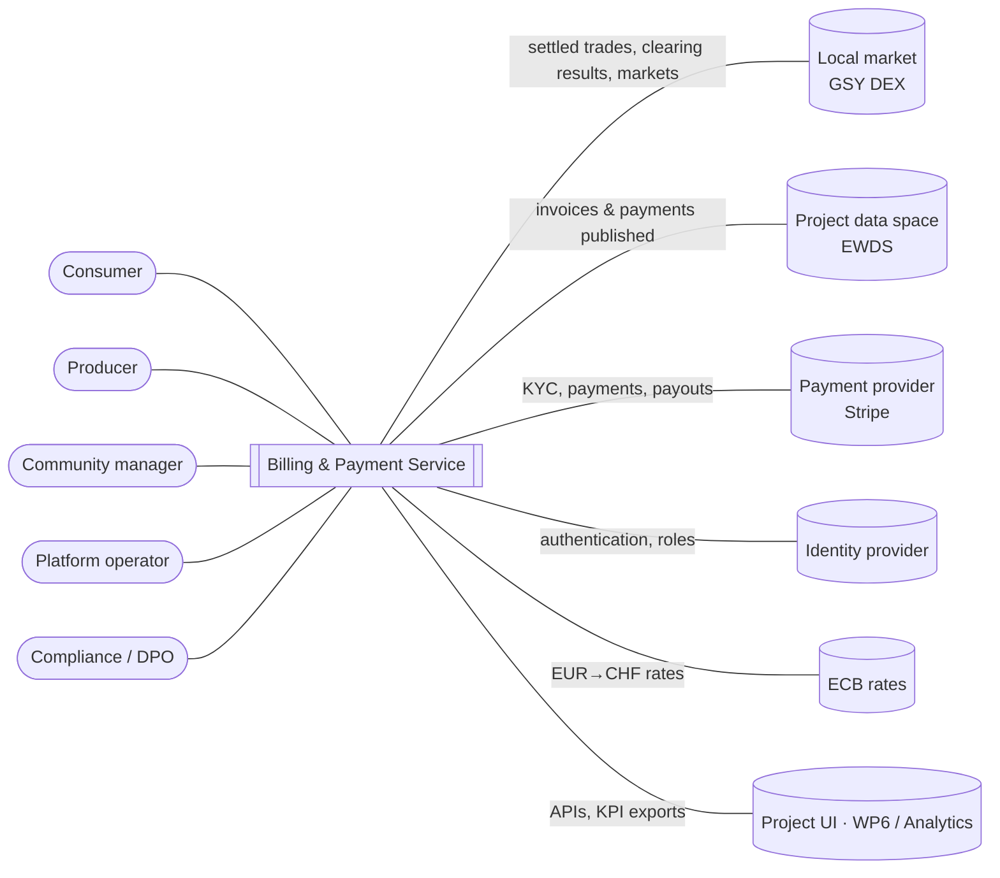
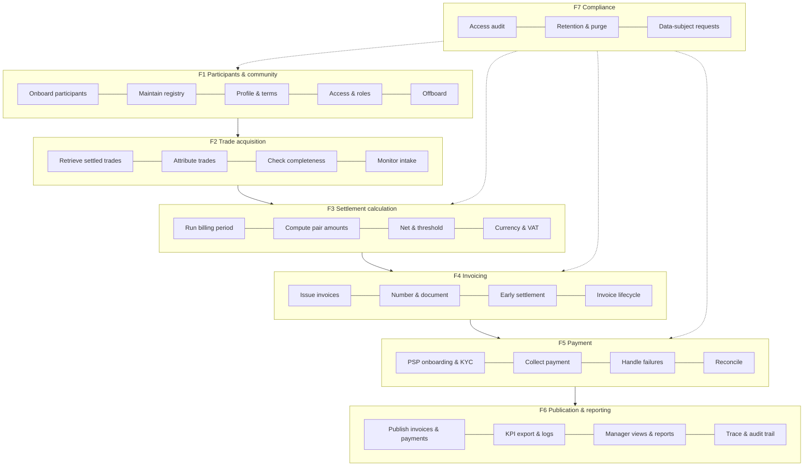
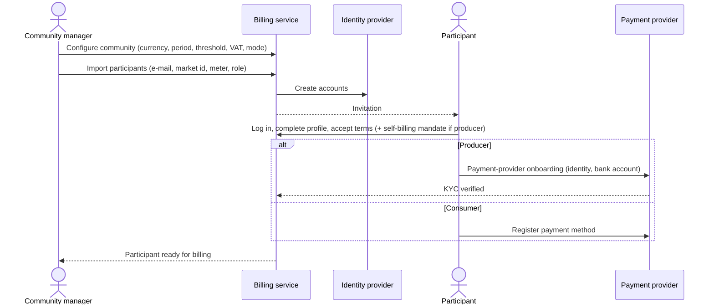
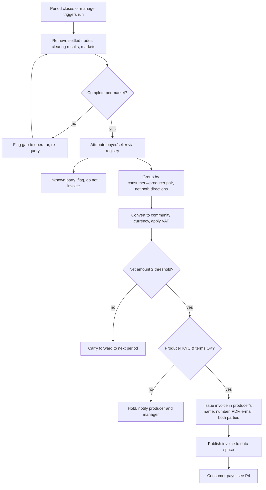
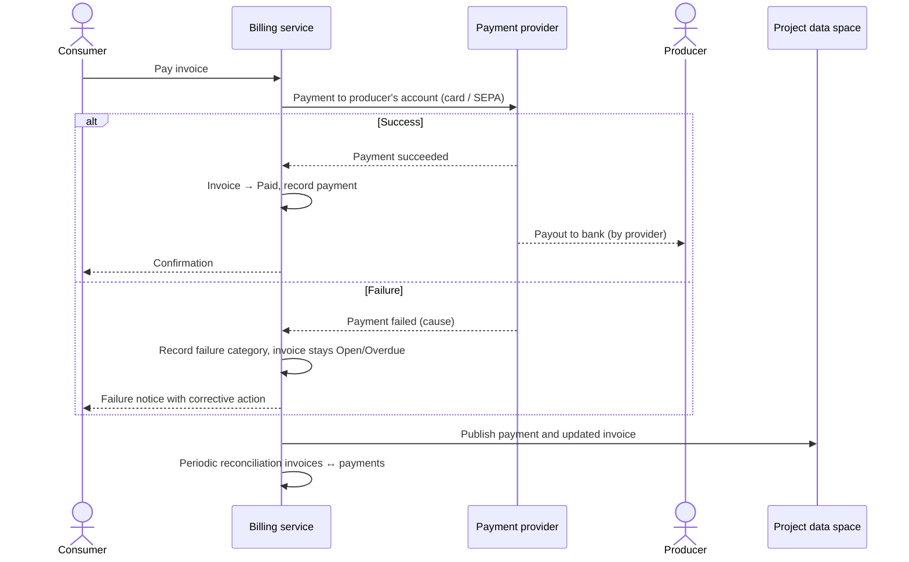
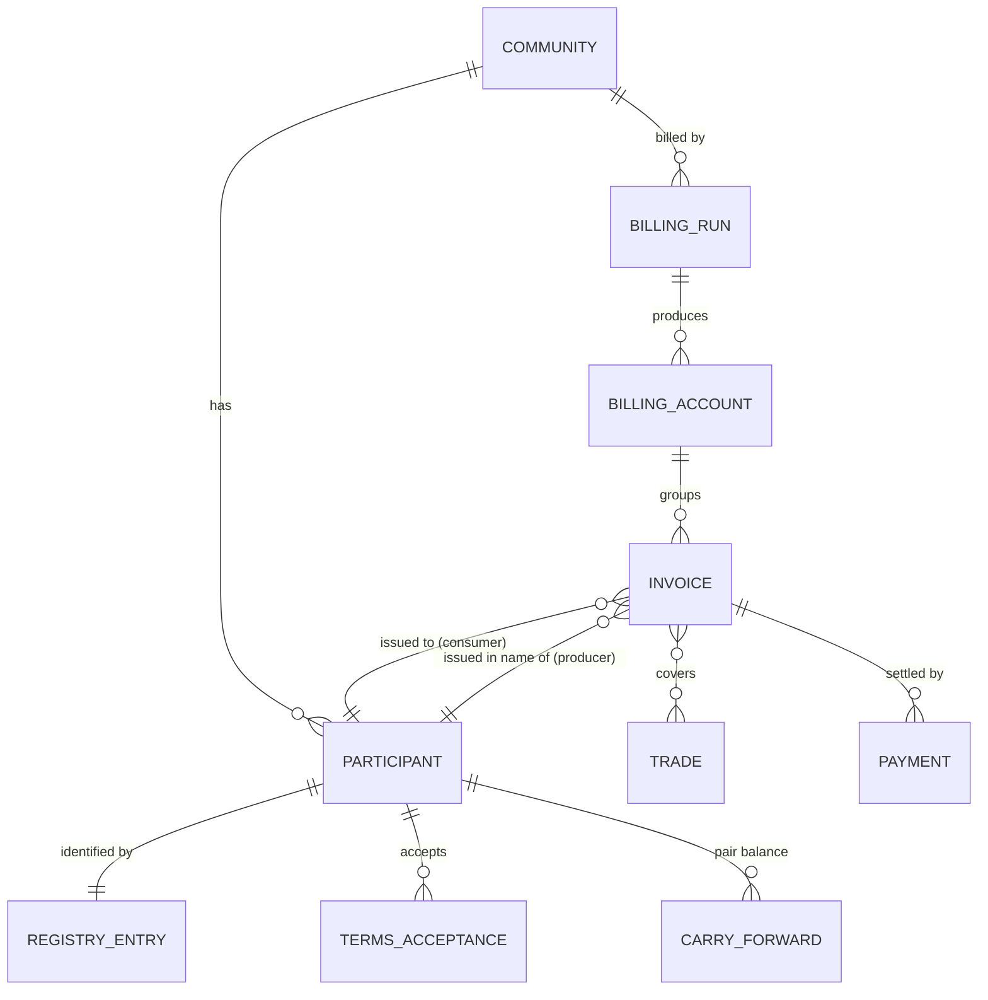

# Billing & Payment Service: functional architecture

> **View 1 of 5** in the iterative architecture approach: functional → logical → application → technical → physical (see [README](README.md)).
> This view describes **what** the service does, for **whom**, and with **which business objects and processes**. It deliberately says nothing about components, technologies or deployment. Those belong to the next views.
> Baseline: requirements v5 and assumptions A13–A32. Status: **validated (2026-10-07)**.

## 1. Purpose and scope

The Billing & Payment Service (T5.6, deliverable D5.5) turns the energy trades settled on the INTELLIGENT local market into **invoices and payments between community members**. It also publishes the results so other project services can use them.

| In scope for D5.5 V1 | Out of scope for D5.5 |
|---|---|
| Peer-to-peer invoices between consumers and producers for energy traded on the local market | Grid fees, taxes and levies of suppliers and DSOs: they stay on the existing supplier/DSO bill (A20) |
| Fiat payment through a payment service provider, in **test mode** for every community (A22, A32) | Real-money payments: the first live community comes after V1 |
| Participant onboarding, payment KYC, terms and self-billing mandate | Imbalance penalties (A18); community bonus and incentives (A30) |
| Publication of invoices and payments for the project (KPIs, trade payment status) | Crypto payments, AMM interface, i-Euro stablecoin (D5.10) |
| GDPR obligations of the billing data | KPI computation EC-1/EC-2 and comparison with a baseline bill (A23) |

**Functional principles**
1. **The producer is the bank** (A19). Each producer is paid by each consumer who bought energy from them. Invoices are issued per consumer→producer pair, in the producer's name, through self-billing.
2. **The market price is final.** The price of each settled trade is used as is (REQ-003). Billing never recomputes market results and never changes the status of a trade.
3. **Money never transits through the platform.** The consumer pays the producer directly through the payment provider (REQ-014, REQ-015).
4. **Minimum personal data.** The service only holds what invoicing and payment need. Identity proofing is done by the payment provider (REQ-051), and nothing personal is published to the project data space.
5. **Everything is traceable.** Every amount can be traced back to its trades and to the run that computed it, and nothing is overwritten (REQ-005, REQ-028, NFR-003).

## 2. Actors

| Actor | Kind | Role towards billing | Persona |
|---|---|---|---|
| Consumer | Human | Receives one invoice per producer, pays, can settle early | P2 (and P1 when buying) |
| Producer | Human / organisation | Gets invoices issued in their name and receives payments; must complete payment KYC | P1 |
| Community manager | Human | Onboards participants, configures the community (period, threshold, VAT, mode), follows billing and payments, handles disputes | P4 |
| Platform operator | Human | Runs billing, monitors data intake, reconciles, handles incidents | P6 |
| Compliance stakeholder (DPO) | Human | Handles data-subject requests, checks retention and audit | P7 |
| Local market | External system (GSY DEX) | Source of settled trades, clearing results and markets | — |
| Project data space | External system (EWDS) | Channel used to obtain trades and publish invoices and payments | — |
| Payment service provider | External system (Stripe) | KYC of producers, payment collection, payout to producers | — |
| Identity provider | External system (project IdP) | Authenticates users and provides their roles | — |
| Exchange-rate source | External system (ECB reference rates) | EUR→CHF rate for CHF communities (A16) | — |
| Project UI and evaluation | External consumers (R2M UI, WP6 / GSY Analytics) | Use the billing APIs, invoices, payments and KPI exports | — |

### Context diagram

## 3. Functional map

Seven functional domains (F1–F7), each split into functions. The last column traces every function to the requirements.

| Function | Description | Main actor(s) | Requirements |
|---|---|---|---|
| **F1.1 Onboard participants** | The community manager imports a minimal list (e-mail, market identifier, meter, role). This creates the participants and their accounts and sends invitations | Community manager | REQ-008, US-007 |
| **F1.2 Maintain registry** | Links each participant to their market identifier, community and meter. Only the community manager changes these links | Community manager | REQ-058 |
| **F1.3 Profile & terms** | The participant completes their billing profile and accepts the terms. A producer also accepts the self-billing mandate | Consumer, producer | REQ-009, REQ-050, US-044 |
| **F1.4 Access & roles** | Authentication through the project IdP; roles (member, community manager, operator) restrict access to the participant's own data and community | All humans | REQ-033–037, REQ-049, REQ-010, NFR-011, NFR-013 |
| **F1.5 Offboard** | Removes a participant from future billing and forces a final settlement, while keeping the history | Community manager | REQ-012, REQ-056 |
| **F2.1 Retrieve settled trades** | Obtains from the local market the settled trades of a period, plus clearing results and markets (delivery period, mechanism) | Platform operator | REQ-001 |
| **F2.2 Attribute trades** | Resolves the buyer and seller of each trade through the registry. A trade with an unknown party is flagged and not invoiced | — | REQ-058 |
| **F2.3 Check completeness** | Per market, compares the trades received with the clearing result (quantity, count) | Platform operator | REQ-041 |
| **F2.4 Monitor intake** | Alerts when expected data stops arriving or when the data-space connection degrades | Platform operator | REQ-029, US-028 |
| **F3.1 Run billing period** | A billing run for a community over a configurable period (monthly by default). Each run is a versioned record that is never overwritten | Community manager, operator | REQ-006, REQ-005, NFR-003 |
| **F3.2 Compute pair amounts** | For each consumer→producer pair: Σ(kWh × trade price) over the settled, not yet invoiced trades | — | REQ-002, REQ-003 |
| **F3.3 Net & threshold** | Nets purchases and sales between the same two participants. A pair below the threshold (5 €/CHF by default) is carried forward, with a final invoice forced at year end or exit | — | REQ-055, REQ-056 |
| **F3.4 Currency & VAT** | Converts EUR prices into the community currency at the ECB reference rate, then applies the community VAT rate (0 by default) | — | REQ-002, REQ-007 |
| **F4.1 Issue invoices** | One invoice per pair and per period, issued in the producer's name. Issuing is blocked while the producer's KYC is incomplete | — | REQ-054, REQ-045 |
| **F4.2 Number & document** | Gives the invoice a legal sequential number per producer, then produces the PDF (trades, amounts, self-billing mention) and e-mails it to both parties | — | REQ-042, REQ-039, REQ-007 |
| **F4.3 Early settlement** | The consumer settles the not yet invoiced trades with one producer at any time | Consumer | REQ-057, US-047 |
| **F4.4 Invoice lifecycle** | Statuses Draft → Open → PartiallyPaid / Paid / Overdue / Void / Disputed, with a manual change by the community manager (reason + audit) | Community manager | REQ-044, US-041 |
| **F5.1 PSP onboarding & KYC** | The producer gets a verified payment-provider account (identity, bank account). The consumer registers a payment method | Producer, consumer | REQ-051, REQ-040, REQ-045 |
| **F5.2 Collect payment** | The consumer pays the invoice (card or SEPA debit) directly to the producer's account, and the provider pays out to the producer's bank | Consumer, producer | REQ-014, REQ-015 |
| **F5.3 Handle failures** | Detects failed payments from provider events, records the cause and notifies the participant | Platform operator | REQ-016, REQ-017, REQ-046 |
| **F5.4 Reconcile** | Matches invoices with payments and flags discrepancies | Platform operator | REQ-041 |
| **F6.1 Publish invoices & payments** | Publishes every invoice and payment change to the data space (no personal data). This lets other services see which trades are paid | — | REQ-048 |
| **F6.2 KPI export & logs** | Exports amounts, kWh and components per participant and period, and logs failures and payment times | Platform operator | REQ-047, REQ-046 |
| **F6.3 Manager views & reports** | Payment status overview, member history for disputes, periodic summary | Community manager | REQ-018, REQ-031, REQ-032 |
| **F6.4 Trace & audit trail** | Links every payment back to its invoice, run and trades | Platform operator | REQ-028 |
| **F7.1 Access audit** | Logs every access to or change of personal and payment data | DPO | REQ-030 |
| **F7.2 Retention & purge** | Retention periods for personal data; data-space messages purged within 7 days | DPO | REQ-011, REQ-053 |
| **F7.3 Data-subject requests** | Access and erasure requests received through the portal or the community manager, propagated to the payment provider and the IdP. Invoices are kept for the legal retention period | DPO | REQ-013 |

The billing functions are exposed through **documented APIs** (REQ-052). Blooo's reference screens and the project UI both use them.

## 4. Main business processes

### P1 Onboarding of a community and its participants

### P2 Periodic billing run

### P3 Early settlement

The consumer chooses a producer in the portal and asks to "settle now". The service computes the not yet invoiced trades with that producer, nets them and issues an invoice (`settlementType = early`), which the consumer pays immediately. The next periodic invoice only covers the trades after that point. The threshold does not apply to an early settlement the consumer requested.

### P4 Payment, failure and reconciliation

### P5 Data-subject request

A request comes in through the portal or the community manager. The DPO validates it. The service then exports or erases the participant's personal data, asks the payment provider and the IdP to erase their copies, keeps the invoices and accounting records for the legal period, and confirms the outcome.

## 5. Business objects

| Business object | Description | Owner | Ontology mapping | Personal data |
|---|---|---|---|---|
| Community | Billing settings: currency, period, threshold, VAT rate, mode live/virtual | Community manager | `int:Community` (+ billing settings) | No |
| Participant | Member of a community, with role consumer / producer / prosumer and billing profile | Participant / manager | `int:Actor`, `Address`, `ContactDetails`, `UserAccount` | **Yes** |
| Registry entry | Link participant ↔ market identifier ↔ community ↔ meter | Community manager | `int:Actor` + GSY actor id | Pseudonymous |
| Terms acceptance | Version and date accepted, including the self-billing mandate | Participant | (extension) | Yes (link) |
| Payment account status | KYC and onboarding status at the payment provider; payment method present | Payment provider | `UserAccount.kycVerified` | Status only |
| Trade (read only) | Settled trade: buyer, seller, kWh, price, market | Local market | `int:EnergyTrade` | Pseudonymous |
| Billing run | One computation for a community and period, versioned and immutable | Billing | (extension) | No |
| Billing account | A consumer's account for a period, grouping their invoices | Billing | `int:Billing` | Pseudonymous |
| Invoice | Consumer→producer, one period or early settlement; trades, amounts, legal number, PDF | Billing (in the producer's name) | `int:Invoice` | Yes (PDF) |
| Payment | One payment of one invoice, with status and failure category | Billing / payment provider | `int:Payment` (`StripePayment` kept internal) | No (published), yes (internal provider ids) |
| Carry-forward balance | Net amount of a pair that stayed below the threshold | Billing | (extension) | No |
| Exchange rate | EUR→community-currency rate and date used | Billing | (extension) | No |
| Audit event | Who accessed or changed what, and when | Billing | — | Yes (actor) |

## 6. Business rules

| # | Rule | Source |
|---|---|---|
| BR-01 | Only trades whose status is `settled` are billed. Each trade is billed once (idempotent on the trade id). | REQ-001 |
| BR-02 | The delivery period of a trade comes from its market, not from the trade timestamp. | REQ-001 |
| BR-03 | Amount of a trade = kWh × trade price. The price is never adjusted. | REQ-002, REQ-003 |
| BR-04 | Purchases and sales between the same two participants in the same period are netted. The invoice goes in the direction of the net amount. | REQ-055 |
| BR-05 | A pair whose net amount is below the community threshold (5 €/CHF by default) is carried forward. A final invoice is forced at year end and when a participant leaves. Early settlement ignores the threshold. | REQ-056, REQ-057 |
| BR-06 | Each invoice has one currency, the community currency. EUR prices are converted at the ECB reference rate of the last business day of the period (or the settlement date for an early settlement), and the rate is shown on the invoice. | REQ-002 |
| BR-07 | VAT is applied at the community rate (0 by default). There are no grid-fee, tax or levy lines from suppliers or DSOs. | REQ-007 |
| BR-08 | Amounts are computed in exact decimals and rounded to the cent per invoice line. The total is the sum of the lines. | A17 |
| BR-09 | Nothing is invoiced in a producer's name until the producer has accepted the terms (self-billing mandate) and completed KYC. Until then, their trades stay unbilled. | REQ-045, REQ-050 |
| BR-10 | Legal invoice numbers are sequential, without gaps, per producer, and never change. | REQ-042 |
| BR-11 | Billing never changes a trade's status. "Paid" is read from the published invoices and payments. | REQ-048 |
| BR-12 | In virtual mode no real money moves. Payments run in the payment provider's test environment. | REQ-043 |
| BR-13 | A computed result is never overwritten. A correction creates a new version. | REQ-005 |

## 7. V1 functional coverage (iteration 1)

Only the payment provider (test mode) is integrated for real. Every other external system is simulated behind the same functional interface (A32).

| Domain | V1 status | Note |
|---|---|---|
| F1 Participants & community | Implemented | Identity provider = local development instance |
| F2 Trade acquisition | Implemented on **mocked** market and data-space data | Datasets cover netting, threshold, unknown party and incomplete markets |
| F3 Settlement calculation | Implemented | ECB rates from a fixture |
| F4 Invoicing | Implemented | E-mail to a local mail catcher |
| F5 Payment | **Implemented with Stripe test mode** | KYC, payments and failure scenarios with Stripe test data |
| F6 Publication & reporting | Implemented; data-space publication **mocked** | Messages validated against the draft `billingInvoice` / `billingPayment` schemas |
| F7 Compliance | Implemented | Propagation to the payment provider (test) and the IdP (local) |

## 8. Assumptions and open points carried by this view
- Working assumptions A13–A32 (`requirements.md`, mirror of the Blooo register WA-01…WA-20) still need partner validation. The ones with the strongest impact on this view are:
  - **A19:** pair model and self-billing (legal check);
  - **A20:** fees off-platform;
  - **A21:** onboarding by import.
- Still to be decided for the logical view:
  - which reference screens are in V1 scope;
  - the notification channels (e-mail only in V1?).

## 9. Validation checklist
- [ ] Actors and external systems complete
- [ ] Functional map F1–F7 and requirement traceability correct
- [ ] Processes P1–P5 reflect the target operation
- [ ] Business objects and ontology mapping acceptable
- [ ] Business rules BR-01…BR-13 correct
- [ ] V1 coverage (Stripe test + mocks) correct

Once this view is validated, iteration 2 produces the **logical architecture**: logical blocks, responsibilities, the interfaces between blocks and with external systems, and the data flows.