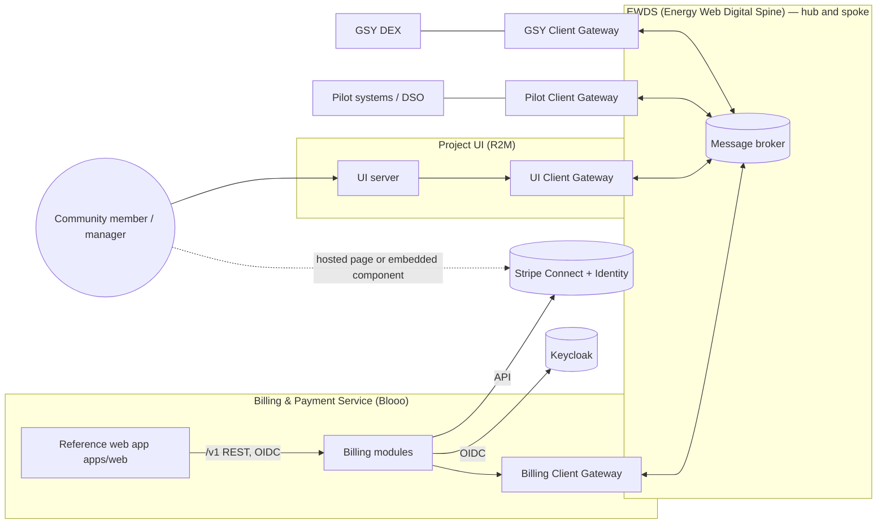
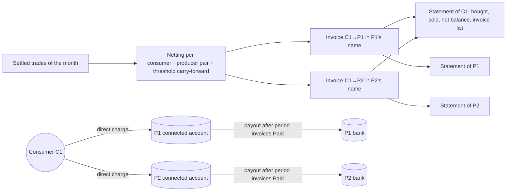
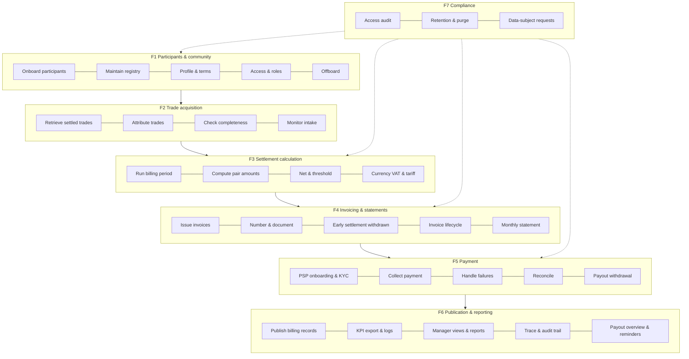
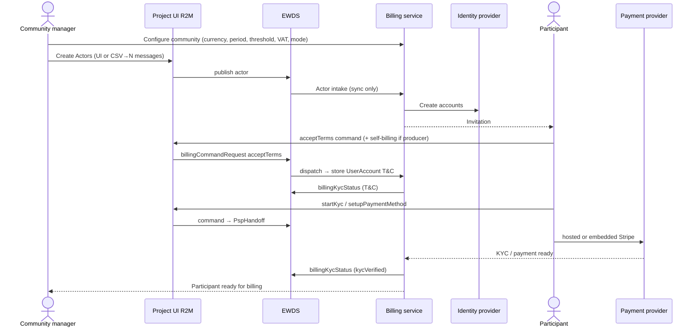
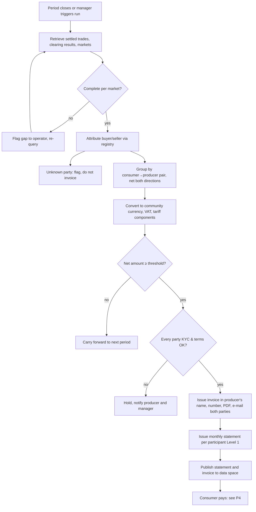
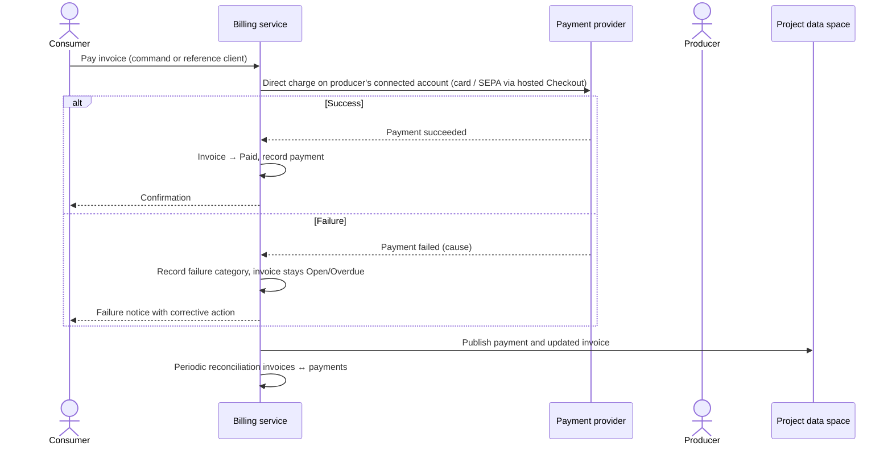
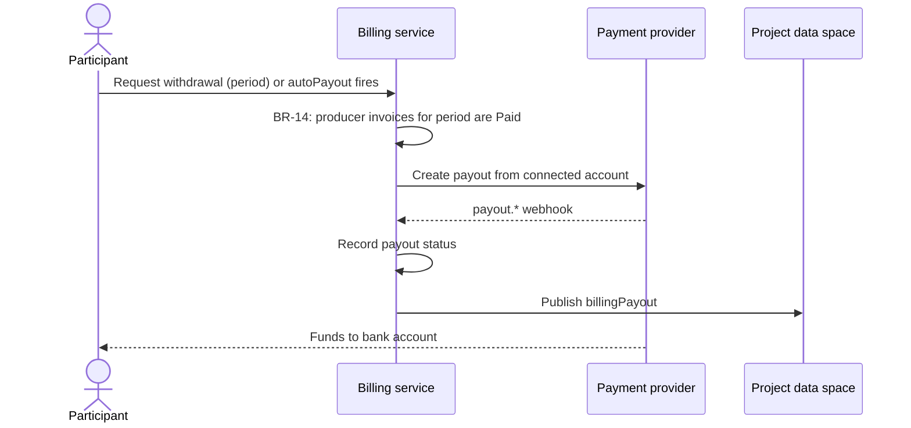
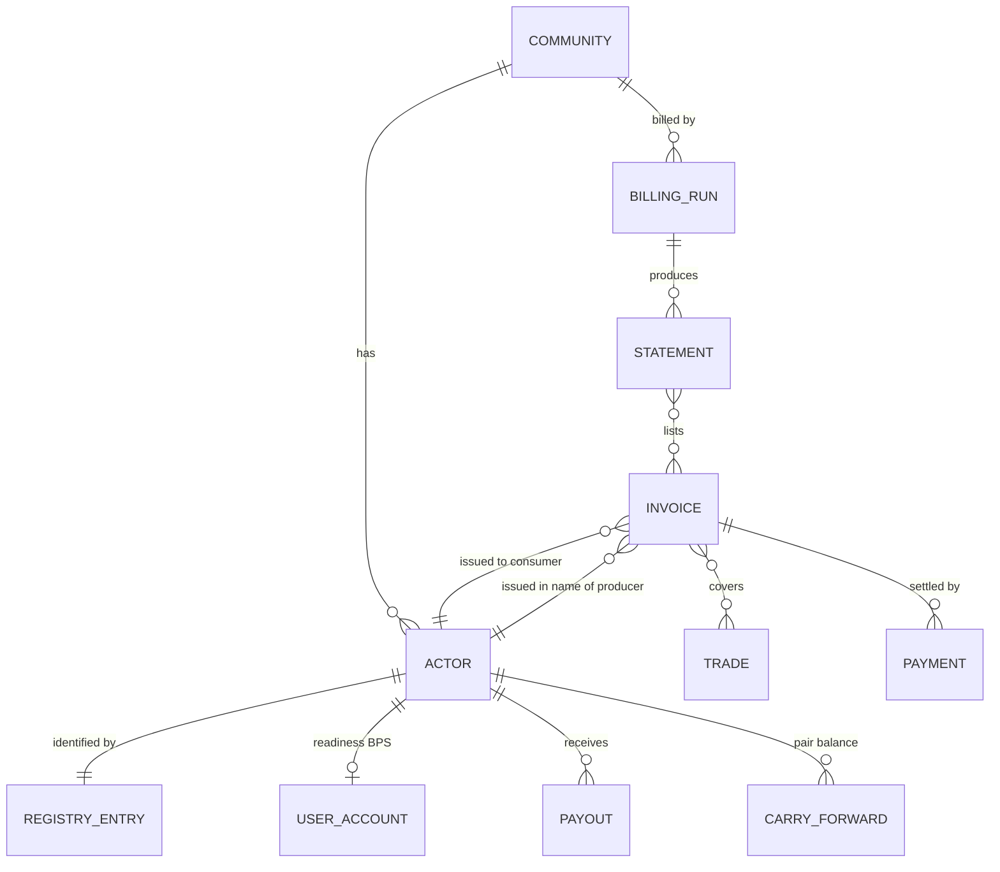

# Billing & Payment Service: functional architecture

> **View 1 of 5** in the iterative architecture approach: functional → logical → application → technical → physical (see [README](README.md)). Ontology datamodel and detailed flows: [06](06-datamodel-ontology.md), [07](07-scenario-flows.md).
> This view describes **what** the service does, for **whom**, and with **which business objects and processes**. It deliberately says nothing about components, technologies or deployment. Those belong to the next views.
> Baseline: requirements v6.1 and assumptions A1–A33. Status: **aligned 2026-11-26 (INT-447 Actor EWDS-only; INT-448 UserAccount T&C)**.

## 1. Purpose and scope

The Billing & Payment Service (T5.6, deliverable D5.5) turns the energy trades settled on the INTELLIGENT local market into **invoices and payments between community members**. It also publishes the results so other project services can use them.

| In scope for D5.5 V1 | Out of scope for D5.5 |
|---|---|
| Fiat payment through Stripe; virtual (test) or live per community (REQ-043, A10.1) | Grid-fee, levy and tax amounts only when a DSO tariff is published (tariff port; else 0 + mention) (A20 revised) |
| Participant onboarding, payment KYC for **all roles**, terms and self-billing mandate | Imbalance penalties (A18); community bonus and incentives (A30) |
| **Two-level billing:** monthly participant statement (Level 1) + legal pair invoices (Level 2) | KPI computation EC-1/EC-2 and comparison with a baseline bill (A23) |
| Publication of statements, invoices, payments, payouts and KYC status for the project | Crypto payments, AMM interface, i-Euro stablecoin (D5.10) |
| GDPR obligations of the billing data | EV charging (A10.4) |
| Payout / withdrawal from the producer's connected account (REQ-015) | — |

**Functional principles**
1. **Two levels** (REQ-059, REQ-054): a monthly **statement** per participant (informative, not payable) and legal **invoices** per consumer→producer pair issued in the producer's name (self-billing mandate in the T&C).
2. **The market price is final.** Amount = kWh × price, where price = `adjustedPrice` when GSY provides it, else `tradePrice` (A10.3, REQ-003). Billing never recomputes market results and never changes the status of a trade.
3. **Money never transits through the platform.** The consumer pays the producer directly through the payment provider; **payouts come from the producer's connected account** (REQ-014, REQ-015).
4. **Minimum personal data.** The service only holds what invoicing and payment need. **Identity proofing is done by the payment provider for every participant** (REQ-051), and nothing personal is published to the project data space.
5. **Everything is traceable.** Every amount can be traced back to its trades and to the run that computed it, and nothing is overwritten (REQ-005, REQ-028, NFR-003).

## 2. Actors

| Actor | Kind | Role towards billing | Persona |
|---|---|---|---|
| Consumer | Human | Receives one invoice per producer, pays, may request payout when a producer | P2 (and P1 when buying) |
| Producer | Human / organisation | Gets invoices issued in their name, receives payments and **payouts by withdrawal**; Connect account + KYC | P1 |
| Community manager | Human | Onboards participants, configures the community (period, threshold, VAT, mode), **Stripe Identity check**, **payout overview**, **payment reminders** (REQ-060, REQ-061) | P4 |
| Platform operator | Human | Runs billing, monitors data intake, reconciles, handles incidents | P6 |
| Compliance stakeholder (DPO) | Human | Handles data-subject requests, checks retention and audit | P7 |
| Local market | External system (GSY DEX) | Source of settled trades, clearing results and markets | — |
| Project data space | External system (EWDS) | Channel used to obtain trades and publish billing records; **command channel for the project UI** | — |
| Payment service provider | External system (Stripe) | **KYC of every participant**, payments, payouts | — |
| Identity provider | External system (project IdP) | Authenticates users and provides their roles | — |
| Exchange-rate source | External system (ECB reference rates) | EUR→CHF rate for CHF communities (A16) | — |
| Project UI and evaluation | External consumers (R2M UI, WP6 / GSY Analytics) | **Reads records and sends commands through the EWDS only** (REQ-052) | — |

### Context diagram

D1 (spec v6.1): the project UI never calls billing `/v1`; it talks to the EWDS through its own Client Gateway. `/v1` serves only the reference web app. Card, IBAN and identity data go from the user's browser straight to Stripe (A7-bis hosted or embedded).

### Money flow (two-level model)

D2: statements are informative; pair invoices are the legal payable documents. Funds go from the consumer to the producer's connected account, then to the producer's bank. The platform never holds them.

## 3. Functional map

Seven functional domains (F1–F7), each split into functions. The last column traces every function to the requirements.

| Function | Description | Main actor(s) | Requirements |
|---|---|---|---|
| **F1.1 Onboard participants** | The community manager creates Actors in the **project UI (R2M)** (UI form or CSV→N Actor messages). Billing **ingests** the EWDS `actor` topic only and sends invitations | Community manager | REQ-008, US-007, INT-447 |
| **F1.2 Maintain registry** | Links each participant to their market identifier, community and meter. Changes are published as Actor updates from R2M; billing syncs | Community manager | REQ-058, INT-447 |
| **F1.3 Profile & terms** | Administrative profile changes republish `actor`. T&C (+ self-billing mandate) are accepted via command `acceptTerms` and stored on **UserAccount** (published on `billingKycStatus`) | Consumer, producer | REQ-009, REQ-050, US-044, INT-448 |
| **F1.4 Access & roles** | Authentication through the project IdP; roles (member, community manager, operator) restrict access to the participant's own data and community | All humans | REQ-033–037, REQ-049, REQ-010, NFR-011, NFR-013 |
| **F1.5 Offboard** | Removes a participant from future billing and forces a final settlement, while keeping the history | Community manager | REQ-012, REQ-056 |
| **F2.1 Retrieve settled trades** | Obtains from the local market the settled trades of a period, plus clearing results and markets (delivery period, mechanism) | Platform operator | REQ-001 |
| **F2.2 Attribute trades** | Resolves the buyer and seller of each trade through the registry. A trade with an unknown party is flagged and not invoiced | — | REQ-058 |
| **F2.3 Check completeness** | Per market, compares the trades received with the clearing result (quantity, count) | Platform operator | REQ-041 |
| **F2.4 Monitor intake** | Alerts when expected data stops arriving or when the data-space connection degrades | Platform operator | REQ-029, US-028 |
| **F3.1 Run billing period** | A billing run for a community over a configurable period (monthly by default). Each run is a versioned record that is never overwritten | Community manager, operator | REQ-006, REQ-005, NFR-003 |
| **F3.2 Compute pair amounts** | For each consumer→producer pair: Σ(kWh × price) over the settled, not yet invoiced trades | — | REQ-002, REQ-003 |
| **F3.3 Net & threshold** | Nets purchases and sales between the same two participants. A pair below the threshold (5 €/CHF by default) is carried forward, with a final invoice forced at year end or exit | — | REQ-055, REQ-056 |
| **F3.4 Currency, VAT & tariff** | Converts EUR prices into the community currency at the ECB reference rate, applies the community VAT rate (0 by default), and adds grid fee, levy and tax from the tariff port (0 and a mention when no DSO tariff is published) | — | REQ-002, REQ-004, REQ-007 |
| **F4.1 Issue invoices** | One invoice per pair and per period, issued in the producer's name. Issuing is blocked while the producer's KYC is incomplete | — | REQ-054, REQ-045 |
| **F4.2 Number & document** | Gives the invoice a legal sequential number per producer (owned by billing), produces the PDF in-house (pdf-lib) and e-mails it to both parties via notification | — | REQ-042, REQ-039, REQ-007 |
| **F4.3 Early settlement — withdrawn** | Removed in v6.1 (REQ-057 deprecated). Pair netting uses only periodic and forced-final runs. | — | REQ-057 (deprecated) |
| **F4.4 Invoice lifecycle** | Statuses Draft → Open → PartiallyPaid / Paid / Overdue / Void / Disputed, with a manual change by the community manager (reason + audit) | Community manager | REQ-044, US-041 |
| **F4.5 Monthly statement** | After each billing run, one informative statement per participant: totals bought/sold, net balance, list of invoice ids, status — **not payable** (Level 1) | — | REQ-059 |
| **F5.1 PSP onboarding & KYC** | **Every participant** gets a verified payment-provider account (Connect + Identity where required) and consumers register a payment method | All participants | REQ-051, REQ-040, REQ-045 |
| **F5.2 Collect payment** | The consumer pays the invoice (card or SEPA debit) via a **direct charge** on the producer's connected account (Stripe-hosted Checkout when needed) | Consumer | REQ-014 |
| **F5.3 Handle failures** | Detects failed payments from provider events, records the cause and notifies the participant | Platform operator | REQ-016, REQ-017, REQ-046 |
| **F5.4 Reconcile** | Matches invoices with payments and flags discrepancies | Platform operator | REQ-041 |
| **F5.5 Payout / withdrawal** | Participant (or `autoPayout` schedule) withdraws funds from their connected account once period invoices where they are producer are Paid (REQ-015, BR-14) | Producer, consumer (prosumer) | REQ-015 |
| **F6.1 Publish billing records** | Publishes statement, invoice, payment, payout and **UserAccount readiness** (`billingKycStatus`: KYC + T&C) to the data space (no personal data). Five record types (REQ-048) | — | REQ-048, INT-448 |
| **F6.2 KPI export & logs** | Exports amounts, kWh and components per participant and period, and logs failures and payment times | Platform operator | REQ-047, REQ-046 |
| **F6.3 Manager views & reports** | Payment status overview, member history for disputes, periodic summary | Community manager | REQ-018, REQ-031, REQ-032 |
| **F6.4 Trace & audit trail** | Links every payment back to its invoice, run and trades | Platform operator | REQ-028 |
| **F6.5 Manager payout overview and reminders** | Community-manager payout overview (REQ-060) and payment reminders / missing-payment alerts (REQ-061) | Community manager | REQ-060, REQ-061 |
| **F7.1 Access audit** | Logs every access to or change of personal and payment data | DPO | REQ-030 |
| **F7.2 Retention & purge** | Retention periods for personal data; data-space messages purged within 7 days | DPO | REQ-011, REQ-053 |
| **F7.3 Data-subject requests** | Access and erasure requests received through the portal or the community manager, propagated to the payment provider and the IdP. Invoices are kept for the legal retention period | DPO | REQ-013 |

Billing results reach the **project UI only through the EWDS** (REQ-052); the REST API serves the reference client.

## 4. Main business processes

### P1 Onboarding of a community and its participants

Project path is EWDS-only (detailed sequences in [07-scenario-flows.md](07-scenario-flows.md) S1–S5).

### P2 Periodic billing run

### P3 Early settlement

**Withdrawn in v6.1 (REQ-057 deprecated).** See **P6** for payout (withdrawal).

### P4 Payment, failure and reconciliation

### P5 Data-subject request

A request comes in through the portal or the community manager. The DPO validates it. The service then exports or erases the participant's personal data, asks the payment provider and the IdP to erase their copies, keeps the invoices and accounting records for the legal period, and confirms the outcome.

### P6 Payout (withdrawal)

## 5. Business objects

| Business object | Description | Owner | Ontology mapping | Personal data |
|---|---|---|---|---|
| Community | Billing settings: currency, period, threshold, VAT rate, mode live/virtual, `autoPayout` | Community manager | `int:Community` (+ billing settings) | No |
| Participant (admin) | Member of a community: role, profile, registry links — **mastered by R2M as Actor** | R2M / manager | `int:Actor`, `Address`, `ContactDetails` | **Yes** (on Actor topic / BPS cache) |
| Registry entry | Link participant ↔ market identifier ↔ community ↔ meter | Community manager (via Actor) | `int:Actor` + GSY actor id | Pseudonymous |
| UserAccount (readiness) | KYC + T&C + self-billing mandate + account status — **mastered by BPS** | Billing / PSP | `int:UserAccount` (wire: `billingKycStatus`) | Status only (no PII on wire) |
| Payment account status | KYC and payment-method readiness at the payment provider — **every participant** | Payment provider | `UserAccount.kycVerified` (+ payments cache) | Status only |
| Trade (read only) | Settled trade: buyer, seller, kWh, price, market | Local market | `int:EnergyTrade` | Pseudonymous |
| Billing run | One computation for a community and period, versioned and immutable (`periodic` or `final`) | Billing | (extension) | No |
| **Monthly statement** | Totals bought/sold, net balance, invoiceIds, status; **not payable** | Billing | `int:Billing` | Pseudonymous |
| Invoice | Consumer→producer, one period (or forced final); trades, amounts, legal number, PDF | Billing (in the producer's name) | `int:Invoice` | Yes (PDF) |
| Payment | One payment of one invoice, with status and failure category | Billing / payment provider | `int:Payment` (`StripePayment` kept internal) | No (published), yes (internal provider ids) |
| **Payout** | Withdrawal from a participant's connected account for a period | Billing / payment provider | (extension) | No (published) |
| Carry-forward balance | Net amount of a pair that stayed below the threshold | Billing | (extension) | No |
| Exchange rate | EUR→community-currency rate and date used | Billing | (extension) | No |
| Audit event | Who accessed or changed what, and when | Billing | — | Yes (actor) |

Full ontology class map: [06-datamodel-ontology.md](06-datamodel-ontology.md).

## 6. Business rules

| # | Rule | Source |
|---|---|---|
| BR-01 | Only trades whose status is `settled` are billed. Each trade is billed once (idempotent on the trade id). | REQ-001 |
| BR-02 | The delivery period of a trade comes from its market, not from the trade timestamp. | REQ-001 |
| BR-03 | Amount of a trade = kWh × price, where price = `adjustedPrice` when GSY provides it, else `tradePrice` (A10.3). | REQ-003 |
| BR-04 | Purchases and sales between the same two participants in the same period are netted. The invoice goes in the direction of the net amount. | REQ-055 (under REQ-059) |
| BR-05 | A pair whose net amount is below the community threshold (5 €/CHF by default) is carried forward. A final invoice is forced at year end and when a participant leaves. | REQ-056 |
| BR-06 | Each invoice has one currency, the community currency. EUR prices are converted at the ECB reference rate of the last business day of the period, and the rate is shown on the invoice. | REQ-002 |
| BR-07 | VAT at the community rate (0 default); grid fee, levy and tax from the tariff port; 0 and a mention when no DSO tariff is published. | REQ-004, REQ-007 |
| BR-08 | Amounts are computed in exact decimals and rounded to the cent per invoice line. The total is the sum of the lines. | A17 |
| BR-09 | No statement, invoice, payment or payout for a participant whose `kycVerified` is false; no invoice in a producer's name before T&C incl. self-billing mandate. | REQ-045, REQ-050 |
| BR-10 | Legal invoice numbers are sequential, without gaps, **per producer, owned by billing (not the PSP)**. | REQ-042 |
| BR-11 | Billing never changes a trade's status. "Paid" is read from the published invoices and payments. | REQ-048 |
| BR-12 | Virtual communities use the PSP test environment; live communities need the operator role and live keys (REQ-043, A10.1). | REQ-043 |
| BR-13 | A computed result is never overwritten. A correction creates a new version. | REQ-005 |
| BR-14 | A payout of a period's amount is allowed only when the invoices of that period where the participant is producer are Paid. | REQ-015 |
| BR-15 | The monthly statement is informative and never payable; payments target invoices only. | REQ-059 |

## 7. V1 functional coverage (iteration 1)

Adapters for every external system; **Stripe test or live per community**; EWDS Client Gateway adapters are real with **mock as the default** until grants land (A8).

| Domain | V1 status | Note |
|---|---|---|
| F1 Participants & community | Implemented | Actor intake EWDS-only (R2M); `/v1` import = reference/e2e only |
| F2 Trade acquisition | Implemented | **EWDS Client Gateway adapters real, mock default (A8)** |
| F3 Settlement calculation | Implemented | ECB rates from a fixture; tariff port returns 0 + mention when no DSO tariff |
| F4 Invoicing | Implemented | **In-house PDF (pdf-lib), e-mail by notification** |
| F5 Payment | **Implemented** | **Stripe test or live per community; payouts** |
| F6 Publication & reporting | Implemented | **Publishes 5 record types** (`billingStatement`, `billingInvoice`, `billingPayment`, `billingPayout`, `billingKycStatus`) |
| F7 Compliance | Implemented | **Real IdP/PSP erasure adapters** (with mock path in local dev) |

## 8. Assumptions and open points carried by this view
- Working assumptions A13–A33 (`requirements.md`, mirror of the Blooo register WA-01…WA-20) still need partner validation. The ones with the strongest impact on this view are:
  - **A19:** invalidated v6, replaced by the two-level model (v6.1);
  - **A20:** fees off-platform (revised: tariff port for grid/levy/tax when published);
  - **A21:** **withdrawn (INT-447)** — replaced by A4 EWDS-only Actor from R2M.
- Still to be decided for the logical view:
  - which reference screens are in V1 scope.

## 9. Validation checklist
- [ ] Actors and external systems complete
- [ ] Functional map F1–F7 and requirement traceability correct
- [ ] Processes P1–P6 reflect the target operation (P3 withdrawn)
- [ ] Business objects and ontology mapping acceptable
- [ ] Business rules BR-01…BR-15 correct
- [ ] V1 coverage (adapters env-selected, Stripe per community) correct

Once this view is validated, iteration 2 produces the **logical architecture**: logical blocks, responsibilities, the interfaces between blocks and with external systems, and the data flows.