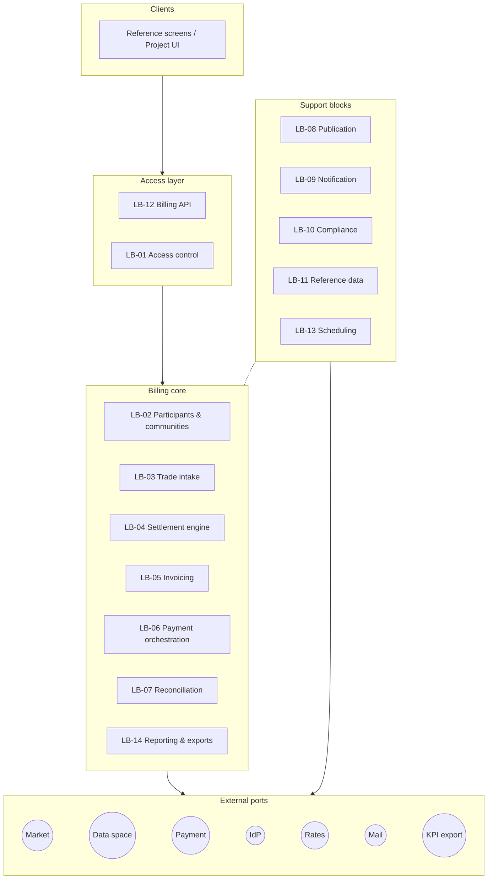
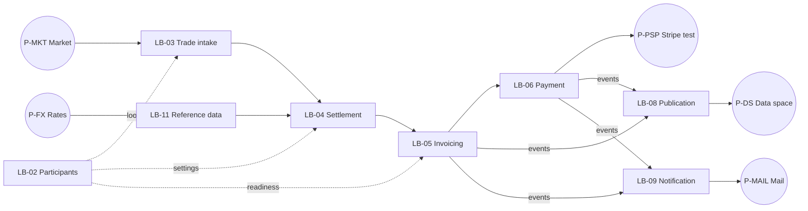
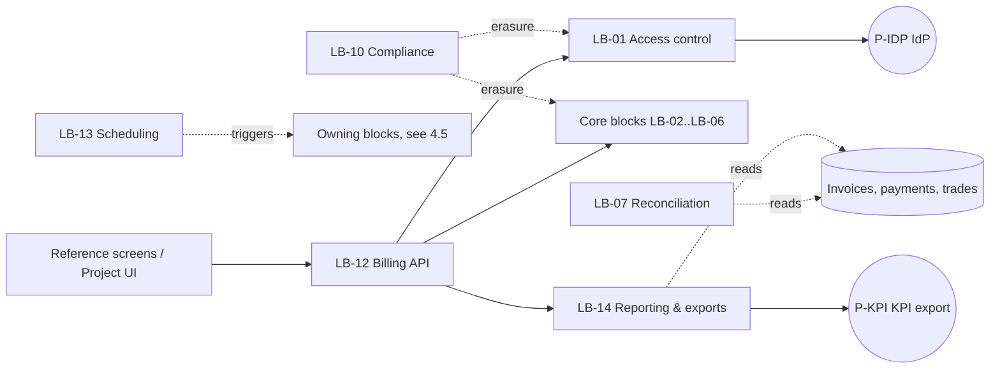
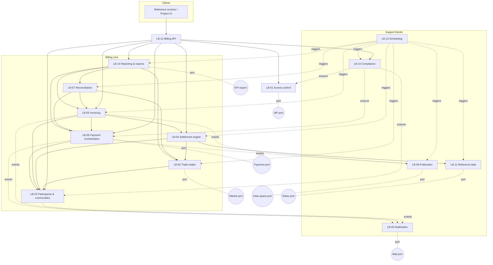
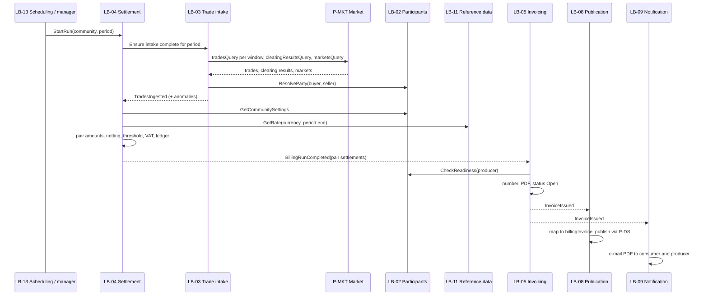
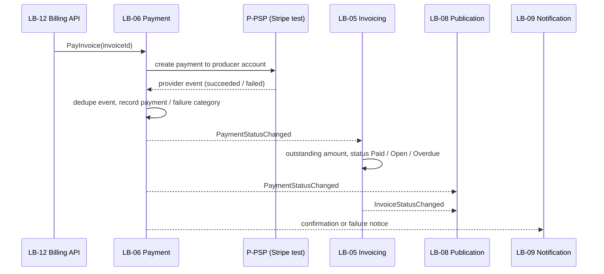
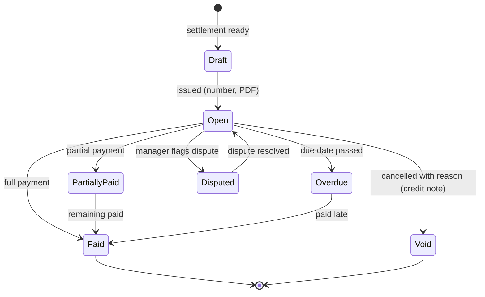
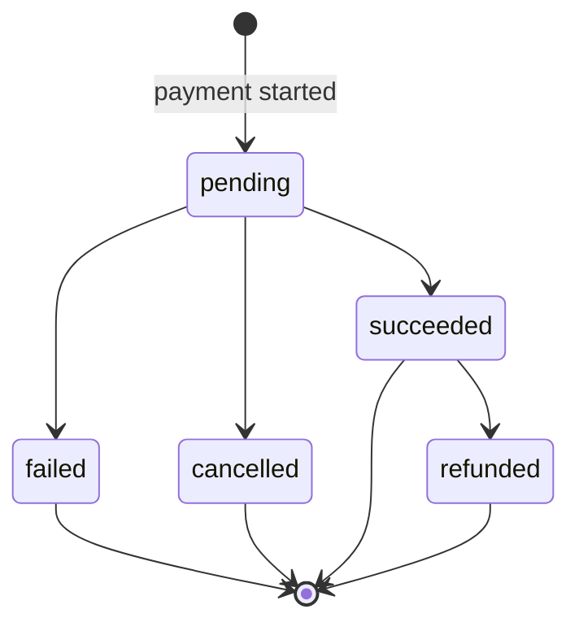
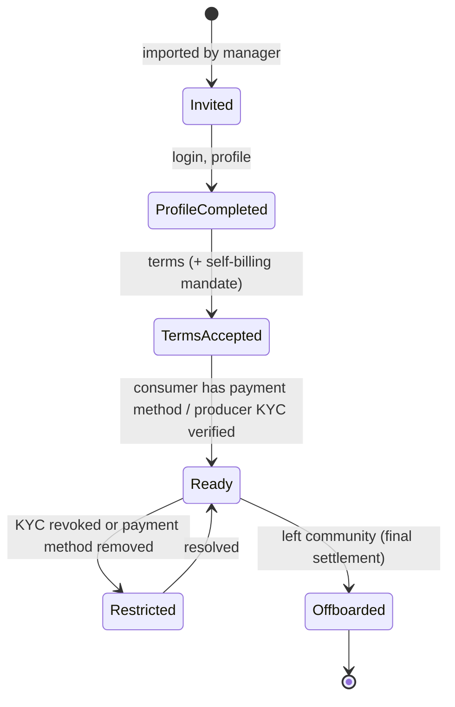

# Billing & Payment Service: logical architecture

> **View 2 of 5** (functional → **logical** → application → technical → physical, see [README](README.md)).
> This view answers: **which logical blocks carry the functions of the [functional view](01-functional-architecture.md), what each block owns, and how blocks exchange information with each other and with external systems.**
> It stays technology-neutral. It does not decide how blocks are packaged (modules vs. services); that is decided in the application view.
> Status: **validated (2026-10-07)**.

## 1. Logical design principles

| # | Principle | Consequence |
|---|---|---|
| LP-1 | **One block, one responsibility, one owner of its data.** | A block never writes another block's data. It asks the owning block through an interface or reacts to its events. |
| LP-2 | **External systems are reached only through ports.** | Each external dependency (market, data space, payment provider, IdP, rates, mail) sits behind a logical port. A port can be implemented for real or by a mock without changing the blocks (A32). |
| LP-3 | **Commands synchronous, facts as events.** | Requests between blocks are commands. Facts that other blocks need are published as domain events (e.g. *InvoiceIssued*). |
| LP-4 | **Idempotency on every entry point.** | Trades are keyed by trade id, provider events by event id, and runs by (community, period, version). |
| LP-5 | **Immutable financial records.** | Billing runs, computed amounts and issued invoices are append-only. A correction creates a new version or a credit note (REQ-005, NFR-003). |
| LP-6 | **Personal data confined.** | Personal data lives only in the Participant block (profiles), the Invoicing block (PDF documents) and the Compliance block (audit). Every other block and every outbound message uses pseudonymous identifiers. |
| LP-7 | **Single entry point for clients.** | Users and client applications (reference screens, project UI) reach the service only through the Billing API block (REQ-052). |

## 2. Logical blocks

The blocks are shown in three small diagrams, one per concern. One big diagram is unreadable in renderers that use the dagre layout, such as Obsidian.

**2.1 Overview by layer**

**2.2 Main business flow** (from trades to payment and publication)

**2.3 Access, control, reporting, scheduling and compliance**

**2.4 Complete block map** (all dependencies in one diagram. It renders cleanly only with the ELK layout: in Obsidian, the *Mermaid ELK Renderer* plugin)

| Block | Responsibility | Owns (data) | Functions | Requirements |
|---|---|---|---|---|
| **LB-01 Access control** | Authenticates every request with the project IdP, resolves the user's role and community from token claims, and enforces "own data / own community" rules | Session context only (no persistence); OIDC client configuration per community | F1.4 | REQ-033–037, REQ-049, REQ-010, NFR-011, NFR-013 |
| **LB-02 Participants & communities** | Community settings, participant registry (market id, meter), billing profiles, roles, terms and self-billing mandate acceptance, participant readiness, offboarding | Community, Participant, RegistryEntry, BillingProfile, TermsAcceptance, ParticipantReadiness | F1.1, F1.2, F1.3, F1.5 | REQ-008, 009, 012, 050, 058 |
| **LB-03 Trade intake** | Queries the market for settled trades, clearing results and markets per window; deduplicates; attributes buyer/seller through LB-02; checks completeness per market; monitors intake | Trade (copy, read-only semantics), MarketInfo, ClearingResult, IntakeWindow, IntakeAnomaly | F2.1–F2.4 | REQ-001, 029, 041 (completeness), 058 |
| **LB-04 Settlement engine** | Runs billing periods (scheduled or on demand) and early settlements. Computes pair amounts, netting, threshold and carry-forward, currency conversion and VAT. Keeps the immutable billing ledger | BillingRun, PairSettlement, CarryForwardBalance, LedgerEntry, BillingAccount | F3.1–F3.4 | REQ-002, 003, 005, 006, 007, 043, 055, 056, 057 |
| **LB-05 Invoicing** | Turns pair settlements into invoices in the producer's name. Assigns the legal number per producer, generates the PDF document and manages the invoice lifecycle (including manual status change with reason) | Invoice, InvoiceLine, InvoiceNumberSeries, InvoiceDocument, InvoiceStatusHistory | F4.1, F4.2, F4.4 (F4.3 with LB-04) | REQ-039, 042, 044, 045 (check), 054 |
| **LB-06 Payment orchestration** | Onboards participants with the payment provider (producer accounts + KYC, consumer payment methods). Initiates payments to the producer's account, processes provider events and classifies failures | PaymentAccount (provider refs, KYC status), PaymentIntent, Payment, ProviderEvent, FailureRecord | F5.1–F5.3 | REQ-014, 015, 016, 017, 040, 045, 046, 051 |
| **LB-07 Reconciliation** | **Control**: checks that every invoice has its payment(s) and that every market has all its trades (vs ClearingResult). Flags discrepancies and incomplete settlements as alerts to the operator. Read-only on other blocks' data | ReconciliationResult, Discrepancy | F5.4, F2.3 (control part) | REQ-041 |
| **LB-14 Reporting & exports** | **Consultation**: community-manager views (payment status, member history for disputes), periodic summary, KPI export and KPI logs, end-to-end trace payment → invoice → run → trades. Read-only on other blocks' data | ReportSnapshot, KpiExport (derived, rebuildable) | F6.2–F6.4 | REQ-018, 028, 031, 032, 046, 047 |
| **LB-13 Scheduling** | Triggers **time-based** jobs at the right moment, per community calendar, by sending a command to the owning block. It has no business logic and gives one supervision point for every deadline (see §4.5) | JobDefinition, JobExecution | — (cross-cutting) | REQ-006, 011, 029, 053, 056 |
| **LB-08 Publication** | Maps InvoiceIssued/InvoiceStatusChanged/PaymentStatusChanged events to the `billingInvoice` / `billingPayment` messages (no personal data). Publishes them through the data-space port with retry, and purges cached messages | OutboundMessage (outbox), PublicationStatus | F6.1, F7.2 (purge) | REQ-048, 053 |
| **LB-09 Notification** | Sends invitations, invoice e-mails (PDF attached), payment confirmations and failure notices | NotificationLog | P1, F4.2, F5.3 | REQ-017, 039, 008 |
| **LB-10 Compliance** | Access/change audit log. Retention rules and purge. Data-subject request workflow: export or erase personal data and propagate the request to LB-02, LB-05, LB-06 (provider) and LB-01 (IdP), keeping invoices under legal retention | AuditEvent, RetentionPolicy, DataSubjectRequest | F7.1–F7.3 | REQ-011, 013, 030 |
| **LB-11 Reference data** | Exchange rates (EUR→community currency, by date) and VAT rates per community | ExchangeRate | F3.4 | REQ-002, 007 |
| **LB-12 Billing API** | Single documented entry point for screens and client applications: profiles, balances, invoices, early settlement, payment, onboarding, terms, admin, reports | None (facade) | all user-facing functions | REQ-052 |

## 3. External ports

Each port is a logical interface. Its V1 implementation follows decision A32: **Stripe test is the only real integration**.

| Port | Direction | Purpose | Real implementation (target) | **V1 implementation** |
|---|---|---|---|---|
| **P-MKT Market** | out → in | Get settled trades per time window (≤ 24 h), clearing results per market, markets (delivery period, community, mechanism) | GSY DEX via EWDS request/reply (`tradesQuery`, `clearingResultsQuery`, `marketsQuery`); GSY off-chain storage REST for backfill | **Mock**: fixture datasets (pairs, netting, threshold, unknown party, incomplete market, late trade, duplicate) |
| **P-DS Data space** | out | Publish `billingInvoice` / `billingPayment` messages; purge cached messages | EWDS Client Gateway (Blooo instance) | **Mock**: in-memory/broker stub that validates each message against the draft schemas and records it |
| **P-PSP Payment provider** | out + in (events) | Producer account onboarding and KYC, consumer payment method, payment to producer's account, refunds; incoming provider events | Stripe (Connect, Identity, PaymentIntents, webhooks) | **Stripe test mode** (real integration) |
| **P-IDP Identity provider** | out + in | Token validation and claims; account creation, invitation and erasure | Project IdP (Keycloak operated by Blooo, replaceable by a pilot OIDC IdP) | Local development instance |
| **P-FX Rates** | out | EUR→CHF reference rate for a date | ECB reference rates | **Mock**: fixture table |
| **P-MAIL Mail** | out | Send e-mails with attachments | Transactional mail service | Local mail catcher |
| **P-KPI KPI export** | out | Deliver periodic billing exports for WP6 / GSY Analytics | Format/channel to agree (file or EWDS) | File export |
| **Client API** | in | Used by the reference screens and the project UI | — | Real (Blooo reference screens) |

## 4. Internal interactions

### 4.1 Domain events

| Event | Emitted by | Consumed by | Meaning |
|---|---|---|---|
| ParticipantOnboarded | LB-02 | LB-09 (invitation), LB-06 (create provider customer/account link) | Participant imported, account created |
| ParticipantReadinessChanged | LB-02 (from LB-06 KYC status) | LB-05, LB-12 | Producer is or is no longer allowed to have invoices issued in their name |
| ParticipantOffboarded | LB-02 | LB-04 (force final settlement) | Participant left the community |
| TradesIngested | LB-03 | LB-04 | New attributed trades available for a window |
| IntakeAnomalyDetected | LB-03 | LB-07, LB-14, operator alert | Incomplete market, unknown party, intake stopped |
| BillingRunCompleted | LB-04 | LB-05 | Pair settlements of a run (or of an early settlement) ready to invoice |
| InvoiceIssued / InvoiceStatusChanged | LB-05 | LB-08, LB-09, LB-07, LB-14 | New invoice; any status change (incl. manual) |
| PaymentStatusChanged | LB-06 | LB-05 (outstanding amount, status), LB-08, LB-09, LB-07, LB-14 | pending / succeeded / failed / cancelled / refunded |
| ErasureRequested | LB-10 | LB-02, LB-05, LB-06, LB-01 | Data-subject erasure to execute |

### 4.2 Key commands (synchronous)

| Command | From → To | Purpose |
|---|---|---|
| ResolveParty(marketId) | LB-03 → LB-02 | Market identifier → participant, community |
| GetCommunitySettings(communityId) | LB-04 → LB-02 | Currency, period, threshold, VAT, mode |
| GetRate(currency, date) | LB-04 → LB-11 | Exchange rate |
| GetUnbilledTrades(pair, until) | LB-04 → LB-03 | Trades for a settlement or an early settlement |
| CheckReadiness(producerId) | LB-05 → LB-02 | Terms + KYC OK before issuing |
| RequestEarlySettlement(consumer, producer) | LB-12 → LB-04 | Early settlement on demand |
| PayInvoice(invoiceId) | LB-12 → LB-06 | Start payment of an invoice |
| ChangeInvoiceStatus(invoiceId, status, reason) | LB-12 → LB-05 | Manual status change by the community manager |

### 4.3 Periodic billing run (P2) at block level

### 4.4 Payment (P4) at block level

### 4.5 Time-based jobs (LB-13 Scheduling)

LB-13 only decides **when** a job runs. Each job then sends a command to the block that owns the work; the business logic stays in that block.

| Job | Default schedule | Target block | Command | Requirement |
|---|---|---|---|---|
| Re-query recent trade windows | Hourly, plus before each run | LB-03 | RefreshIntake(window) | REQ-001 |
| Intake watchdog | Every 15 min | LB-03 | CheckIntakeHealth | REQ-029 |
| Close billing period | Per community calendar (monthly by default) | LB-04 | StartRun(community, period) | REQ-006 |
| Forced final invoices | 31 Dec, and on offboarding (event-driven) | LB-04 | StartRun(type = final) | REQ-056 |
| Overdue detection | Daily | LB-05 | MarkOverdue(asOf) | REQ-044 |
| Reconciliation | Daily, plus after each run | LB-07 | Reconcile(scope) | REQ-041 |
| Periodic summary and KPI export | After each period close | LB-14 | BuildReport / ExportKpi | REQ-032, REQ-047 |
| Publication retry | Every 5 min | LB-08 | RetryPending | REQ-048 |
| Gateway cache purge | Daily (≤ 7 days) | LB-08 | PurgeCache | REQ-053 |
| Personal-data retention | Daily | LB-10 | ApplyRetention | REQ-011 |
| Exchange-rate refresh | Business days | LB-11 | FetchRates(date) | REQ-002 |

Every job execution is recorded (JobExecution) and visible to the operator. A failed job is retried and raises an alert.

## 5. Lifecycles

### Invoice

### Payment

### Participant readiness (gates invoicing in a producer's name)

### Billing run
`Scheduled → Collecting (intake) → Computing → Completed`, or `→ Failed` (retryable). A rerun for the same community and period creates a new **version**, and earlier versions are kept (LP-5).

## 6. Logical data model

Each entity is owned by one block (LP-1). Pseudonymous identifiers cross block boundaries; personal attributes do not.

| Entity | Owner | Key attributes | Personal data |
|---|---|---|---|
| Community | LB-02 | communityId, currency, billingPeriod, threshold, vatRate, billingMode, oidcIssuer | No |
| Participant | LB-02 | participantId (Actor UUID), communityId, role (consumer/producer/prosumer), status | No |
| RegistryEntry | LB-02 | participantId, marketActorId, meterId, validFrom/To | Pseudonymous |
| BillingProfile | LB-02 | participantId, name, address, e-mail | **Yes** |
| TermsAcceptance | LB-02 | participantId, termsVersion, selfBillingMandate, acceptedAt | Link only |
| PaymentAccount | LB-06 | participantId, providerAccountRef / customerRef, kycStatus, paymentMethodPresent | Provider refs |
| Trade | LB-03 | tradeId, marketId, buyerActorId, sellerActorId, kWh, price, status, deliveryStart/End, attributed participants, invoicedBy (invoiceId) | Pseudonymous |
| ClearingResult / MarketInfo | LB-03 | marketId, tradedQuantity, numTrades, delivery window, mechanism | No |
| BillingRun | LB-04 | runId, communityId, period, version, type (periodic/early/final), status | No |
| PairSettlement | LB-04 | runId, consumerId, producerId, tradeIds, kWh, energyAmount, vat, currency, rate, carriedForwardIn/Out | No |
| CarryForwardBalance | LB-04 | consumerId, producerId, amount, since | No |
| Invoice | LB-05 | invoiceId, legalNumber, producerId (issuer), consumerId, period, amounts, currency, status, dueDate, pairSettlementRef | No (ids) |
| InvoiceDocument | LB-05 | invoiceId, PDF (names, addresses) | **Yes** |
| Payment | LB-06 | paymentId, invoiceId, amount, method, status, failureCategory, providerPaymentRef | Provider refs |
| OutboundMessage | LB-08 | messageId, topic, payload, status, publishedAt, purgeAt | No |
| AuditEvent | LB-10 | actor, action, target, timestamp | Yes (actor) |
| DataSubjectRequest | LB-10 | requestId, participantId, type, status, propagation results | Link only |
| ExchangeRate | LB-11 | currencyPair, date, rate, source | No |
| ReconciliationResult / Discrepancy | LB-07 | scope (invoice or market), expected, actual, status | No |
| JobDefinition / JobExecution | LB-13 | job, target block, schedule (per community), last run, outcome | No |

The mapping to ontology classes is in the functional view §5. Outbound messages follow `ewds-topics/billingInvoice` and `billingPayment`.

## 7. Cross-cutting logical rules

| Concern | Rule |
|---|---|
| Consistency | Each block updates its own data atomically and emits events through an outbox. Consumers are idempotent. Trades and pair settlements are reserved by a run, so a trade can never be invoiced twice. |
| Ordering and late data | A trade that arrives after its period was billed goes to the next run. Recent intake windows are re-queried before each run (A13). |
| Corrections | A new run version for a still-uninvoiced period. For an issued invoice: Void plus a new invoice (or credit note). Never an update in place. |
| Failure handling | Port calls retry with backoff, and permanent failures become anomalies visible to the operator (NFR-006). Provider events are deduplicated by event id. |
| Security zones | Zone A (personal data): LB-02 profiles, LB-05 documents, LB-10 audit. Zone B (financial, pseudonymous): LB-03, LB-04, LB-05 invoices, LB-06, LB-07, LB-14. Zone C (outbound): LB-08, with no personal data by construction. Access is checked by LB-01 on every API call. |
| Auditability | Every write in zones A and B creates an AuditEvent (REQ-030). Every payment can be traced to its invoice, pair settlement, run and trades (REQ-028). |
| Mode live/virtual | Carried by the community and propagated to runs, invoices, payments and messages. In V1 every community is virtual and P-PSP points to Stripe test. |

## 8. Traceability: functional → logical

| Function | Block(s) |
|---|---|
| F1.1–F1.3, F1.5 | LB-02 (+ LB-09 invitations, LB-06 payment onboarding) |
| F1.4 | LB-01 |
| F2.1–F2.4 | LB-03 |
| F3.1–F3.4 | LB-04 (+ LB-11) |
| F4.1, F4.2, F4.4 | LB-05 (+ LB-09) |
| F4.3 | LB-04 + LB-05 |
| F5.1–F5.3 | LB-06 |
| F5.4 (and F2.3 control) | LB-07 |
| F6.1 | LB-08 |
| F6.2–F6.4 | LB-14 |
| Time-based triggers (all domains) | LB-13 |
| F7.1–F7.3 | LB-10 (+ LB-08 purge) |
| REQ-052 (APIs) | LB-12 |

## 9. Points for the application view
- Packaging: one modular application (blocks as modules) or several services. A modular monolith fits the V1 scope and team size; this is to be decided in view 3.
- Reference screens: which screens are in V1, built on LB-12 only.
- API style and versioning for LB-12, and the event transport between blocks.

## 10. Validation checklist
- [ ] The 14 logical blocks and their responsibilities are right (no missing or overlapping block)
- [ ] Data ownership per block is acceptable (LP-1, §6)
- [ ] External ports and V1 implementations are correct (Stripe test only, all else mocked)
- [ ] Events and commands are sufficient for processes P1–P5
- [ ] Lifecycles (invoice, payment, readiness, run) are correct
- [ ] Cross-cutting rules (consistency, corrections, security zones) are acceptable

## 11. Decisions taken during validation (2026-10-07)
- Personal data limited to participant profiles (LB-02), invoice PDFs (LB-05) and the audit log (LB-10): **confirmed**.
- Correction of an issued invoice = Void + new invoice or credit note, never an update in place: **confirmed**.
- LB-07 "Reconciliation & reporting" **split** into LB-07 Reconciliation (control) and LB-14 Reporting & exports (consultation).
- New block **LB-13 Scheduling** for every time-based trigger (§4.5).
