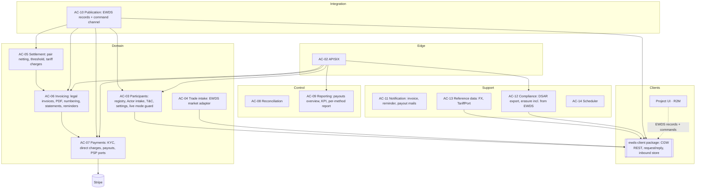
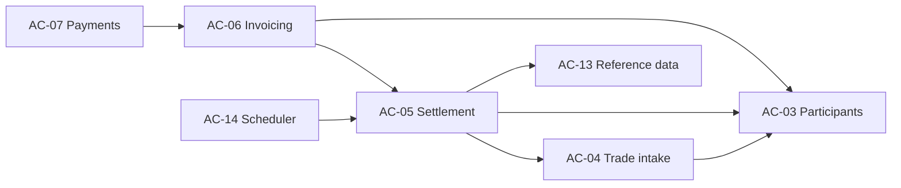
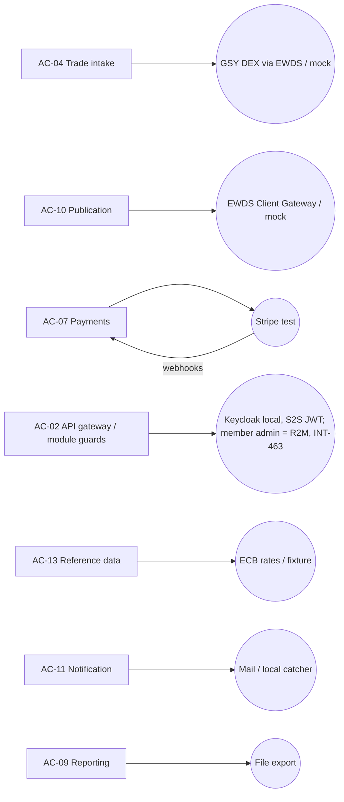
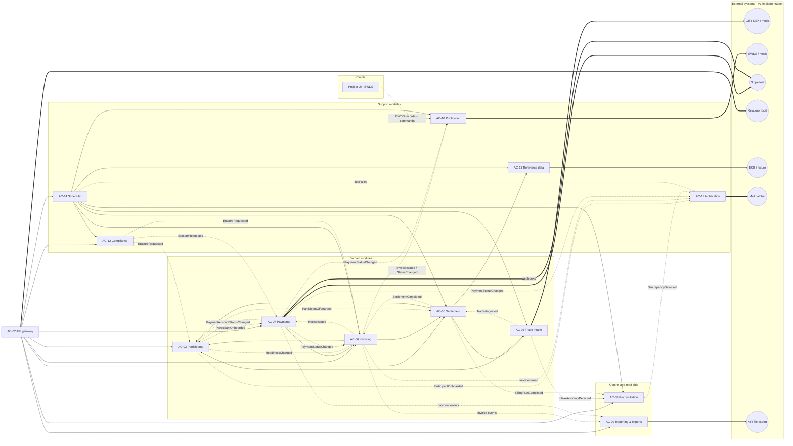
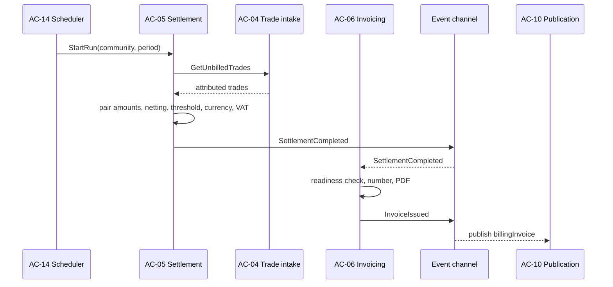
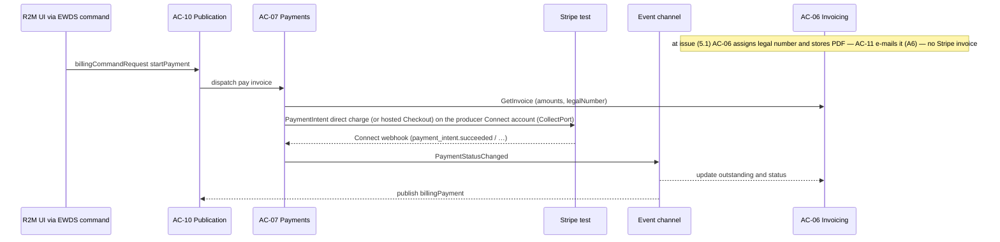
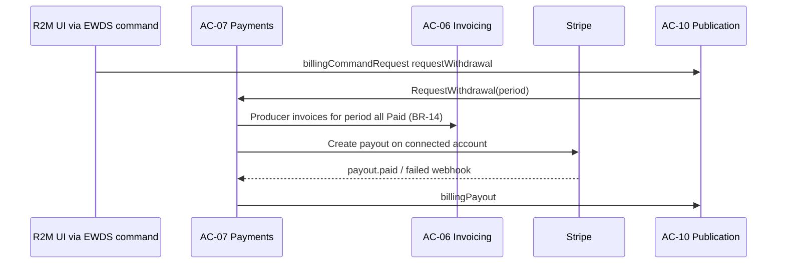

# Billing & Payment Service: application architecture

> **View 3 of 5** (functional → logical → **application** → technical → physical, see [README](README.md)).
> This view answers: **which application components implement the logical blocks, what they expose (APIs, events, screens) and how they connect to external systems through adapters.**
> No technology is chosen here. Languages, frameworks, database, event transport and Kubernetes specifics will be decided together in the technical view.
> Status: **revised (2026-11-25), revalidation pending**. v2.0 aligns with the two-level billing model and EWDS command channel.

## 1. Decisions framing this view

| # | Decision | Source |
|---|---|---|
| AD-1 | **Modular architecture, one deployable module per logical block.** Each module is built, tested and deployed independently. It owns its data and exposes its capabilities only through APIs and events. | 2026-10-07 |
| AD-2 | **Target hosting: a Kubernetes cluster.** Each module runs as its own workload. Cluster design belongs to the technical and physical views. | 2026-10-07 |
| AD-3 | **External API: EWDS records + command channel (AsyncAPI) only.** ~~REST `/v1` for the reference client~~ **Withdrawn (INT-455).** | 2026-10-07; REQ-052; A7; INT-455 |
| AD-4 | **Events between modules: asynchronous, at-least-once, through a transactional outbox per module.** Consumers are idempotent. The transport is chosen in the technical view. | 2026-10-07; logical LP-3/LP-4 |
| AD-5 | ~~**Reference client (`apps/web`) for adopters without the project UI**~~ **Withdrawn (INT-455)** — no Blooo portal / reference SPA on the product path. | 2026-10-07; REQ-052; INT-455 |
| AD-6 | **Adapters selected by environment variables.** EWDS adapters are real with **mock as the code default** (A8); deployed environments switch them live. Stripe runs in test or live mode per community. | A8; A10.1 |
| AD-7 | **API-first, contract-first** (added 2026-10-07): public and internal REST APIs are specified in OpenAPI, domain events and the EWDS command channel in AsyncAPI, and EWDS record schemas as JSON Schema **before** implementation. Contracts are the source for mocks and generated clients (see technical view TP-8 / TD-13). | 2026-10-07; A7 |

## 2. Application components

Each logical block becomes its own deployable module. The only exception is LB-01 access control, which is embedded in the API gateway because it checks every request. The product has **12 NestJS services (AC-03…AC-14)**, the **AC-02 APISIX** gateway (configuration, not a NestJS service), the **AC-15 mock suite** and the **Mock CGW** (`services/mock-cgw`, INT-454). **AC-01 is withdrawn (INT-455).**

| Component | Kind | Logical block | Responsibility | Owns data |
|---|---|---|---|---|
| ~~**AC-01 Web app**~~ | ~~Front-end~~ | — | **Withdrawn (INT-455)** — no reference web app; project UX is the R2M UI over the EWDS | None |
| **AC-02 API gateway** | Edge | LB-12 + LB-01 | Public entry for webhooks, docs, auth host; product `/v1` human OIDC withdrawn (INT-455). Member login is R2M (INT-463); module guards validate S2S JWT | None (config) |
| **AC-03 Participants** | Domain | LB-02 | Communities, registry, profiles, terms and mandate, readiness, offboarding; no IdP account provisioning (R2M owns member accounts, INT-463) | Community, Participant, RegistryEntry, BillingProfile, TermsAcceptance |
| **AC-04 Trade intake** | Domain | LB-03 | Market queries per window, deduplication, attribution, completeness, intake health | Trade, MarketInfo, ClearingResult, IntakeWindow, IntakeAnomaly |
| **AC-05 Settlement** | Domain | LB-04 | Billing runs, **monthly statements**, pair settlement, netting, threshold and carry-forward, currency, VAT and tariff, ledger | BillingRun, PairSettlement, Statement, CarryForward, LedgerEntry |
| **AC-06 Invoicing** | Domain | LB-05 | Billing-owned invoices in the producer's name: legal numbering per producer, PDF stored in the invoicing DB, lifecycle and manual status; e-mail via AC-11 (A6) | Invoice, InvoiceLine, NumberSeries, InvoiceDocument, StatusHistory |
| **AC-07 Payments** | Domain | LB-06 | **Every participant:** Connect/KYC, direct charges, **payouts/withdrawal**, provider webhooks incl. `payout.*`, failures | PaymentAccount, Payment, Payout, ProviderEvent, FailureRecord |
| **AC-08 Reconciliation** | Control | LB-07 | Invoice ↔ payment and market ↔ clearing checks, discrepancies and alerts | ReconciliationResult, Discrepancy |
| **AC-09 Reporting & exports** | Read side | LB-14 | Manager views, history, summaries, KPI export, end-to-end trace (read models built from events) | Read models, KpiExport |
| **AC-10 Publication** | Support | LB-08 | **Five EWDS records** + **command channel consumer**; publication to the data space, retry, cache purge | OutboundMessage, PublicationStatus |
| **AC-11 Notification** | Support | LB-09 | **Invoice e-mail with PDF sent by billing**, payment confirmations, **reminders**, failure notices (member IdP invites are R2M, INT-463) | NotificationLog |
| **AC-12 Compliance** | Support | LB-10 | Audit log, retention, data-subject requests (export, erasure orchestration) | AuditEvent, RetentionPolicy, DataSubjectRequest |
| **AC-13 Reference data** | Support | LB-11 | Exchange rates by date, VAT rates per community | ExchangeRate |
| **AC-14 Scheduler** | Support | LB-13 | Time-based jobs: decides *when* and sends the command to the owning module | JobDefinition, JobExecution |
| **AC-15 Mock suite (V1)** | Test / demo | — | Simulated market (GSY DEX request/reply), simulated data space (validates and records messages), FX fixture, scenario datasets (§8) | Fixtures |

That makes 12 NestJS services, the APISIX gateway, the mock suite and the Mock CGW. Every component maps to exactly one logical block, so traceability stays one to one.

### 2.1 Overview by layer

D6 (spec v6.1) — module map. **INT-455:** no reference web app / public `/v1`; the project UI uses the EWDS command channel only.

### 2.2 Synchronous dependencies between modules

Only the internal commands of §3.2 cross module boundaries synchronously. Everything else travels as events (§4).

### 2.3 External adapters

### 2.4 Complete component map

This diagram shows every dependency in one picture and is readable only with the ELK layout (*Mermaid ELK Renderer* plugin in Obsidian).
- Solid arrows are synchronous calls.
- Dotted arrows are events, labelled with the event name. The outbox-based channel is not drawn.
- Thick arrows go to external systems.

## 3. APIs

### 3.1 Public API (AC-02, `/v1`, OpenAPI) — **withdrawn (INT-455)**

~~Consumed by the reference client AC-01 (`apps/web`).~~ **Removed.** The INTELLIGENT project UI integrates through EWDS records and the command channel only (REQ-052 / A7 / INT-455). APISIX still terminates TLS and routes payment-provider webhooks and the docs portal; there is no public `/v1` product API.

The table below is the **historical** REST map, kept for traceability only (**Withdrawn (INT-455)**; do not implement). Its EWDS equivalents are the commands `startPayment`, `requestWithdrawal`, `setInvoiceStatus`, `startKyc`, `sendReminder`, `triggerBillingRun`, `setupPaymentMethod` and `acceptTerms` (§5.4) plus the five record topics.

| Resource / operation | Role(s) | Served by | Requirements | Screen |
|---|---|---|---|---|
| `GET /me` (profile, roles, community, readiness) | all | AC-03 | REQ-049, REQ-009 | Portal home |
| `PUT /me/profile` | member | AC-03 | REQ-009 | Profile — **reference/`source=import` only**; `source=ewds` → `409 profile_managed_by_ewds` (INT-447) |
| `GET /terms/current`, `POST /me/terms-acceptance` | member, manager | AC-03 | REQ-050 | Terms — project path uses command `acceptTerms` (INT-448) |
| `POST /me/payment-account/onboarding` (returns Stripe-hosted Account Link / Identity URL) | member | AC-07 | REQ-051, REQ-040 | Payment setup |
| `GET /me/balances` (unbilled amounts per counterpart) | member | AC-05 | REQ-002, REQ-056 | Balances |
| `GET /me/statements`, `GET /me/invoices`, `GET /invoices/{id}`, `GET /invoices/{id}/document` | member | AC-05 / AC-06 | REQ-059, REQ-007, REQ-039 | Statements / invoices |
| `GET /me/payouts`, `POST /me/payouts` {period} | member | AC-07 | REQ-015, REQ-060 | Payouts |
| `POST /invoices/{id}/payments` | consumer | AC-07 | REQ-014 | Pay |
| `POST /invoices/{id}/reminders` | manager | AC-06 (emits for AC-11) | REQ-061 | Reminders (INT-461 / INT-462) |
| `GET/PUT /communities/{id}/settings` (currency, period, threshold, VAT, mode) | manager | AC-03 | REQ-006, REQ-043, REQ-056 | Community settings |
| `POST /communities/{id}/participants:import`, `GET /communities/{id}/participants`, `PATCH /participants/{id}`, `POST /participants/{id}:offboard` | manager | AC-03 | REQ-008, REQ-058, REQ-012 | Participants — **`:import` is reference/e2e seed only**; project path = R2M `actor` topic (INT-447) |
| `POST /communities/{id}/billing-runs`, `GET /billing-runs/{id}` | manager, operator | AC-05 | REQ-006 | Billing runs |
| `POST /invoices/{id}/status` {status, reason} | manager | AC-06 | REQ-044 | Invoice detail |
| `GET /communities/{id}/payments-overview`, `/participants/{id}/history`, `/reports/summary` | manager | AC-09 | REQ-018, REQ-031, REQ-032 | Reports |
| `GET /reconciliation/discrepancies` | operator | AC-08 | REQ-041 | Operator views |
| `GET /intake/anomalies` | operator | AC-04 | REQ-029 | Operator views |
| `GET /kpi-exports/{period}` | operator | AC-09 | REQ-047 | — |
| `POST /data-subject-requests`, `GET /data-subject-requests/{id}` | member, DPO | AC-12 | REQ-013 | Privacy |
| `GET /jobs`, `POST /jobs/{id}:run` | operator | AC-14 | logical §4.5 | Operator views |

Inbound integration endpoint, not part of the public API: `POST /webhooks/payment-provider` (AC-07), with the signature verified (NFR-015).

The REQ-057 settle-now operations are removed and `/v1` itself is removed (INT-455); internal APIs use `/internal/v1/...` and follow the contract workstream versioning decision (oasdiff, target — not in CI today).

### 3.2 Internal APIs (module to module, never exposed to clients)

| Command | Provider | Callers |
|---|---|---|
| ResolveParty(marketId) | AC-03 | AC-04 |
| GetCommunitySettings(communityId) | AC-03 | AC-05, AC-06 |
| CheckReadiness(participantId) | AC-03 | AC-06 |
| GetUnbilledTrades(community or pair, until) | AC-04 | AC-05 |
| GetRate(currency, date), GetVatRate(communityId) | AC-13 | AC-05 |
| GetPairSettlement(settlementId) | AC-05 | AC-06 |
| GetInvoice(invoiceId) (amounts, legalNumber; producer Connect account id) | AC-06 | AC-07 |
| GetKycStatus(subjectId) | AC-07 | AC-03, AC-06, guards |
| ApplyRetention / GetRetentionPolicy | AC-12 | AC-14; operators / peers |
| erase-identity / erase-at-psp | AC-03 / AC-07 | AC-12 (DSAR erasure) |
| StartRun / RefreshIntake / MarkOverdue / Reconcile / PurgeCache / FetchRates … | owning module | AC-14 |

## 4. Event catalogue

**Common envelope:** `eventId`, `type`, `version`, `occurredAt`, `producer`, `communityId`, `billingMode`, `data`.

**Delivery and handling:**
- Events are written to the producer's outbox in the same transaction as the business change, then relayed to the event channel.
- Delivery is at least once. Consumers deduplicate on `eventId`.
- Payloads carry identifiers only, never personal data.

| Event (v1) | Producer | Consumers | Key data |
|---|---|---|---|
| ParticipantOnboarded | AC-03 | AC-07, AC-11 | participantId, role |
| ParticipantReadinessChanged | AC-03 | AC-06 | participantId, ready, reason |
| ParticipantOffboarded | AC-03 | AC-05 | participantId, effectiveAt |
| PaymentAccountStatusChanged | AC-07 | AC-03 | participantId, kycStatus, paymentMethodPresent |
| TradesIngested | AC-04 | AC-05, AC-09 | window, tradeIds, communityIds |
| IntakeAnomalyDetected | AC-04 | AC-08, AC-09, AC-11 (operator alert) | type, marketId, details |
| SettlementCompleted | AC-05 | AC-06, AC-09 | runId, pair settlements |
| StatementIssued | AC-05 | AC-10, AC-09 | statementId, participantId, period |
| BillingRunCompleted | AC-05 | AC-08, AC-09 | runId, period, version, counts |
| InvoiceIssued | AC-06 | AC-07, AC-08, AC-09, AC-10, AC-11 | invoiceId, issuer, recipient, settlementId, period bounds, amounts, energy, VAT rate, currency, tradeIds |
| PayoutStatusChanged | AC-07 | AC-10, AC-09, AC-11 | payoutId, participantId, period, status |
| InvoiceStatusChanged | AC-06 | AC-08, AC-09, AC-10 | invoiceId, status, reason, outstanding |
| PaymentStatusChanged | AC-07 | AC-06, AC-08, AC-09, AC-10, AC-11 | paymentId, invoiceId, payerId, payeeId, status, failureCategory |
| KycStatusChanged | AC-07 | AC-03, AC-10 (billingKycStatus), AC-09 | subjectId, subjectType, kycStatus, kycVerified, method, payoutAccountVerified |
| UserAccountStatusChanged | AC-03 | AC-10 (billingKycStatus) | actorId, kycVerified, termsVersion, termsAcceptedAt, selfBillingMandate (INT-448) |
| DiscrepancyDetected | AC-08 | AC-09, AC-11 (operator alert) | scope, expected, actual |
| ErasureRequested | AC-12 | AC-03, AC-06, AC-07 | requestId, participantId |
| ErasureCompleted | AC-03, AC-06, AC-07 | AC-12 | requestId, module, result |
| AuditableActionPerformed | all modules handling personal or payment data | AC-12 | actor, action, target, timestamp |
| JobFailed | AC-14 | AC-11 (operator alert) | jobId, error |

AC-10 produces the five EWDS record types (`ewds-topics/`) from domain events (statement, invoice, payment, payout, KYC).

## 5. Main interactions

### 5.1 Periodic billing run

### 5.2 Payment

Payment rules (INT-355, REQ-014, TD-6 / A6, A10.5):
- The payment is a **direct charge** on the producer's Stripe Connect account via **Stripe-hosted Checkout URL** (or off-session card when a saved method exists). There is no Stripe invoice. The platform never holds the funds.
- **Card and SEPA Direct Debit** are supported (A10.5).
- Onboarding uses **Stripe-hosted Account Link** (and Identity URL for managers); AC-07 returns only PSP-hosted handoff URLs on the command channel (A7-bis).
- A repeated Pay on a settled invoice returns the existing payment.
- **Fees and disputes are on the producer; the platform absorbs nothing (INT-362).**
- Webhooks include `payment_intent.*` and **`payout.*`**; deduplicate on the Stripe event id.

### 5.3 Payout

### 5.4 EWDS command request/reply

The project UI sends `billingCommandRequest` messages (`startPayment`, `requestWithdrawal`, `startKyc`, `acceptTerms`, `sendReminder`, `triggerBillingRun`, `setupPaymentMethod`, …). Actor create/update is **not** a command — R2M publishes the `actor` topic (INT-447). AC-10 authorizes the three layers (channel role, sender DID, actor role), dispatches to the owning module, and publishes `billingCommandReply` with a **PspHandoff** when needed — Stripe-hosted URL or embedded `clientSecret` + `publishableKey` (A7-bis). See D4 in [`ewds-client-gateway.md`](ewds-client-gateway.md). End-to-end sequences: [`07-scenario-flows.md`](07-scenario-flows.md); ontology map: [`06-datamodel-ontology.md`](06-datamodel-ontology.md).

## 6. Reference screens (AC-01) — **withdrawn (INT-455)**

The former reference SPA (`apps/web`) and its `/v1` screen map are **removed**. Project UX is owned by the R2M UI over EWDS (see [`07-scenario-flows.md`](07-scenario-flows.md)).

## 7. Adapters and V1 implementations

Every adapter implements one logical port behind a stable interface. Switching from a mock to the real system is a configuration change (AD-6).

| Adapter (module) | Port | Interface (operations) | V1 / selection | Notes |
|---|---|---|---|---|
| Market adapter (AC-04) | P-MKT | queryTrades(window), queryClearingResults(marketId), queryMarkets(window) | `MARKET_ADAPTER=mock\|ewds` (mock default) | EWDS request/reply on GSY channels; GSY off-chain REST is a **test fixture only** (A8) |
| Data-space adapter (AC-10) | P-DS | publish(topic, message), purgeCache(before) | `DATASPACE_ADAPTER=mock\|ewds` (mock default) | EWDS CG adapter (env-selected), mock default |
| Command channel (AC-10) | P-CMD | poll commands, authorize, dispatch, reply | `COMMAND_CHANNEL_ENABLED=true\|false` (default false) | Three-layer auth: CGW channel role → sender DID allowlist + signature → actor role |
| Actor intake (AC-03) | P-ACTOR-SRC | receive Actor records | `ACTOR_SOURCE=mock\|ewds` (mock default; `ewds` in deployed envs) | EWDS subscriber (`ActorSourcePort`) |
| Erasure intake (AC-12) | P-ERASURE-REQ | receive erasure requests; reportOutcome | `ERASURE_REQUEST_SOURCE=mock\|ewds\|none` (default none; mock in tests; `ewds` in WS4) | EWDS subscriber (`ErasureRequestPort`) |
| Tariff adapter (AC-13) | P-TARIFF | getTariff(communityId, at) | `TARIFF_ADAPTER=mock\|ewds` (mock default) | EWDS when DSO publishes; else 0 |
| Payment adapter (AC-07) | P-PSP | KycOnboardingPort, CollectPort (direct charge / hosted Checkout on the producer account), PayoutPort, PspEventsPort | **Stripe** test or live per community | — |
| Service-JWT validation (module guard) | P-IDP | validateServiceToken (`module-service` client credentials); no createUser / sendInvitation / deleteUser in BPS (R2M owns member admin, INT-463) | Keycloak, local instance | Project IdP (Blooo-hosted) or pilot OIDC IdP |
| FX adapter (AC-13) | P-FX | getRate(currency, date) | **Fixture** (AC-15) | ECB reference rates |
| Mail adapter (AC-11) | P-MAIL | send(template, to, attachments) — invoice PDF and payment reminders are sent by billing via AC-11 (A6; Stripe no longer e-mails invoices) | Local mail catcher | Transactional mail service |
| KPI export adapter (AC-09) | P-KPI | export(period, dataset) | File export | Format/channel agreed with WP6 / GSY |

## 8. Mock suite: V1 scenarios (AC-15)

The mock scenarios S1–S13 below are **integration fixtures** of the AC-15 mock suite. The EWDS-only journeys S1–S14 (different numbering) are the Mermaid flows in [07-scenario-flows.md](07-scenario-flows.md).

| # | Scenario | Validates |
|---|---|---|
| S1 | Consumer buys from 2 producers → 2 invoices | REQ-054 |
| S2 | Prosumers trade both ways → one netted invoice | REQ-055 |
| S3 | Pair below 5 € → carry-forward, invoiced next period | REQ-056 |
| S4 | Trade with an unknown party → flagged, not invoiced | REQ-058 |
| S5 | Market missing one trade vs clearing result → discrepancy | REQ-041 |
| S6 | Late trade arriving after the run → next run | REQ-001 |
| S7 | Duplicate trade delivery → billed once | REQ-001 |
| S8 | CHF community → ECB fixture rate on invoice | REQ-002 |
| S9 | *(retired, REQ-057 deprecated)* | — |
| S10 | Payment failures (Stripe test cards: declined, insufficient funds, authentication) | REQ-016, REQ-046 |
| S11 | Producer without KYC → invoices held | REQ-045 |
| S12 | Erasure request → propagation to Stripe test; IdP erasure delegated to R2M (INT-463) | REQ-013 |
| S13 | Every published message validates against `billingInvoice` / `billingPayment` | REQ-048 |

## 9. Traceability: logical → application

| Logical block | Component |
|---|---|
| LB-01 Access control, LB-12 Billing API | AC-02 API gateway |
| LB-02 Participants & communities | AC-03 Participants |
| LB-03 Trade intake | AC-04 Trade intake |
| LB-04 Settlement engine | AC-05 Settlement |
| LB-05 Invoicing | AC-06 Invoicing |
| LB-06 Payment orchestration | AC-07 Payments |
| LB-07 Reconciliation | AC-08 Reconciliation |
| LB-14 Reporting & exports | AC-09 Reporting & exports |
| LB-08 Publication | AC-10 Publication |
| LB-09 Notification | AC-11 Notification |
| LB-10 Compliance | AC-12 Compliance |
| LB-11 Reference data | AC-13 Reference data |
| LB-13 Scheduling | AC-14 Scheduler |
| Ports (mock side) | AC-15 Mock suite |
| ~~Reference screens~~ | ~~AC-01 Web app~~ — **Withdrawn (INT-455)** |

## 10. Open points and inputs for the technical view
- **Consequences of one module per block, to address in the technical view:**
  - 12 back-end NestJS workloads (plus the APISIX gateway);
  - one data store or schema per module;
  - a shared module template (health, configuration, outbox, observability) to avoid repeating work;
  - per-module CI/CD pipelines;
  - local development with every module running together.
- **To decide together in the technical view:**
  - languages and frameworks (back-end, front-end);
  - database(s);
  - event transport behind the outbox;
  - API gateway product;
  - PDF generation;
  - secrets management;
  - observability;
  - CI/CD;
  - Kubernetes packaging.
- **To decide in the physical view:**
  - environments (dev, test, demo);
  - cluster and hosting in the EU;
  - network exposure (Stripe webhooks, IdP);
  - backups.

## 11. Validation checklist
- [ ] One deployable module per logical block (AC-03 … AC-14, 12 NestJS services) behind the AC-02 gateway, plus mock suite (AC-01 withdrawn, INT-455)
- [ ] Public and internal APIs
- [ ] Event catalogue (names, producers, consumers)
- [x] ~~Reference screens for V1~~ — withdrawn (INT-455)
- [ ] Adapters and V1 implementations (Stripe test or live per community; EWDS adapters real, mock default)
- [ ] Mock integration fixtures S1–S13 and EWDS journeys S1–S14 ([07](07-scenario-flows.md))

## 12. Changes in v0.2 (2026-10-07)
- To favour more separately deployed modules, v0.1's grouped modules (Billing = LB-04/05/11, Control & reporting = LB-07/14, Platform = LB-08/09/10/13) are split. There is now **one module per logical block**: AC-05 Settlement, AC-06 Invoicing, AC-08 Reconciliation, AC-09 Reporting, AC-10 Publication, AC-11 Notification, AC-12 Compliance, AC-13 Reference data, AC-14 Scheduler. The mock suite becomes AC-15.
- New events SettlementCompleted, DiscrepancyDetected, AuditableActionPerformed and JobFailed, needed now that these blocks are separate deployables.

## 13. Changes in v2.0 (2026-11-25)
- Two-level billing: monthly statements (AC-05) plus pair invoices (AC-06); early settlement removed (REQ-057 deprecated).
- Project UI path: five EWDS records + command channel (AC-10); public `/v1` / reference client withdrawn (INT-455).
- Payouts, KYC for every participant, hosted Checkout / Account Link onboarding, in-house PDF invoices (TP-7).
