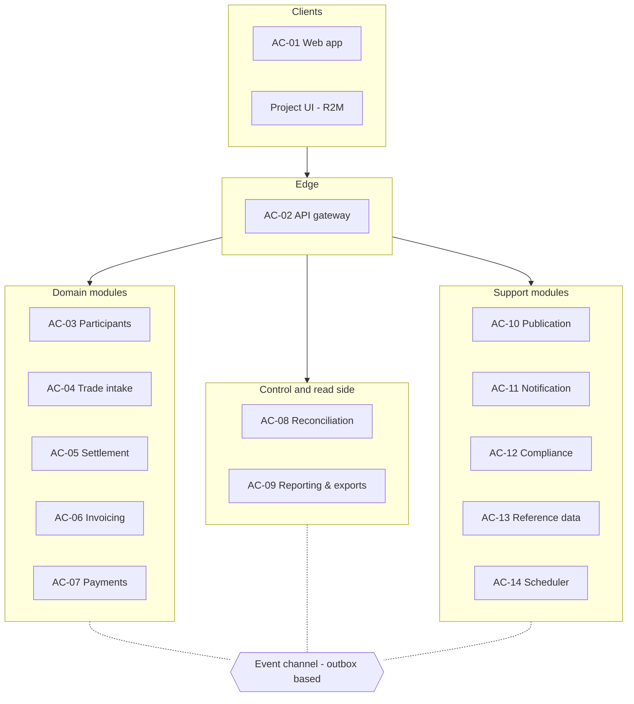
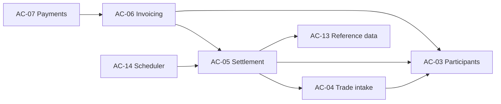
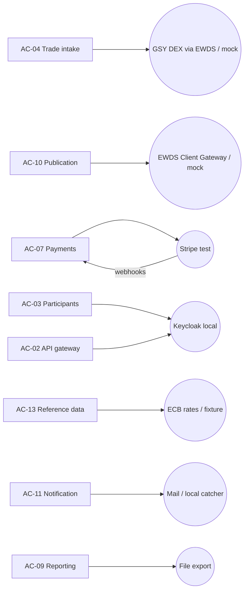
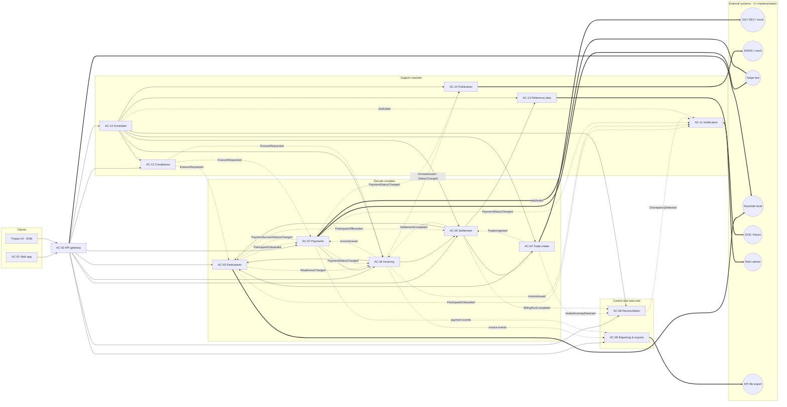
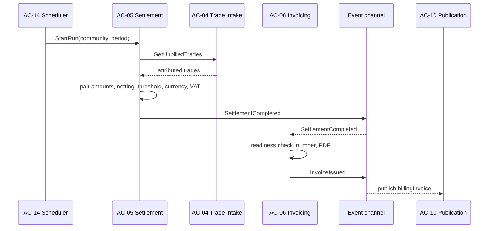
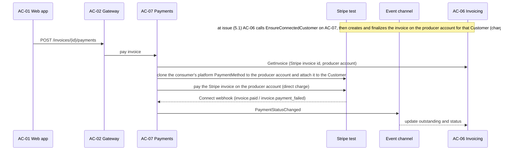

# Billing & Payment Service: application architecture

> **View 3 of 5** (functional → logical → **application** → technical → physical, see [README](README.md)).
> This view answers: **which application components implement the logical blocks, what they expose (APIs, events, screens) and how they connect to external systems through adapters.**
> No technology is chosen here. Languages, frameworks, database, event transport and Kubernetes specifics will be decided together in the technical view.
> Status: **validated (2026-10-07)**. v0.2 introduced one deployable module per logical block.

## 1. Decisions framing this view

| # | Decision | Source |
|---|---|---|
| AD-1 | **Modular architecture, one deployable module per logical block.** Each module is built, tested and deployed independently. It owns its data and exposes its capabilities only through APIs and events. | 2026-10-07 |
| AD-2 | **Target hosting: a Kubernetes cluster.** Each module runs as its own workload. Cluster design belongs to the technical and physical views. | 2026-10-07 |
| AD-3 | **External API: REST, versioned (`/v1`), described by an OpenAPI contract.** Authentication uses OIDC bearer tokens from the project IdP. | 2026-10-07; REQ-052 |
| AD-4 | **Events between modules: asynchronous, at-least-once, through a transactional outbox per module.** Consumers are idempotent. The transport is chosen in the technical view. | 2026-10-07; logical LP-3/LP-4 |
| AD-5 | **Reference screens in V1: participant portal and community-manager console**, built only on the public API. | 2026-10-07; REQ-052 |
| AD-6 | **V1 integrates only Stripe in test mode.** Every other external system is reached through an adapter whose V1 implementation is a mock (or a local instance). | A32 |
| AD-7 | **API-first, contract-first** (added 2026-10-07): public and internal APIs are specified in OpenAPI and events in AsyncAPI **before** implementation. The web app and the project UI consume only the public API; contracts are the source for mocks and generated clients (see technical view TP-8 / TD-13). | 2026-10-07 |

## 2. Application components

Each logical block becomes its own deployable module. The only exception is LB-01 access control, which is embedded in the API gateway because it checks every request.

| Component | Kind | Logical block | Responsibility | Owns data |
|---|---|---|---|---|
| **AC-01 Web app** | Front-end | — (client) | Participant portal and community-manager console (reference screens) | None |
| **AC-02 API gateway** | Edge | LB-12 + LB-01 | Single public entry point: routing, OIDC token validation, role and community checks, rate limiting, public OpenAPI | None (config) |
| **AC-03 Participants** | Domain | LB-02 | Communities, registry, profiles, terms and mandate, readiness, offboarding; account provisioning in the IdP | Community, Participant, RegistryEntry, BillingProfile, TermsAcceptance |
| **AC-04 Trade intake** | Domain | LB-03 | Market queries per window, deduplication, attribution, completeness, intake health | Trade, MarketInfo, ClearingResult, IntakeWindow, IntakeAnomaly |
| **AC-05 Settlement** | Domain | LB-04 | Billing runs and early settlements, pair settlement, netting, threshold and carry-forward, currency and VAT, ledger | BillingRun, PairSettlement, CarryForward, LedgerEntry, BillingAccount |
| **AC-06 Invoicing** | Domain | LB-05 | Invoices in the producer's name, legal numbering per producer, PDF, lifecycle and manual status | Invoice, InvoiceLine, NumberSeries, InvoiceDocument, StatusHistory |
| **AC-07 Payments** | Domain | LB-06 | Payment-provider onboarding (producer accounts, KYC, consumer payment methods), payments, provider webhooks, failures | PaymentAccount, Payment, ProviderEvent, FailureRecord |
| **AC-08 Reconciliation** | Control | LB-07 | Invoice ↔ payment and market ↔ clearing checks, discrepancies and alerts | ReconciliationResult, Discrepancy |
| **AC-09 Reporting & exports** | Read side | LB-14 | Manager views, history, summaries, KPI export, end-to-end trace (read models built from events) | Read models, KpiExport |
| **AC-10 Publication** | Support | LB-08 | Mapping to `billingInvoice` / `billingPayment`, publication to the data space, retry, cache purge | OutboundMessage, PublicationStatus |
| **AC-11 Notification** | Support | LB-09 | Invitations, invoice e-mails with PDF, payment confirmations and failure notices | NotificationLog |
| **AC-12 Compliance** | Support | LB-10 | Audit log, retention, data-subject requests (export, erasure orchestration) | AuditEvent, RetentionPolicy, DataSubjectRequest |
| **AC-13 Reference data** | Support | LB-11 | Exchange rates by date, VAT rates per community | ExchangeRate |
| **AC-14 Scheduler** | Support | LB-13 | Time-based jobs: decides *when* and sends the command to the owning module | JobDefinition, JobExecution |
| **AC-15 Mock suite (V1)** | Test / demo | — | Simulated market (GSY DEX request/reply), simulated data space (validates and records messages), FX fixture, scenario datasets (§8) | Fixtures |

That makes 13 back-end modules, the web app and the mock suite. Every component maps to exactly one logical block, so traceability stays one to one.

### 2.1 Overview by layer

### 2.2 Synchronous dependencies between modules

Only the internal commands of §3.2 cross module boundaries synchronously. Everything else travels as events (§4).

### 2.3 External adapters

### 2.4 Complete component map

This diagram shows every dependency in one picture and is readable only with the ELK layout (*Mermaid ELK Renderer* plugin in Obsidian).
- Solid arrows are synchronous calls.
- Dotted arrows are events, labelled with the event name. The outbox-based channel is not drawn.
- Thick arrows go to external systems.

## 3. APIs

### 3.1 Public API (AC-02, `/v1`, OpenAPI)

Consumed by AC-01 and by the project UI. Every call needs a bearer token, and responses only contain data of the caller's own participant or community (REQ-010).

| Resource / operation | Role(s) | Served by | Requirements | Screen |
|---|---|---|---|---|
| `GET /me` (profile, roles, community, readiness) | all | AC-03 | REQ-049, REQ-009 | Portal home |
| `PUT /me/profile` | member | AC-03 | REQ-009 | Profile |
| `GET /terms/current`, `POST /me/terms-acceptance` | member, manager | AC-03 | REQ-050 | Terms |
| `POST /me/payment-account/onboarding` (producer KYC link / consumer payment method) | member | AC-07 | REQ-051, REQ-040 | Payment setup |
| `GET /me/balances` (unbilled amounts per counterpart) | member | AC-05 | REQ-002, REQ-057 | Balances |
| `GET /me/invoices`, `GET /invoices/{id}`, `GET /invoices/{id}/document` | member | AC-06 | REQ-007, REQ-039 | Invoices |
| `POST /invoices/{id}/payments` | consumer | AC-07 | REQ-014 | Pay |
| `POST /early-settlements` {producerId} | consumer | AC-05 | REQ-057 | Settle now |
| `GET/PUT /communities/{id}/settings` (currency, period, threshold, VAT, mode) | manager | AC-03 | REQ-006, REQ-043, REQ-056 | Community settings |
| `POST /communities/{id}/participants:import`, `GET /communities/{id}/participants`, `PATCH /participants/{id}`, `POST /participants/{id}:offboard` | manager | AC-03 | REQ-008, REQ-058, REQ-012 | Participants |
| `POST /communities/{id}/billing-runs`, `GET /billing-runs/{id}` | manager, operator | AC-05 | REQ-006 | Billing runs |
| `POST /invoices/{id}/status` {status, reason} | manager | AC-06 | REQ-044 | Invoice detail |
| `GET /communities/{id}/payments-overview`, `/participants/{id}/history`, `/reports/summary` | manager | AC-09 | REQ-018, REQ-031, REQ-032 | Reports |
| `GET /reconciliation/discrepancies` | operator | AC-08 | REQ-041 | Operator views |
| `GET /intake/anomalies` | operator | AC-04 | REQ-029 | Operator views |
| `GET /kpi-exports/{period}` | operator | AC-09 | REQ-047 | — |
| `POST /data-subject-requests`, `GET /data-subject-requests/{id}` | member, DPO | AC-12 | REQ-013 | Privacy |
| `GET /jobs`, `POST /jobs/{id}:run` | operator | AC-14 | logical §4.5 | Operator views |

Inbound integration endpoint, not part of the public API: `POST /webhooks/payment-provider` (AC-07), with the signature verified (NFR-015).

### 3.2 Internal APIs (module to module, never exposed to clients)

| Command | Provider | Callers |
|---|---|---|
| ResolveParty(marketId) | AC-03 | AC-04 |
| GetCommunitySettings(communityId) | AC-03 | AC-05, AC-06 |
| CheckReadiness(participantId) | AC-03 | AC-06 |
| GetUnbilledTrades(community or pair, until) | AC-04 | AC-05 |
| GetRate(currency, date), GetVatRate(communityId) | AC-13 | AC-05 |
| GetPairSettlement(settlementId) | AC-05 | AC-06 |
| GetInvoice(invoiceId) (incl. Stripe invoice id and producer Connect account) | AC-06 | AC-07 |
| EnsureConnectedCustomer(participantId, stripeAccountId) | AC-07 | AC-06 |
| StartRun / RefreshIntake / MarkOverdue / Reconcile / PurgeCache / ApplyRetention / FetchRates … | owning module | AC-14 |

## 4. Event catalogue

**Common envelope:** `eventId`, `type`, `version`, `occurredAt`, `producer`, `communityId`, `billingMode`, `data`.

**Delivery and handling:**
- Events are written to the producer's outbox in the same transaction as the business change, then relayed to the event channel.
- Delivery is at least once. Consumers deduplicate on `eventId`.
- Payloads carry identifiers only, never personal data.

| Event (v1) | Producer | Consumers | Key data |
|---|---|---|---|
| ParticipantOnboarded | AC-03 | AC-07, AC-11 | participantId, role |
| ParticipantReadinessChanged | AC-03 | AC-06 | participantId, ready, reason |
| ParticipantOffboarded | AC-03 | AC-05 | participantId, effectiveAt |
| PaymentAccountStatusChanged | AC-07 | AC-03 | participantId, kycStatus, paymentMethodPresent |
| TradesIngested | AC-04 | AC-05, AC-09 | window, tradeIds, communityIds |
| IntakeAnomalyDetected | AC-04 | AC-08, AC-09, AC-11 (operator alert) | type, marketId, details |
| SettlementCompleted | AC-05 | AC-06, AC-09 | runId or earlySettlementId, pair settlements |
| BillingRunCompleted | AC-05 | AC-08, AC-09 | runId, period, version, counts |
| InvoiceIssued | AC-06 | AC-07, AC-08, AC-09, AC-10, AC-11 | invoiceId, issuer, recipient, amounts, currency, tradeIds |
| InvoiceStatusChanged | AC-06 | AC-08, AC-09, AC-10 | invoiceId, status, reason, outstanding |
| PaymentStatusChanged | AC-07 | AC-06, AC-08, AC-09, AC-10, AC-11 | paymentId, invoiceId, status, failureCategory |
| DiscrepancyDetected | AC-08 | AC-09, AC-11 (operator alert) | scope, expected, actual |
| ErasureRequested | AC-12 | AC-03, AC-06, AC-07 | requestId, participantId |
| ErasureCompleted | AC-03, AC-06, AC-07 | AC-12 | requestId, module, result |
| AuditableActionPerformed | all modules handling personal or payment data | AC-12 | actor, action, target, timestamp |
| JobFailed | AC-14 | AC-11 (operator alert) | jobId, error |

The external messages `billingInvoice` / `billingPayment` (`ewds-topics/`) are produced by AC-10 from InvoiceIssued, InvoiceStatusChanged and PaymentStatusChanged.

## 5. Main interactions

### 5.1 Periodic billing run

### 5.2 Payment

Payment rules (INT-355, REQ-014, TD-6):
- The payment is a **direct charge** on the producer's Stripe Connect account: AC-07 pays the producer's own Stripe invoice there with `invoices.pay`. The platform never holds the funds; no `transfer_data` / destination charge is used.
- The consumer saves one PaymentMethod on the platform (SetupIntent). At payment time AC-07 clones it to the producer account and attaches it to the consumer's Customer on that account. AC-07 owns the mapping consumer × Connect account → Customer (one Customer per pair, metadata `participantId` only).
- **SEPA Direct Debit (open decision):** Stripe does not share `sepa_debit` PaymentMethods with connected accounts, so a platform SEPA mandate cannot fund a direct charge. Until a per-producer mandate flow is specified, AC-07 refuses such a payment with `failureCategory: sepa_debit_not_shareable` and makes no charge.
- Stripe accepts a single payment per invoice, and the invoice is never e-mailed with a payable link: no double payment. A repeated Pay on a settled invoice returns the existing payment.
- The webhook endpoint accepts both the platform and the Connect endpoint signing secrets (`stripe_webhook_secret`, `stripe_connect_webhook_secret`) and deduplicates on the Stripe event id.

## 6. Reference screens (AC-01, V1)

| Area | Screen | Main API | Requirements |
|---|---|---|---|
| Participant | Sign-in (IdP), home with readiness checklist | `/me` | REQ-033, REQ-049 |
| Participant | Profile | `/me/profile` | REQ-009 |
| Participant | Terms (+ self-billing mandate for producers) | `/terms`, `/me/terms-acceptance` | REQ-050 |
| Participant | Payment setup (Stripe onboarding or payment method) | `/me/payment-account/onboarding` | REQ-051 |
| Participant | Balances per counterpart + "settle now" | `/me/balances`, `/early-settlements` | REQ-057 |
| Participant | Invoices (list, detail, PDF) + pay | `/me/invoices`, `/invoices/{id}/payments` | REQ-007, REQ-014, REQ-039 |
| Participant | Privacy (export / erasure request) | `/data-subject-requests` | REQ-013 |
| Manager | Community settings | `/communities/{id}/settings` | REQ-006, REQ-043, REQ-056 |
| Manager | Participants (import, registry, offboard) | `/communities/{id}/participants…` | REQ-008, REQ-058, REQ-012 |
| Manager | Billing runs (trigger, follow) | `/billing-runs` | REQ-006 |
| Manager | Invoices and payment overview (incl. manual status) | `/payments-overview`, `/invoices/{id}/status` | REQ-018, REQ-044 |
| Manager | Member history and periodic summary | `/participants/{id}/history`, `/reports/summary` | REQ-031, REQ-032 |
| Operator | Intake anomalies, discrepancies, jobs | `/intake/anomalies`, `/reconciliation/…`, `/jobs` | REQ-029, REQ-041 |

## 7. Adapters and V1 implementations

Every adapter implements one logical port behind a stable interface. Switching from a mock to the real system is a configuration change (AD-6).

| Adapter (module) | Port | Interface (operations) | V1 implementation | Later implementation |
|---|---|---|---|---|
| Market adapter (AC-04) | P-MKT | queryTrades(window), queryClearingResults(marketId), queryMarkets(window) | **Mock** (AC-15) | EWDS request/reply on GSY channels + REST backfill |
| Data-space adapter (AC-10) | P-DS | publish(topic, message), purgeCache(before) | **Mock** (AC-15, schema validation) | Blooo EWDS Client Gateway |
| Payment adapter (AC-07) | P-PSP | createProducerAccount, onboardingLink, attachPaymentMethod, createConnectedCustomer, createPayment (direct charge: pays the producer's Stripe invoice), refund, verifyWebhook | **Stripe test mode** | Stripe live (per community, after V1) |
| IdP admin adapter (AC-03) + token validation (AC-02) | P-IDP | createUser, sendInvitation, deleteUser; validateToken | Keycloak, local instance | Project IdP (Blooo-operated) or pilot OIDC IdP |
| FX adapter (AC-13) | P-FX | getRate(currency, date) | **Fixture** (AC-15) | ECB reference rates |
| Mail adapter (AC-11) | P-MAIL | send(template, to, attachments) | Local mail catcher | Transactional mail service |
| KPI export adapter (AC-09) | P-KPI | export(period, dataset) | File export | Format/channel agreed with WP6 / GSY |

## 8. Mock suite: V1 scenarios (AC-15)

| # | Scenario | Validates |
|---|---|---|
| S1 | Consumer buys from 2 producers → 2 invoices | REQ-054 |
| S2 | Prosumers trade both ways → one netted invoice | REQ-055 |
| S3 | Pair below 5 € → carry-forward, invoiced next period | REQ-056 |
| S4 | Trade with an unknown party → flagged, not invoiced | REQ-058 |
| S5 | Market missing one trade vs clearing result → discrepancy | REQ-041 |
| S6 | Late trade arriving after the run → next run | REQ-001 |
| S7 | Duplicate trade delivery → billed once | REQ-001 |
| S8 | CHF community → ECB fixture rate on invoice | REQ-002 |
| S9 | Early settlement mid-period | REQ-057 |
| S10 | Payment failures (Stripe test cards: declined, insufficient funds, authentication) | REQ-016, REQ-046 |
| S11 | Producer without KYC → invoices held | REQ-045 |
| S12 | Erasure request → propagation to Stripe test and IdP | REQ-013 |
| S13 | Every published message validates against `billingInvoice` / `billingPayment` | REQ-048 |

## 9. Traceability: logical → application

| Logical block | Component |
|---|---|
| LB-01 Access control, LB-12 Billing API | AC-02 API gateway |
| LB-02 Participants & communities | AC-03 Participants |
| LB-03 Trade intake | AC-04 Trade intake |
| LB-04 Settlement engine | AC-05 Settlement |
| LB-05 Invoicing | AC-06 Invoicing |
| LB-06 Payment orchestration | AC-07 Payments |
| LB-07 Reconciliation | AC-08 Reconciliation |
| LB-14 Reporting & exports | AC-09 Reporting & exports |
| LB-08 Publication | AC-10 Publication |
| LB-09 Notification | AC-11 Notification |
| LB-10 Compliance | AC-12 Compliance |
| LB-11 Reference data | AC-13 Reference data |
| LB-13 Scheduling | AC-14 Scheduler |
| Ports (mock side) | AC-15 Mock suite |
| Reference screens | AC-01 Web app |

## 10. Open points and inputs for the technical view
- **Consequences of one module per block, to address in the technical view:**
  - 13 back-end workloads;
  - one data store or schema per module;
  - a shared module template (health, configuration, outbox, observability) to avoid repeating work;
  - per-module CI/CD pipelines;
  - local development with every module running together.
- **To decide together in the technical view:**
  - languages and frameworks (back-end, front-end);
  - database(s);
  - event transport behind the outbox;
  - API gateway product;
  - PDF generation;
  - secrets management;
  - observability;
  - CI/CD;
  - Kubernetes packaging.
- **To decide in the physical view:**
  - environments (dev, test, demo);
  - cluster and hosting in the EU;
  - network exposure (Stripe webhooks, IdP);
  - backups.

## 11. Validation checklist
- [ ] One deployable module per logical block (AC-02 … AC-14), plus web app and mock suite
- [ ] Public and internal APIs
- [ ] Event catalogue (names, producers, consumers)
- [ ] Reference screens for V1
- [ ] Adapters and V1 implementations (Stripe test only, everything else mocked or local)
- [ ] Mock scenarios S1–S13

## 12. Changes in v0.2 (2026-10-07)
- To favour more separately deployed modules, v0.1's grouped modules (Billing = LB-04/05/11, Control & reporting = LB-07/14, Platform = LB-08/09/10/13) are split. There is now **one module per logical block**: AC-05 Settlement, AC-06 Invoicing, AC-08 Reconciliation, AC-09 Reporting, AC-10 Publication, AC-11 Notification, AC-12 Compliance, AC-13 Reference data, AC-14 Scheduler. The mock suite becomes AC-15.
- New events SettlementCompleted, DiscrepancyDetected, AuditableActionPerformed and JobFailed, needed now that these blocks are separate deployables.
