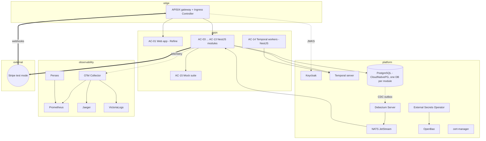
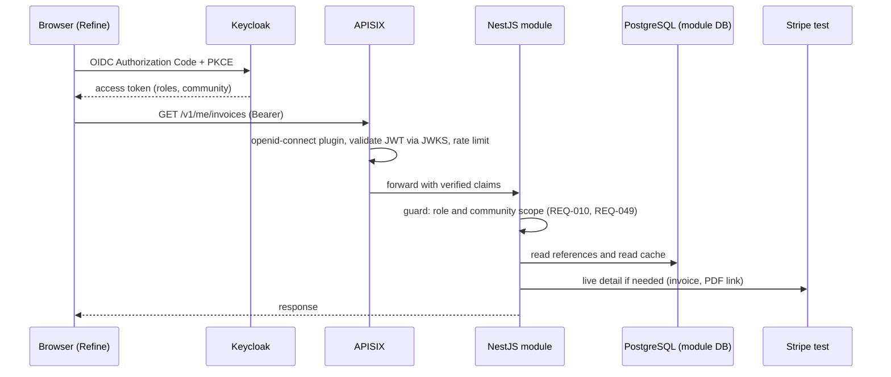
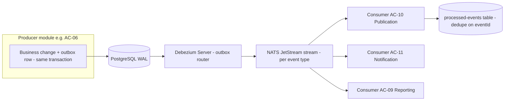
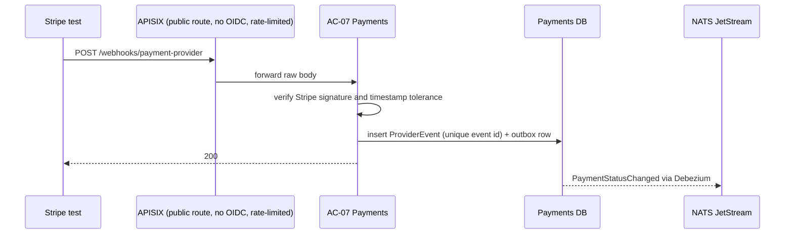

# Billing & Payment Service: technical architecture

> **View 4 of 5** (functional → logical → application → **technical** → physical, see [README](README.md)).
> This view chooses the technologies that implement the application components AC-01 … AC-15. It is built **together with Rouslan, one topic at a time**: options, then recommendation, then decision.
> Status: **in progress**. §3 records the decisions as they are taken.

## 1. Technical principles

| # | Principle | Source |
|---|---|---|
| TP-1 | **Reuse before build.** Rely as much as possible on existing open-source frameworks and products, used as accelerators, so that custom code is kept to the business logic that is specific to INTELLIGENT. | Rouslan, 2026-10-07 |
| TP-2 | **Permissive licences only: MIT or Apache-2.0** for every component we embed, link or ship, consistent with the Apache-2.0 publication of the service (NFR-012) and with no GPL code linked. AGPL, SSPL, BSL and similar licences are excluded. A copyleft tool that only runs as a separate, unmodified service is flagged and needs an explicit decision. | Rouslan, 2026-10-07; NFR-012 |
| TP-3 | **Kubernetes-native.** Every module is a container. Prefer components with an official Helm chart or operator. | AD-2 |
| TP-4 | **EU hosting and data minimisation** in every product choice: no personal data sent to services outside the EU/adequacy area. | NFR-002 |
| TP-5 | **Stripe test mode is the only real external integration in V1.** Everything else runs as a mock or a local instance behind the same adapter. | A32 |
| TP-6 | **Licence check by local `git clone`** of each candidate. The result is recorded in §4 with date and commit date. | brain rule 9 |
| TP-7 | **Single master per data item.** Data mastered by an external system, Stripe in particular, is never copied as a source of truth. Only identifiers and links are stored, plus a rebuildable read cache where lists or reports need it. | Rouslan, 2026-10-07 |
| TP-8 | **API-first, contract-first.** Every interface is described by a versioned contract **before** it is implemented: OpenAPI 3.1 for the public and internal REST APIs, AsyncAPI 3 for the events. The contracts live in the repository, are reviewed like code, and are the single source for mocks, clients, validation and documentation. The web app and the project UI consume only the public API. | Rouslan, 2026-10-07 |

## 2. Reuse map: what can replace custom code

For each application component, the existing open-source building blocks (all MIT or Apache-2.0, verified in §4) and what would remain custom.

| Component | Candidate accelerators | What stays custom | Reuse potential |
|---|---|---|---|
| AC-01 Web app | **Refine** (MIT) or **react-admin** (MIT) for the manager console and portal (CRUD, lists, forms, auth providers); Stripe-hosted onboarding and payment pages | Balances, settle-now and readiness screens | High |
| AC-02 API gateway | **Apache APISIX** (Apache-2.0), **Kong OSS** (Apache-2.0), **Envoy Gateway** (Apache-2.0) or **Traefik** (MIT) + **oauth2-proxy** (MIT); OpenAPI from the framework | Route and role configuration | Very high (no code) |
| AC-03 Participants | **Keycloak** (Apache-2.0) admin API for accounts and invitations; framework CRUD | Registry, readiness rules, CSV import | Medium |
| AC-04 Trade intake | Stripe/HTTP clients; EWDS client patterns from the GSY/EWAG repos | Window querying, deduplication, attribution, completeness | Low (core logic) |
| AC-05 Settlement | **Formance Ledger** (MIT) or **TigerBeetle** (Apache-2.0) for the immutable double-entry ledger and the carry-forward balances | Pair computation, netting, threshold, FX and VAT rules | Medium |
| AC-06 Invoicing | **Stripe Invoicing on the producer's connected account** (numbering per account, hosted PDF, e-mail, payment link). Alternatively **Gotenberg** (MIT) for a custom PDF template | Mapping a pair settlement to an invoice; self-billing mention | **High if Stripe Invoicing is used** |
| AC-07 Payments | **stripe-node / stripe-java** (MIT); Stripe Connect, Identity, hosted onboarding, webhooks | Readiness sync, failure categorisation | High |
| AC-08 Reconciliation | SQL over read models | Matching rules | Low |
| AC-09 Reporting & exports | Read models in the database; optionally a BI tool (see §5, Grafana is AGPL) | Report queries, KPI export format | Medium |
| AC-10 Publication | **Transactional outbox library** (framework-native, **Debezium** (Apache-2.0), **Eventuate Tram** (Apache-2.0) or **Watermill** (MIT)); JSON Schema validators | Mapping to `billingInvoice` / `billingPayment` | High |
| AC-11 Notification | Stripe e-mails (invoices, receipts); a templating library; **Mailpit** (MIT) as the local mail catcher | Invitation and failure templates | High |
| AC-12 Compliance | Keycloak and Stripe deletion APIs; database audit features | DSAR orchestration, retention rules | Medium |
| AC-13 Reference data | Simple HTTP client to the ECB feed | Rate storage | Low effort anyway |
| AC-14 Scheduler | **Temporal** (MIT): durable workflows, timers and retries for runs, early settlements and DSAR sagas. Alternatively **Kubernetes CronJobs** + **Quartz** (Apache-2.0) | Job definitions | High |
| Event transport | **NATS JetStream** (Apache-2.0) | — | Very high (no code) |
| Database | **PostgreSQL** (PostgreSQL licence, permissive) on **CloudNativePG** (Apache-2.0) | Schemas | Very high |
| Observability | **OpenTelemetry Collector** (Apache-2.0), **Prometheus** (Apache-2.0); dashboard tool to choose (§5) | Dashboards | Very high |
| CI/CD and GitOps | **Argo CD** (Apache-2.0), Helm; **KEDA** (Apache-2.0) for scaling if needed | Pipelines | Very high |
| Policy (optional) | **OPA** (Apache-2.0) for fine-grained authorisation | Policies | Optional |

**Excluded by TP-2:** **Lago** (open-source billing, AGPL-3.0). **Kill Bill** (Apache-2.0) was considered but is built for subscription and usage billing of a single merchant. It does not fit the P2P model where invoices are issued per consumer→producer pair in the producer's name.

## 3. Decisions (filled in topic by topic)

| # | Topic | Decision | Date |
|---|---|---|---|
| TD-1 | Reuse strategy and licences | TP-1 / TP-2 adopted. One explicit exception under TP-2: OpenBao (MPL-2.0), see TD-9 | 2026-10-07 |
| TD-2 | Invoicing engine | **Stripe Invoicing on each producer's connected account.** Stripe handles numbering per producer, the hosted PDF, the e-mail and the payment link. Self-billing mention, trade summary and ECB rate go in Stripe custom fields, footer and metadata. Custom code is limited to mapping a pair settlement to a Stripe invoice | 2026-10-07 |
| TD-3 | Workflow and scheduling | **Temporal** (MIT; TypeScript SDK and Helm charts MIT) for all time-based jobs, billing runs, early settlements and multi-step sagas (DSAR propagation, retries). It implements AC-14 | 2026-10-07 |
| TD-4 | Back-end language and framework | **TypeScript + NestJS** (MIT) for the 13 modules, with stripe-node (MIT), Temporal TS SDK (MIT), OpenAPI contracts written first (TD-13), with express-openapi-validator (MIT) validating requests and responses against them and OpenTelemetry JS (Apache-2.0). A shared module template covers health, configuration, outbox, idempotent consumers and telemetry | 2026-10-07 |
| TD-5 | Front-end framework | **Refine** (MIT), React, with an MIT UI kit (Ant Design or MUI, to fix at implementation), OIDC auth provider and REST data provider on the public API | 2026-10-07 |
| TD-6 | Data and database | **Single master per data item (TP-7):** Stripe is master of accounts and KYC, customers, invoices and payments, and we keep only Stripe ids and links. **PostgreSQL** on **CloudNativePG** (Apache-2.0), **one database and one user per module**, holds the data we master; calculation tables are append-only. A **read-only cache** of Stripe invoice and payment fields, fed by webhooks, is used only for lists, reports and reconciliation. It is rebuildable from Stripe and checked nightly. Detail screens read Stripe live | 2026-10-07 |
| TD-7 | Event transport and outbox | **NATS JetStream** (Apache-2.0; NACK operator Apache-2.0) as the event channel. **Debezium Server** (Apache-2.0) reads each module's outbox table (PostgreSQL CDC) and publishes to JetStream, so there is no custom relay code. Consumers are idempotent (module template) | 2026-10-07 |
| TD-8 | API gateway | **Apache APISIX** (Apache-2.0) + APISIX Ingress Controller (Apache-2.0): openid-connect plugin (Keycloak), routing, rate limiting, CORS, public OpenAPI | 2026-10-07 |
| TD-9 | Secrets and certificates | **External Secrets Operator** (Apache-2.0) syncs Kubernetes secrets from **OpenBao** (MPL-2.0). OpenBao is accepted as an exception to TP-2: it is deployed as a separate, unmodified service and never linked into our code. ESO keeps the secret backend replaceable later (cloud KMS, another vault). TLS certificates come from **cert-manager** (Apache-2.0) | 2026-10-07 |
| TD-10 | Observability | **100 % Apache-2.0 stack:** OpenTelemetry (collector + JS SDK), Prometheus (+ kube-prometheus), Jaeger (traces), VictoriaLogs (logs), Perses (dashboards). The Grafana stack (AGPL) is not used | 2026-10-07 |
| TD-11 | CI/CD and Kubernetes packaging | **GitHub Actions** for CI (tests, build, Trivy scan (Apache-2.0), gitleaks (MIT)); **one Helm chart per module, orchestrated with helmfile** (MIT); **Argo CD** (Apache-2.0) for GitOps deployment. Dependabot for dependencies (Renovate is AGPL) | 2026-10-07 |
| TD-12 | Local development environment | **k3d** (MIT) local cluster with the same charts as the target, deployed with helmfile; **Tilt** (Apache-2.0) for live reload; **Stripe CLI** (Apache-2.0) to forward Stripe test webhooks; **Mailpit** (MIT) as mail catcher; mock suite AC-15 | 2026-10-07 |
| TD-13 | API contract-first tooling | Contracts: **OpenAPI 3.1** (REST, public and internal) and **AsyncAPI 3** (events), in `contracts/`. Lint with **Spectral** (Apache-2.0) and **Redocly CLI** (MIT), which also builds the documentation. Breaking-change detection in CI with **oasdiff** (Apache-2.0). Mock server for R2M and front-end work with **Prism** (Apache-2.0). TypeScript types and clients generated with **openapi-typescript** (MIT) and **Orval** (MIT, for Refine/React). Runtime validation in NestJS with **express-openapi-validator** (MIT). Contract tests in CI with **Schemathesis** (MIT). Event documentation and code generation with **AsyncAPI CLI / Generator** (Apache-2.0) | 2026-10-07 |

### 3.1 Technology map per application component

| Component | Technologies |
|---|---|
| AC-01 Web app | Refine + React + MIT UI kit, OIDC (Keycloak) |
| AC-02 API gateway | APISIX + openid-connect plugin, APISIX Ingress Controller |
| AC-03 … AC-13 modules | NestJS (TypeScript), PostgreSQL (own database), outbox → Debezium Server → NATS JetStream, OpenTelemetry |
| AC-06 Invoicing / AC-07 Payments | + stripe-node, Stripe Connect, Invoicing, Identity, webhooks (test mode in V1) |
| AC-03 Participants | + Keycloak admin REST API |
| AC-14 Scheduler | Temporal (workflows and timers), TypeScript workers |
| AC-15 Mock suite | NestJS mock services + fixtures; Stripe test mode is real |
| Platform | Keycloak, Temporal, NATS JetStream, CloudNativePG, Debezium Server, ESO + OpenBao, cert-manager, OTel + Prometheus + Jaeger + VictoriaLogs + Perses, Argo CD |

### 3.2 Consequences to track
- **Stripe Invoicing (TD-2), working assumption WA-21 / A33:**
  - Stripe numbering per connected account must meet the legal sequential numbering for self-billing in each country;
  - the self-billing mention must be acceptable on the Stripe PDF;
  - invoice personal data held by Stripe must be compatible with NFR-002 (to check with the project DPO);
  - production cost of Stripe Invoicing must be checked.
  
  REQ-039 (PDF and e-mail) and REQ-042 (numbering) are implemented by Stripe.
- **TP-7, single master:** add to the logical data model in the next revision. Invoice and Payment in AC-06/AC-07 become Stripe references plus the read cache.
- **13 NestJS services:** the shared module template and the helmfile layout are the first implementation deliverables.

### 3.3 Contract-first workflow

1. **Design.** The API change is written in `contracts/openapi/*.yaml` (or `contracts/asyncapi/*.yaml` for events), linted with Spectral and Redocly, and reviewed in a pull request. R2M can review the public API at this stage.
2. **Mock.** Prism serves the contract immediately, so AC-01, the project UI and dependent modules can work before the implementation exists.
3. **Generate.** openapi-typescript produces the server-side types, and Orval the typed clients for the web app and for module-to-module calls.
4. **Implement.** The NestJS module implements the contract. express-openapi-validator rejects any request or response that does not match it.
5. **Verify in CI.** Schemathesis runs contract tests against the running module. oasdiff blocks unannounced breaking changes, which require a new `/v2` version. Redocly publishes the API documentation (REQ-052).

## 4. Licence verification (local git clones, 2026-10-07)

| Project | Licence | Last commit | Status under TP-2 |
|---|---|---|---|
| Keycloak | Apache-2.0 | 2026-10-07 | OK |
| Temporal | MIT | 2026-10-07 | OK |
| NATS server | Apache-2.0 | 2026-10-07 | OK |
| Apache APISIX | Apache-2.0 | 2026-09-28 | OK |
| Kong (OSS repo) | Apache-2.0 | 2026-09-28 | OK (enterprise features not in the repo) |
| Envoy Gateway | Apache-2.0 | 2026-10-07 | OK |
| Traefik | MIT | 2026-10-06 | OK |
| oauth2-proxy | MIT | 2026-10-01 | OK |
| Gotenberg | MIT | 2026-10-05 | OK |
| Mailpit | MIT | 2026-10-07 | OK |
| Debezium | Apache-2.0 | 2026-10-07 | OK |
| Eventuate Tram core | Apache-2.0 | 2026-08-28 | OK |
| Watermill | MIT | 2026-08-25 | OK |
| Spring Boot / Spring Modulith | Apache-2.0 | 2026-10-07 / 2026-10-02 | OK |
| Quarkus | Apache-2.0 | 2026-10-07 | OK |
| NestJS | MIT | 2026-10-02 | OK |
| FastAPI | MIT | 2026-10-06 | OK |
| stripe-node / stripe-java | MIT | 2026-09-30 | OK |
| Formance Ledger | MIT | 2026-10-05 | OK |
| TigerBeetle | Apache-2.0 | 2026-10-06 | OK |
| OpenMeter | Apache-2.0 | 2026-10-07 | OK (metering; not needed so far) |
| Hyperswitch | Apache-2.0 | 2026-10-07 | OK (payment orchestrator; overkill with Stripe only) |
| Kill Bill | Apache-2.0 | 2026-10-05 | OK, but poor functional fit |
| Refine / react-admin | MIT | 2026-09-10 / 2026-10-02 | OK |
| Prometheus | Apache-2.0 | 2026-10-07 | OK |
| OpenTelemetry Collector | Apache-2.0 | 2026-10-06 | OK |
| Quartz | Apache-2.0 | 2026-09-28 | OK |
| CloudNativePG | Apache-2.0 | 2026-10-07 | OK |
| Argo CD | Apache-2.0 | 2026-10-07 | OK |
| KEDA | Apache-2.0 | 2026-10-04 | OK |
| OPA | Apache-2.0 | 2026-10-07 | OK |
| External Secrets Operator | Apache-2.0 | 2026-10-06 | OK |
| OpenBao | MPL-2.0 | 2026-10-05 | **Accepted exception** (separate unmodified service, TD-9) |
| HashiCorp Vault | BUSL-1.1 | 2026-10-07 | Excluded |
| SOPS | MPL-2.0 | 2026-09-21 | Not used |
| cert-manager | Apache-2.0 | 2026-10-05 | OK |
| Sealed Secrets | Apache-2.0 | 2026-10-01 | OK (not retained) |
| Jaeger | Apache-2.0 | 2026-10-07 | OK |
| VictoriaMetrics / VictoriaLogs | Apache-2.0 | 2026-10-06 | OK |
| Perses | Apache-2.0 | 2026-10-07 | OK |
| kube-prometheus | Apache-2.0 | 2026-09-24 | OK |
| Grafana Loki / Tempo | AGPL-3.0 | 2026-10-07 | Excluded |
| SigNoz / Infisical | MIT core + proprietary `ee/` | 2026-10-07 | Not used |
| APISIX Ingress Controller | Apache-2.0 | 2026-09-29 | OK |
| Debezium Server | Apache-2.0 | 2026-10-02 | OK |
| NATS NACK (JetStream operator) | Apache-2.0 | 2026-09-21 | OK |
| Temporal Helm charts / TypeScript SDK | MIT | 2026-10-07 / 2026-10-06 | OK |
| Ant Design / MUI | MIT | 2026-10-07 | OK |
| Tilt | Apache-2.0 | 2026-10-02 | OK |
| k3d | MIT | 2026-06-12 | OK |
| helmfile | MIT | 2026-10-06 | OK |
| Stripe CLI | Apache-2.0 | 2026-10-05 | OK |
| stripe-mock | MIT | 2026-09-29 | OK |
| testcontainers-node | MIT | 2026-10-06 | OK |
| @nestjs/swagger | MIT | 2026-09-30 | OK |
| OpenTelemetry JS | Apache-2.0 | 2026-10-07 | OK |
| Trivy | Apache-2.0 | 2026-10-07 | OK |
| gitleaks | MIT | 2026-07-22 | OK |
| Kyverno | Apache-2.0 | 2026-10-07 | OK (optional policies) |
| Renovate | AGPL-3.0 | 2026-10-07 | Excluded (Dependabot instead) |
| Spectral | Apache-2.0 | 2026-10-02 | OK |
| Prism | Apache-2.0 | 2026-09-29 | OK |
| Redocly CLI | MIT | 2026-10-07 | OK |
| oasdiff | Apache-2.0 | 2026-10-06 | OK |
| OpenAPI Generator | Apache-2.0 | 2026-10-08 | OK (alternative to Orval) |
| openapi-typescript | MIT | 2026-09-25 | OK |
| Orval | MIT | 2026-10-07 | OK |
| express-openapi-validator | MIT | 2026-08-07 | OK |
| Schemathesis | MIT | 2026-10-07 | OK |
| AsyncAPI CLI / Generator | Apache-2.0 | 2026-10-02 / 2026-10-05 | OK |
| **Lago** | **AGPL-3.0** | 2026-10-07 | **Excluded** |
| **Grafana** | **AGPL-3.0** | 2026-10-07 | **Flagged** (separate unmodified service only; decision needed) |

Method: a shallow, sparse clone of each repository, then reading the top-level licence files only. Licences of nested sub-directories were not exhaustively checked; that full scan is to be done for the components actually retained.

## 5. Open topics
All decisions TD-1 … TD-13 are taken. The view was **validated by Rouslan on 2026-10-07** (v1.0).

Points left open, without blocking:
- service mesh for mTLS between pods (deferred);
- choice of the licence-scanning tool for CI;
- UI kit (Ant Design or MUI), to fix at implementation.

## 6. Technical diagrams

### 6.1 Runtime platform overview

### 6.2 Request path (user call)

### 6.3 Event path (transactional outbox)

### 6.4 Stripe webhook path

## 7. Security design

| Area                     | Design                                                                                                                                                                                                                                                                                                                                      | Requirements                           |
| ------------------------ | ------------------------------------------------------------------------------------------------------------------------------------------------------------------------------------------------------------------------------------------------------------------------------------------------------------------------------------------- | -------------------------------------- |
| User authentication      | Keycloak realm per environment. Authorization Code + PKCE for the web app. APISIX `openid-connect` validates bearer tokens via JWKS. Roles and community come from token claims.                                                                                                                                                            | REQ-033–037, REQ-049, NFR-011, NFR-013 |
| Authorisation in modules | NestJS guards re-check role and community scope on every request, so a participant can only read their own data.                                                                                                                                                                                                                            | REQ-010                                |
| Service-to-service       | Internal APIs require a service token: a Keycloak client-credentials grant per module, validated by the module guard. Kubernetes **NetworkPolicies** use default deny and only allow the synchronous dependencies of 03 §2.2, plus NATS, PostgreSQL, Temporal and the OTel collector. A service mesh for mTLS between pods is **deferred**. | NFR-001                                |
| Secrets                  | ESO syncs Kubernetes secrets from OpenBao, with one path per module and per environment. They cover Stripe secret keys, the webhook signing secret and the Keycloak client secrets. Database credentials are generated by CloudNativePG. No secret is stored in Git or in container images (gitleaks in CI).                                | NFR-005, NFR-015                       |
| Transport security       | TLS at the edge (cert-manager certificates), TLS to PostgreSQL (CloudNativePG default), TLS to NATS. Stripe is called over HTTPS.                                                                                                                                                                                                           | NFR-001, NFR-015                       |
| Data at rest             | PostgreSQL volumes are encrypted by the storage layer (physical view). Personal data is limited to AC-03 profiles and AC-12 audit records; invoice documents are held by Stripe (TP-7).                                                                                                                                                     | NFR-001, NFR-002                       |
| Webhooks                 | Public route only for `/webhooks/payment-provider`, rate-limited. Stripe signature verification with timestamp tolerance. Idempotency on the Stripe event id. Raw body preserved by the gateway.                                                                                                                                            | NFR-015, REQ-016                       |
| Logs and telemetry       | Structured logs without personal data. The OTel Collector applies a redaction processor (e-mail, names, IBAN patterns). Traces carry only identifiers.                                                                                                                                                                                      | NFR-015, REQ-030                       |
| Audit                    | Every module emits `AuditableActionPerformed` for access to or changes of personal or payment data. AC-12 stores them append-only. Keycloak admin events are enabled.                                                                                                                                                                       | REQ-030                                |
| Supply chain             | Trivy scans images and dependencies; gitleaks detects secrets; Dependabot updates dependencies. Images run as non-root with a read-only filesystem and resource limits. These rules can optionally be enforced by Kyverno policies.                                                                                                         | NFR-005                                |
| Licences                 | Licence check at each new dependency (TP-2, TP-6). The CI fails if a dependency with an excluded licence is found (licence scanner to choose at implementation).                                                                                                                                                                            | NFR-012                                |

## 8. Sizing assumptions (V1, to confirm in the physical view)

| Item | Assumption |
|---|---|
| Communities | 4 pilots, all in virtual mode |
| Participants | ≤ 50 per community, about 200 in total |
| Trades | Upper bound 200 participants × 96 slots/day ≈ 20 000 trades/day, ≈ 600 000/month. Trade payloads are small (< 1 kB) |
| Invoices / payments | At most a few thousand per month (one per consumer→producer pair, after netting and the 5 € threshold) |
| Events | A few thousand per day besides trade ingestion. NATS JetStream with a single stream per event type is comfortably sized |
| Stripe | Test-mode API rate limits are lower than live; adapters use backoff and the Stripe idempotency keys |
| Application workloads | 13 NestJS modules + Temporal workers + web app at 1 replica each in dev/test, ≈ 0.25 vCPU / 256–512 MB each |
| Platform workloads | Keycloak ≈ 1 GB; Temporal server + its database ≈ 1–2 GB; PostgreSQL 1 primary (+1 replica outside dev); NATS 1 node (dev) or 3 nodes (test/demo); Debezium Server ≈ 512 MB; observability ≈ 2–3 GB |
| Total per environment | ≈ 8 vCPU / 16–24 GB RAM / 100 GB storage (estimate) |
