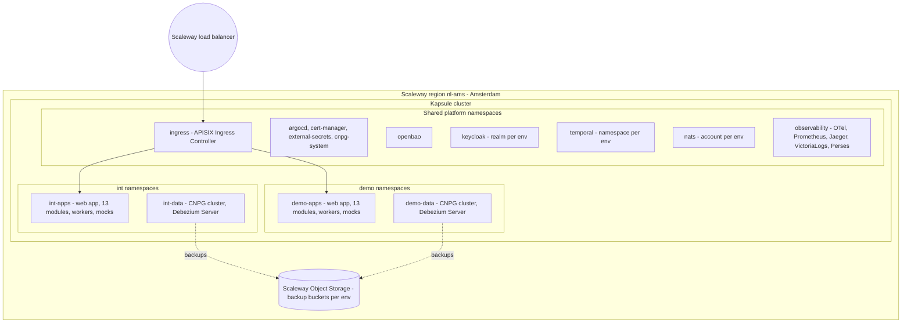
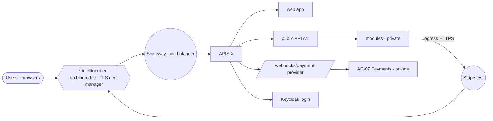

# Billing & Payment Service: physical architecture

> **View 5 of 5** (functional → logical → application → technical → **physical**, see [README](README.md)).
> This view answers: **where and how the components of the technical view run**: hosting, environments, cluster topology, network exposure, storage, backups and operations.
> Status: **validated (2026-10-08)**.

## 1. Decisions framing this view

| # | Decision | Source |
|---|---|---|
| PD-1 | **Hosting: Scaleway** (French provider, not subject to the US CLOUD Act). **Everything runs in the Amsterdam region (nl-ams)**: the managed Kubernetes cluster (**Kapsule**, since capacity is no longer available in Paris), block storage and Object Storage. The Netherlands is in the EU, so NFR-002 is met. **No multi-zone requirement for V1**: these are non-production environments. | Rouslan, 2026-10-08; NFR-002 |
| PD-2 | **Environments for V1:** `local` (developer laptop, k3d), **`int`** (automatic deployment on every merge) and **`demo`** (stable version for partners and pilots). Both cloud environments run in **virtual mode with Stripe test**. There is no production environment before the first live community. | Rouslan, 2026-10-07; A32 |
| PD-3 | **One managed cluster for V1**, with one set of namespaces per environment, NetworkPolicies and resource quotas. Production will get its own cluster later. | Rouslan, 2026-10-07 |
| PD-4 | **Backups:** CloudNativePG continuous backup (WAL archiving + daily base backup) to **Scaleway Object Storage in nl-ams** (same region, separate bucket per environment), with **point-in-time recovery**. Retention is 7 days in `int` and 30 days in `demo`. For non-production, the risk that a regional incident affects both the cluster and its backups is accepted. Production will add a second region. | Rouslan, 2026-10-08 |
| PD-5 | **Domain:** all public hosts live under **`intelligent-eu-bp.blooo.dev`** (§4). | Rouslan, 2026-10-08 |

## 2. Provider selection criteria (PD-1 closed: Scaleway)

These criteria were used to choose the provider. They stay valid for the future production cluster.

| Criterion | Requirement |
|---|---|
| Jurisdiction | EU-headquartered provider, data centres in France/EU, GDPR DPA available |
| Managed Kubernetes | Upstream-conformant (CNCF certified), current Kubernetes versions, autoscaling node pools, free or cheap control plane |
| Storage | Block storage with encryption at rest and CSI snapshots; S3-compatible object storage with encryption and versioning in another zone |
| Network | Managed load balancer, private network between nodes, egress to Stripe |
| Security | Encryption at rest, IAM for cluster access, audit logs |
| Certifications | ISO 27001 at least (HDS / SecNumCloud not required for billing data) |
| Cost | Fits the V1 sizing of §6 within the project budget |
| Blooo fit | Existing accounts, billing and operating habits at Blooo |

## 3. Cluster topology

| Namespace | Content | Shared or per env |
|---|---|---|
| `ingress` | APISIX + Ingress Controller (routes per host) | Shared |
| `argocd`, `cert-manager`, `external-secrets`, `cnpg-system` | Operators and GitOps | Shared |
| `openbao` | OpenBao (paths per env and per module) | Shared |
| `keycloak` | Keycloak, **one realm per environment** (`int`, `demo`); its database is in a CNPG cluster | Shared instance |
| `temporal` | Temporal server, **one Temporal namespace per environment**; its database is in CNPG | Shared instance |
| `nats` | NATS JetStream, **one account per environment** | Shared instance |
| `observability` | OTel Collector, Prometheus, Jaeger, VictoriaLogs, Perses; data labelled by environment | Shared |
| `int-apps` / `demo-apps` | AC-01 web app, AC-03…AC-13 modules, AC-14 Temporal workers, AC-15 mock suite | Per env |
| `int-data` / `demo-data` | CNPG cluster (one database per module), Debezium Server | Per env |

Shared platform services are isolated per environment with their native mechanisms (realm, Temporal namespace, NATS account, OpenBao path). The apps and their data are fully separated per environment.

## 4. Network exposure

Base domain: **`intelligent-eu-bp.blooo.dev`**. In the table, `<env>` is `int` or `demo`.

| Public host | Target | Notes |
|---|---|---|
| `app.<env>.intelligent-eu-bp.blooo.dev` | AC-01 web app | Static front end |
| `api.<env>.intelligent-eu-bp.blooo.dev` | APISIX → public API `/v1` | OIDC bearer required |
| `api.<env>.intelligent-eu-bp.blooo.dev/webhooks/payment-provider` | AC-07 | Only unauthenticated route: Stripe signature verified, rate-limited. Registered as the webhook endpoint in each Stripe test account |
| `auth.intelligent-eu-bp.blooo.dev` | Keycloak (realms `int`, `demo`) | Login pages and OIDC endpoints |
| `docs.intelligent-eu-bp.blooo.dev` | Redocly API documentation, Prism mock for R2M | Public contract (D5.5 is PU) |
| `ops.intelligent-eu-bp.blooo.dev` | Argo CD, Perses, Jaeger (via APISIX) | Keycloak login, Blooo operators only |

DNS: in the `blooo.dev` zone, the records of `*.intelligent-eu-bp.blooo.dev` point to the Scaleway load balancer of the cluster. cert-manager issues one Let's Encrypt certificate per host (HTTP-01 challenge). A wildcard certificate (DNS-01) is possible later if the DNS provider of `blooo.dev` offers an API.

- **Everything else is private**: modules, databases, NATS, Temporal, OpenBao, observability. Operators access the observability UIs and Argo CD through an authenticated route (Keycloak) or port-forward.
- **Egress:** Stripe API (HTTPS). Mail goes to Mailpit inside the cluster, so no external mail in V1. ECB and EWDS are mocked in V1.
- **TLS:** cert-manager certificates (Let's Encrypt) on every public host.

## 5. Storage, backups and recovery

| Data | Storage | Backup | Recovery objective (V1) |
|---|---|---|---|
| Module databases (per env) | CNPG cluster: 1 primary + 1 replica in `demo`, 1 instance in `int`; encrypted block volumes | WAL archiving + daily base backup to Object Storage (nl-ams), PITR; 30 days (`demo`) / 7 days (`int`) | RPO ≈ 5 min, RTO ≈ 1 h (demo) |
| Keycloak, Temporal databases | CNPG clusters in their namespaces | Same as above, 30 days | Same |
| OpenBao | Integrated storage (Raft) on encrypted volumes | Daily Raft snapshot to Object Storage (nl-ams), 30 days; unseal keys held offline by two Blooo people | RTO ≈ 2 h |
| NATS JetStream | Persistent volumes | No backup: events are rebuilt from the module outboxes or replayed | — |
| Observability data | Persistent volumes | No backup; retention 15 days (logs, traces), 30 days (metrics) | — |
| Configuration | Git (helmfile + Argo CD) | Git hosting | Re-deploy from Git |
| Container images | GitHub Container Registry (images contain no data or secrets) | Rebuilt from Git tags | — |

A **restore test** is run before the first partner demo, then every quarter.

## 6. Sizing (from technical view §8)

| Item | Estimate |
|---|---|
| Per environment (apps + data) | ≈ 4–5 vCPU / 8–12 GB RAM |
| Shared platform (ingress, Keycloak, Temporal, NATS, OpenBao, operators, observability) | ≈ 4–6 vCPU / 10–14 GB RAM |
| **Node pool** | **3 nodes × 8 vCPU / 16 GB** (24 vCPU / 48 GB) in nl-ams, single zone; autoscaling 3 → 5 nodes |
| Block storage | ≈ 300 GB (databases, NATS, OpenBao, observability) |
| Object storage | ≈ 100–200 GB (backups, nl-ams) |

These figures are estimates and will be adjusted after the first load test on `int`.

## 7. Operations

| Topic | Design |
|---|---|
| Deployment | GitHub Actions builds, tests and pushes images. Argo CD syncs helmfile-rendered manifests: `int` follows `main`, `demo` follows release tags. |
| Cluster access | Scaleway IAM for cluster administration. Day-to-day work goes through Argo CD; `kubectl` access is limited to named Blooo operators. |
| Secrets | OpenBao is the source of truth and ESO syncs secrets per namespace. Stripe test keys and the webhook secret differ per environment. |
| Monitoring and alerts | Prometheus alert rules: workload health, job failures (`JobFailed`), intake anomalies, reconciliation discrepancies, Stripe webhook rejections, certificate expiry, backup failures, disk usage. **Alertmanager** (Apache-2.0, part of the Prometheus stack) sends the alerts to a **dedicated Blooo Slack channel** (name and webhook to be defined), with labels per environment (`int`, `demo`). |
| Updates | Monthly patching of the platform components through Argo CD; Dependabot for application dependencies; the Kapsule Kubernetes version follows Scaleway's support window. |
| Data reset (demo) | Scripted reset of the `demo` data and Stripe test objects between demo campaigns. |

## 8. Open points
- Scaleway project and account set-up at Blooo; Kapsule cluster and Object Storage buckets in nl-ams.
- DNS records for `*.intelligent-eu-bp.blooo.dev` in the `blooo.dev` zone.
- Name of the Slack alert channel and its incoming webhook (stored in OpenBao).
- **Future production:** a dedicated cluster (Stripe live, first live community), multiple zones, backups in a second region. When the EWDS adapter becomes real, the egress and mTLS set-up to the EWF Message Broker for the Blooo Client Gateway (NFR-017).

## 9. Validation checklist
- [ ] Hosting decision and selection criteria
- [ ] Environments `local` / `int` / `demo`
- [ ] One cluster with namespaces per environment; shared platform with per-env isolation
- [ ] Network exposure (public hosts, private everything else)
- [ ] Backups and recovery objectives
- [ ] Sizing and node pool
- [ ] Operations
