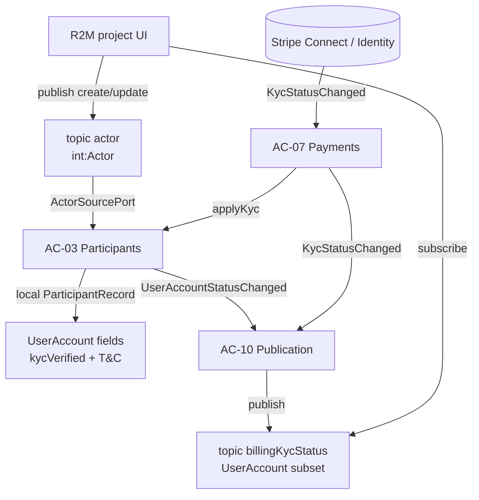
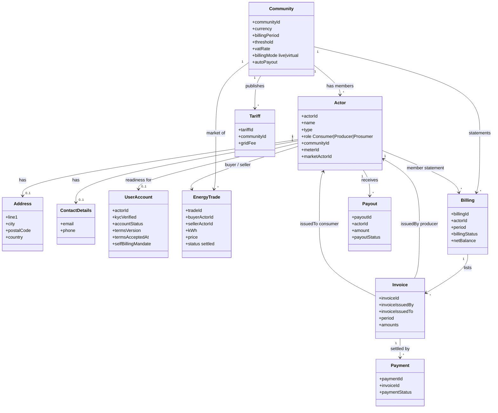
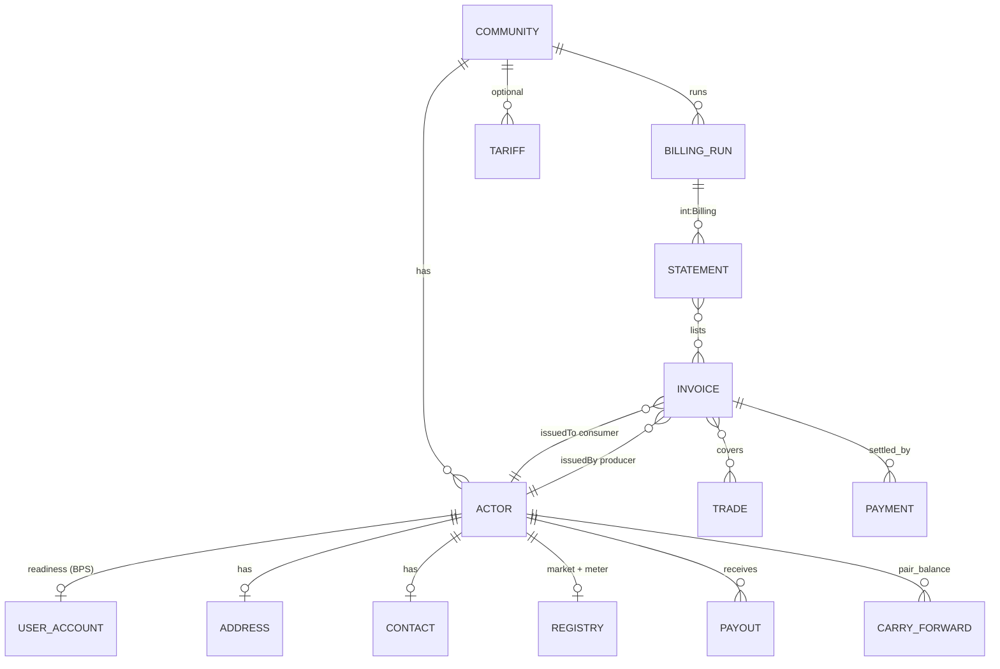

# Ontology datamodel (Actor ↔ UserAccount ↔ billing)

> Supplement to the five architecture views ([README](README.md)).
> Answers: **which ontology classes exist, how they relate, who masters each, and which EWDS topic carries them.**
> Decisions locked: **INT-447** (Actor EWDS-only), **INT-448** (T&C on UserAccount / `billingKycStatus`).

## 1. Two identity layers (do not conflate)

| Layer | Ontology | Master | BPS role | EWDS wire |
|---|---|---|---|---|
| **Administrative energy identity** | `int:Actor` (+ `Address`, `ContactDetails`) | Project UI (**R2M**) / consortium | **Intake only** (`ActorSourcePort`) | Topic `actor` |
| **Billing / payment account readiness** | `int:UserAccount` | **BPS** (mirrors Stripe KYC + stores T&C) | Writes + publishes | Topic `billingKycStatus` |

**Rules of thumb**
- Changing name / address / contacts / meter / role → **republish `actor`** (never `updateProfile` on the project path).
- Accepting T&C / self-billing mandate → **command `acceptTerms`**; status appears on **`billingKycStatus`**.
- KYC / payment method → commands `startKyc` / `setupPaymentMethod`; status appears on **`billingKycStatus`** (`kycVerified`).

## 2. Ontology class map (billing-relevant)

## 3. Logical ER (BPS internal projections)

Identifiers only on the wire; personal fields stay in AC-03 / Stripe.

### Field ownership

| Concept | Stored in BPS | Master outside BPS | Notes |
|---|---|---|---|
| Actor name, address, contacts, role, meter, market id | Cache / registry on ParticipantRecord (`source=ewds`) | R2M via `actor` | `PUT /me/profile` → `409 profile_managed_by_ewds` |
| `termsVersion`, `termsAcceptedAt`, `selfBillingMandate` | ParticipantRecord | BPS (command `acceptTerms`) | Same level as KYC (UserAccount) |
| `kycVerified`, payment-account readiness | ParticipantRecord + payments cache | Stripe (via AC-07) | Published on `billingKycStatus` |
| Invoice PDF, legal number | Invoicing | BPS | Legal number **not** on EWDS |
| Stripe customer / Connect ids | Payments | Stripe | Never published (NFR-004) |
| Trade status | Read-only intake | GSY DEX | BR-11 — billing never mutates |

## 4. EWDS topic ↔ ontology mapping

| Topic | Ontology class / subset | Publisher | Subscriber (project path) |
|---|---|---|---|
| `actor` | `Actor`, `Address`, `ContactDetails` | R2M | BPS AC-03 |
| `tariff` | `Tariff` | Consortium / Blooo (when granted) | BPS AC-13 |
| `billingStatement` | `Billing` | BPS AC-10 | R2M |
| `billingInvoice` | `Invoice` (+ billingMode, amounts) | BPS AC-10 | R2M |
| `billingPayment` | `Payment` | BPS AC-10 | R2M |
| `billingPayout` | `Payout` (extension) | BPS AC-10 | R2M |
| `billingKycStatus` | **`UserAccount` subset** (`kycVerified` + T&C) | BPS AC-10 | R2M |
| `billingCommandRequest` / `Reply` | Actions (not records) | R2M ↔ BPS | — |

Schemas: [`ewds-topics/`](ewds-topics/README.md).

## 5. UserAccount record shape (`billingKycStatus`)

| Field | Meaning |
|---|---|
| `actorId` | Same UUID as Actor / participantId |
| `communityId` | Community scope |
| `kycVerified` | Stripe Identity / Connect verified |
| `accountStatus` | e.g. Active / PendingVerification |
| `verificationKind` | `connect_account` \| Identity |
| `termsVersion` | Accepted T&C version or `null` |
| `termsAcceptedAt` | ISO timestamp or `null` |
| `selfBillingMandate` | Required true for producer/prosumer before invoices in their name (BR-09) |
| `updatedAt` | Last change |

Write path for T&C: command channel `acceptTerms` → AC-03 → `UserAccountStatusChanged` → AC-10 merge-publish.

## 6. Readiness vs ontology

Participant readiness (BPS) is derived, not a separate ontology class:

`Invited → ProfileCompleted → TermsAccepted → Ready` (and `Restricted` / `Offboarded`).

| Gate | Backed by |
|---|---|
| Profile completed | Actor intake (name/address/contacts present) |
| Terms accepted | UserAccount T&C fields |
| Ready | T&C + payment method + `kycVerified` (REQ-045) |

## 7. Validation checklist
- [ ] Actor ≠ UserAccount is explicit for R2M integrators
- [ ] No project-path CSV/profile REST on BPS (INT-447)
- [ ] T&C published with KYC on `billingKycStatus` (INT-448)
- [ ] Diagrams use Mermaid + `%% elk %%` where required
