# Detailed scenario flows

> Supplement to the five architecture views ([README](README.md)).
> Datamodel / ontology: [`06-datamodel-ontology.md`](06-datamodel-ontology.md).
> All project-UI paths are **EWDS-only** (records + command channel). `/v1` is the reference client (`apps/web`) only.

Legend used in sequences:
- **R2M** = project UI Client Gateway
- **CGW** = Blooo billing Client Gateway
- **AC-xx** = BPS modules (see application architecture)

---

## S1 — Onboard participants (Actor create)

R2M is the sole create entry point. CSV in R2M → N `actor` messages.

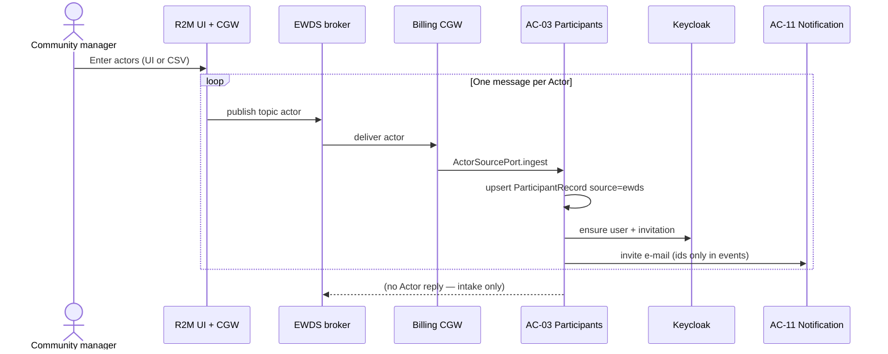

**Trace:** REQ-008, UAT-008, INT-447.

---

## S2 — Update administrative profile (Actor republish)

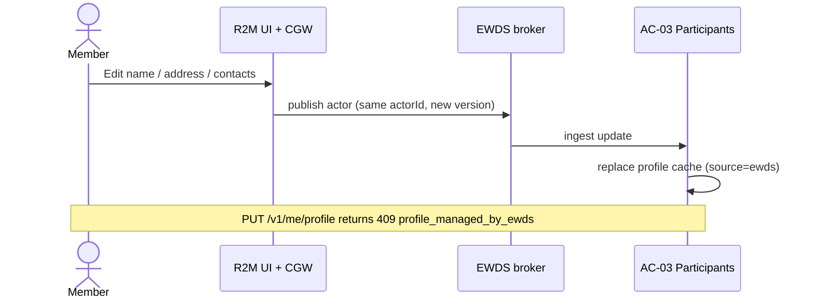

**Trace:** REQ-009, UAT-009, INT-447.

---

## S3 — Accept T&C / self-billing mandate

Write via command channel; read via `billingKycStatus` (UserAccount).

```mermaid
sequenceDiagram
  actor Member as Member
  participant R2M as R2M UI + CGW
  participant EWDS as EWDS broker
  participant AC10 as AC-10 Publication
  participant AC03 as AC-03 Participants
  Member->>R2M: Accept T&amp;C (+ self-billing if producer)
  R2M->>EWDS: billingCommandRequest acceptTerms
  EWDS->>AC10: poll / receive command
  AC10->>AC10: authorize (channel, DID, actor role)
  AC10->>AC03: POST .../terms-acceptance
  AC03->>AC03: store termsVersion, selfBillingMandate, termsAcceptedAt
  AC03->>AC10: UserAccountStatusChanged (outbox)
  AC10->>EWDS: billingCommandReply accepted
  AC10->>EWDS: publish billingKycStatus (T&amp;C + current kycVerified)
  R2M->>EWDS: subscribe billingKycStatus
```

**Trace:** REQ-050, UAT-062, INT-448, BR-09.

---

## S4 — KYC / payment-method setup (PspHandoff)

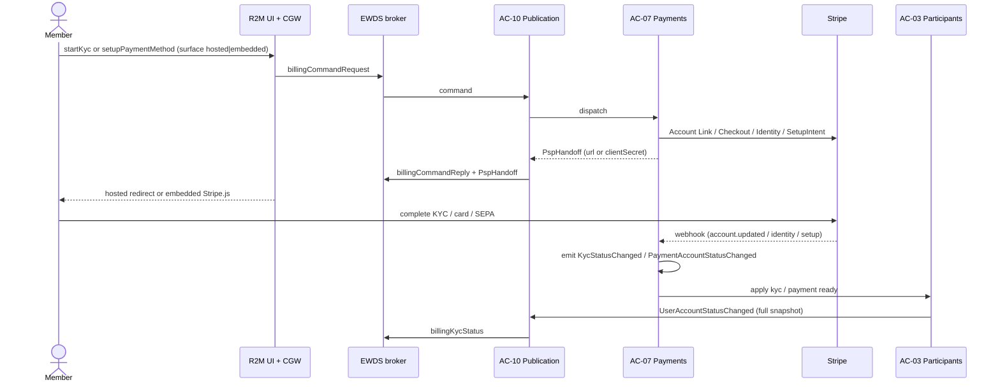

**Trace:** REQ-051, REQ-040, REQ-045, A7-bis.

---

## S5 — Readiness to Ready (gates)

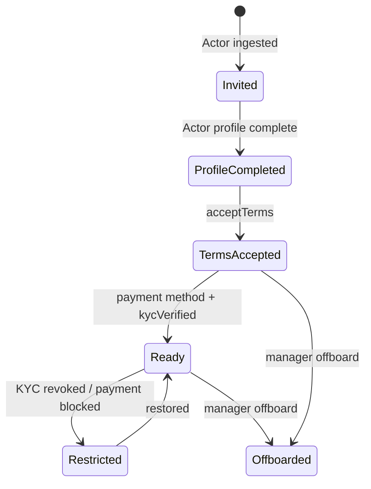

Ready also requires BR-09 gates before invoices / statements / payouts.

---

## S6 — Settled trade intake

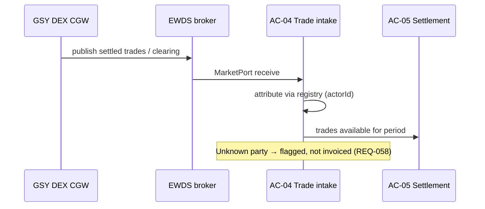

**Trace:** REQ-001, REQ-041, REQ-058, BR-01.

---

## S7 — Periodic billing run (two-level model)

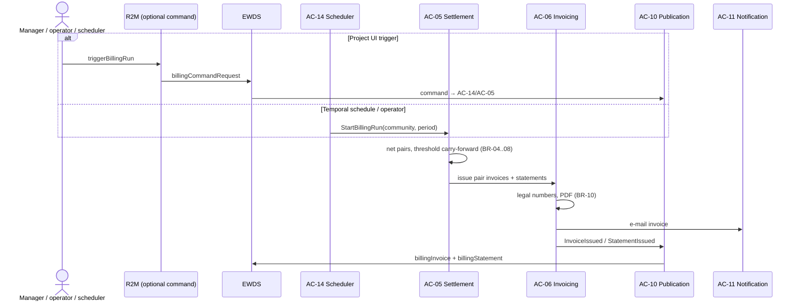

**Trace:** REQ-054, REQ-059, REQ-005, REQ-048.

---

## S8 — Pay an invoice

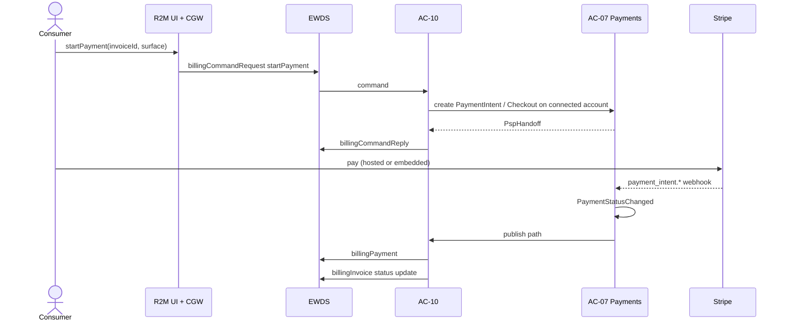

**Trace:** REQ-014, BR-11 (trade status untouched).

---

## S9 — Payment failure & reminder

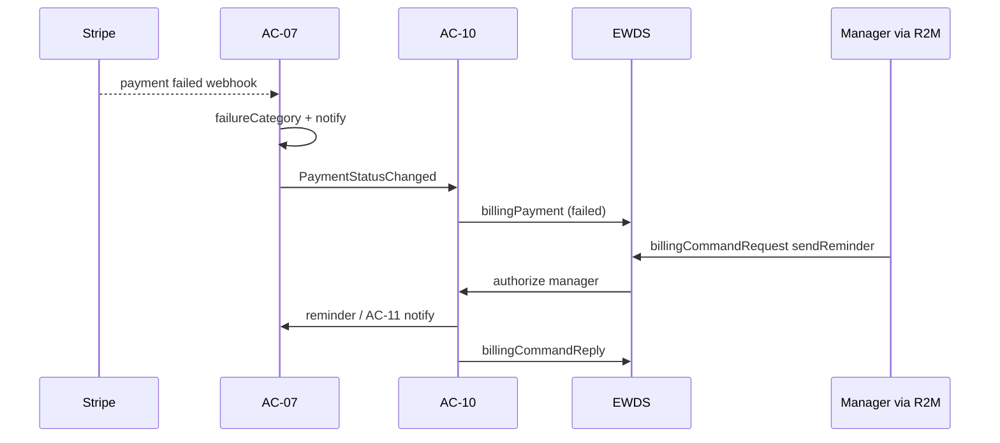

**Trace:** REQ-016, REQ-017, REQ-046, REQ-061.

---

## S10 — Payout / withdrawal

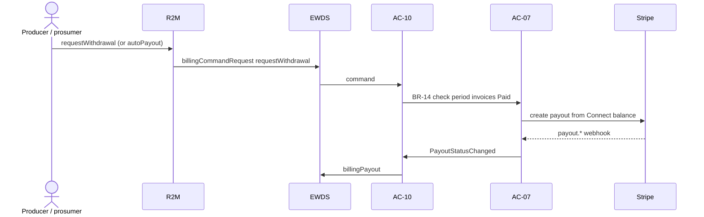

**Trace:** REQ-015, REQ-060, BR-14.

---

## S11 — Manager invoice status change

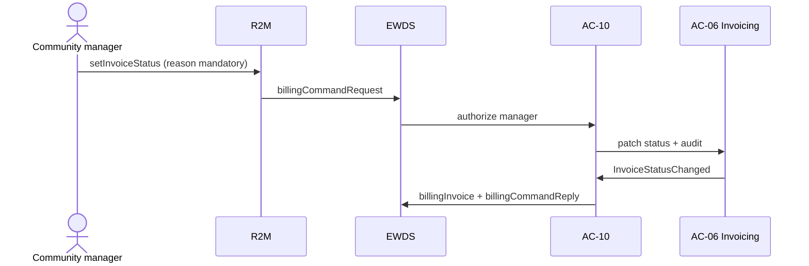

**Trace:** REQ-044, US-041.

---

## S12 — Data-subject erasure

```mermaid
sequenceDiagram
  actor DPO as DPO / manager
  participant Portal as Portal / R2M
  participant AC12 as AC-12 Compliance
  participant AC03 as AC-03
  participant AC07 as AC-07
  participant IdP as Keycloak
  participant Stripe as Stripe
  DPO->>AC12: erasure request (participantId)
  AC12->>AC03: ErasureRequested
  AC03->>AC03: purge personal fields; keep invoices for legal retention
  AC12->>AC07: erase PSP customer where allowed
  AC07->>Stripe: delete / anonymise
  AC12->>IdP: erase user
  AC03-->>AC12: ErasureCompleted
```

**Trace:** REQ-013, NFR-015 (ids only in logs/events).

---

## S13 — Command channel (authorization layers)

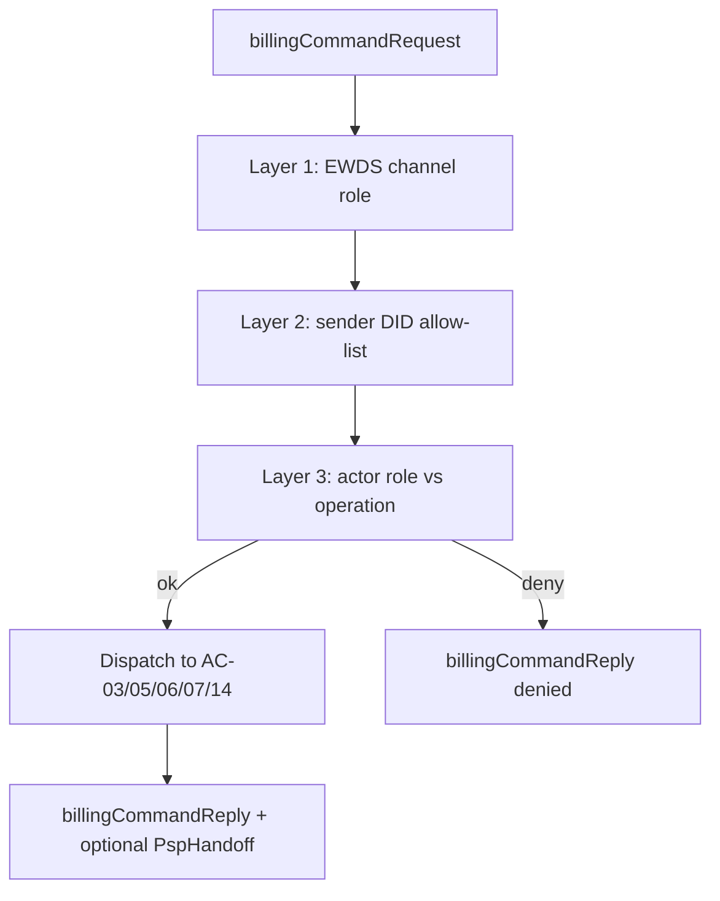

Operations (project path): `startPayment`, `requestWithdrawal`, `setInvoiceStatus`, `startKyc`, `acceptTerms`, `sendReminder`, `triggerBillingRun`, `setupPaymentMethod`.  
**Not** a command: Actor create/update (topic `actor` only).

---

## S14 — Publication purge (≤ 7 days)

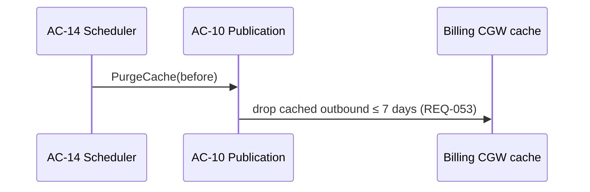

---

## Index by requirement / UAT

| Scenario | Primary REQ / UAT |
|---|---|
| S1 Onboard | REQ-008 / UAT-008 |
| S2 Profile update | REQ-009 / UAT-009 |
| S3 Terms | REQ-050 / UAT-062 |
| S4 KYC / PM | REQ-051 / REQ-040 |
| S5 Readiness | REQ-045 |
| S6 Trades | REQ-001 |
| S7 Billing run | REQ-054 / REQ-059 |
| S8 Pay | REQ-014 |
| S9 Failure | REQ-016 / REQ-061 |
| S10 Payout | REQ-015 |
| S11 Invoice status | REQ-044 |
| S12 Erasure | REQ-013 |
| S13 Commands | REQ-052 |
| S14 Purge | REQ-053 |
