# Detailed scenario flows

> Supplement to the five architecture views ([README](README.md)).
> Datamodel / ontology: [`06-datamodel-ontology.md`](06-datamodel-ontology.md).
> All project-UI paths are **EWDS-only** (records + command channel). `/v1` is the reference client (`apps/web`) only.

## Legend (lifelines)

| Label | Meaning |
|---|---|
| **R2M UI + CGW** | Project UI talking through **its** Client Gateway |
| **EWDS broker** | Energy Web Digital Spine message broker |
| **Billing CGW** | **Blooo BPS** Client Gateway — **always** on the path between EWDS and BPS modules (INT-450) |
| **AC-xx** | NestJS modules inside BPS (behind Billing CGW for all EWDS I/O) |

**Convention:** every EWDS publish/subscribe/command for billing goes `EWDS ↔ Billing CGW ↔ AC-*`. Stripe webhooks and IdP calls do **not** use Billing CGW.

**Ontology on arrows:** each message is annotated with the ontology class(es) or wire subset involved (`int:Actor`, `int:UserAccount`, …). Commands are actions, not record classes — listed as `command` + the UserAccount / Invoice fields they mutate.

| Shorthand | Ontology / wire |
|---|---|
| `int:Actor` | Actor (+ Address, ContactDetails on the same topic) |
| `int:UserAccount` | UserAccount subset on topic `billingKycStatus` (kycVerified + T&C) |
| `int:Billing` | Monthly statement → topic `billingStatement` |
| `int:Invoice` | Pair invoice → topic `billingInvoice` |
| `int:Payment` | → topic `billingPayment` |
| `int:Payout` | Extension → topic `billingPayout` |
| `int:EnergyTrade` | Settled trade intake |
| `int:Tariff` | Tariff catalogue (when published) |
| `int:Community` | Community billing settings (BPS-owned, not an EWDS record in V1) |

---

## S1 — Onboard participants (Actor create)

R2M is the sole create entry point. CSV in R2M → N `actor` messages.

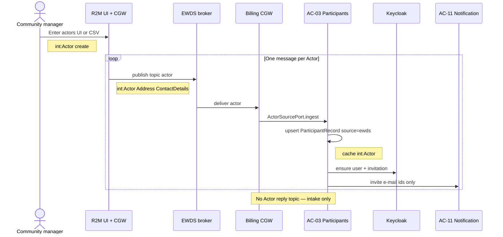

| Step | Ontology objects |
|---|---|
| Manager enters / CSV row | `int:Actor`, `Address`, `ContactDetails` |
| EWDS topic `actor` | same |
| BPS ParticipantRecord | cache of Actor; UserAccount not yet complete |

**Trace:** REQ-008, UAT-008, INT-447.

---

## S2 — Update administrative profile (Actor republish)

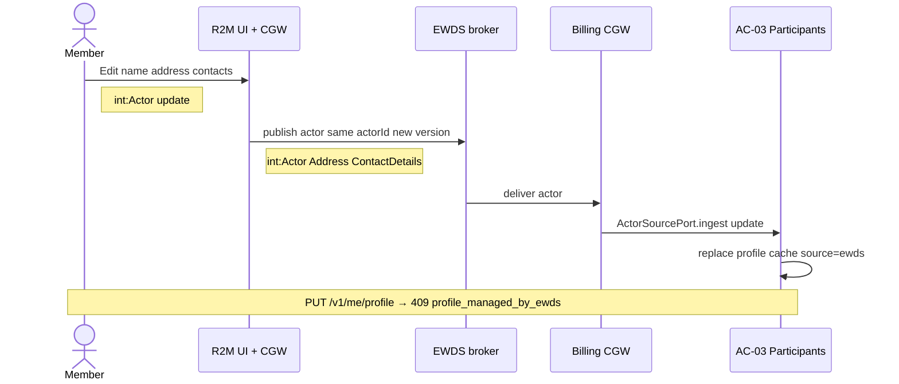

| Step | Ontology objects |
|---|---|
| Edit in R2M | `int:Actor` (+ Address / ContactDetails) |
| EWDS republish | same — **not** UserAccount |
| BPS cache | Actor cache replaced |

**Trace:** REQ-009, UAT-009, INT-447.

---

## S3 — Accept T&C / self-billing mandate

Write via command channel; read via `billingKycStatus` (UserAccount).

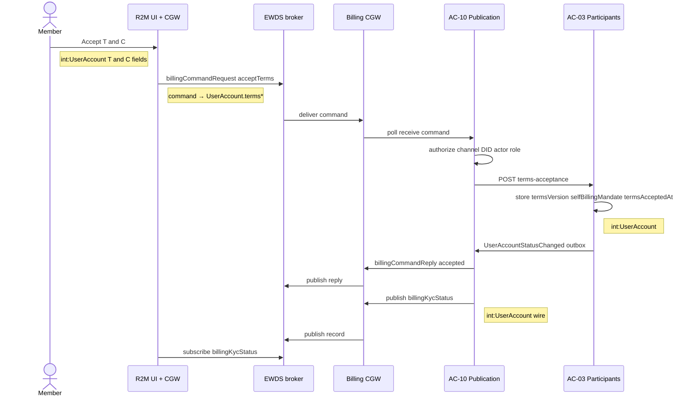

| Step | Ontology objects |
|---|---|
| acceptTerms payload | mutates `int:UserAccount` (`termsVersion`, `termsAcceptedAt`, `selfBillingMandate`) |
| `billingKycStatus` publish | `int:UserAccount` (+ current `kycVerified`) |
| Actor | unchanged |

**Trace:** REQ-050, UAT-062, INT-448, BR-09.

---

## S4 — KYC / payment-method setup (PspHandoff)

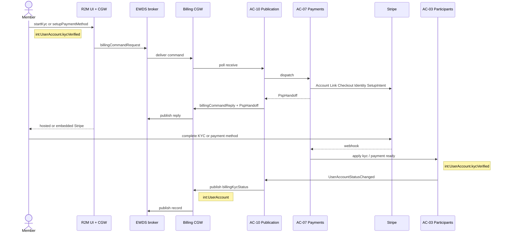

| Step | Ontology objects |
|---|---|
| startKyc / setupPaymentMethod | drives `int:UserAccount.kycVerified` / payment readiness |
| Stripe | PSP evidence (not published as ontology) |
| `billingKycStatus` | `int:UserAccount` |

**Trace:** REQ-051, REQ-040, REQ-045, A7-bis.

---

## S5 — Readiness to Ready (gates)

Derived state on BPS (not a separate ontology class). Gates map to Actor / UserAccount fields.

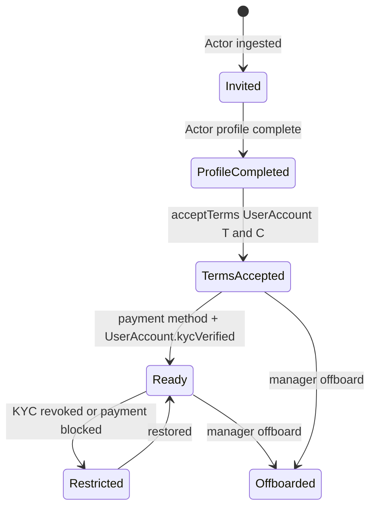

| Gate | Ontology objects |
|---|---|
| Invited / ProfileCompleted | `int:Actor` |
| TermsAccepted | `int:UserAccount` T&C fields |
| Ready | `int:UserAccount.kycVerified` + payment method |

Ready also requires BR-09 before invoices / statements / payouts.

---

## S6 — Settled trade intake

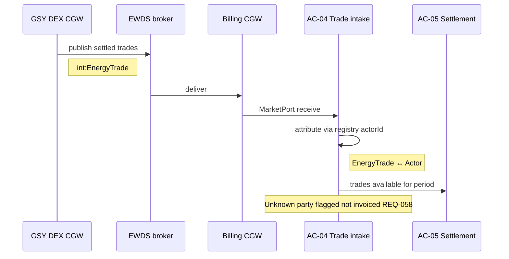

| Step | Ontology objects |
|---|---|
| Market publish | `int:EnergyTrade` (+ Market / ClearingResult) |
| Attribution | links to `int:Actor` via registry |

**Trace:** REQ-001, REQ-041, REQ-058, BR-01.

---

## S7 — Periodic billing run (two-level model)

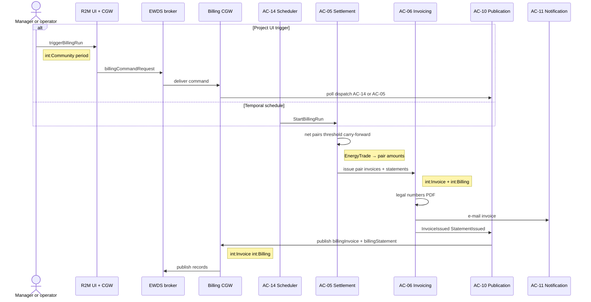

| Step | Ontology objects |
|---|---|
| Run scope | `int:Community`, period |
| Inputs | `int:EnergyTrade` (+ optional `int:Tariff`) |
| Outputs | `int:Invoice` (`billingInvoice`), `int:Billing` (`billingStatement`) |

**Trace:** REQ-054, REQ-059, REQ-005, REQ-048.

---

## S8 — Pay an invoice

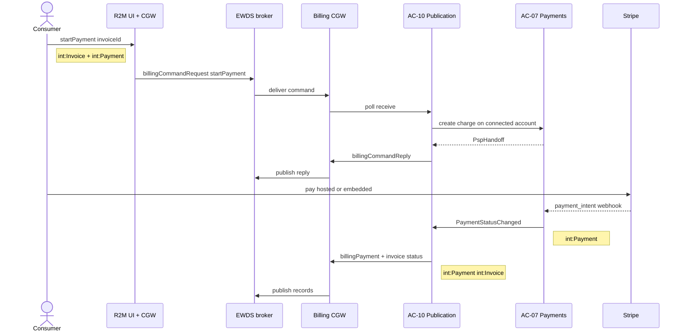

| Step | Ontology objects |
|---|---|
| Command | targets `int:Invoice` |
| Result | `int:Payment`; invoice status on `int:Invoice` |
| Trade | **unchanged** (BR-11) |

**Trace:** REQ-014, BR-11.

---

## S9 — Payment failure & reminder

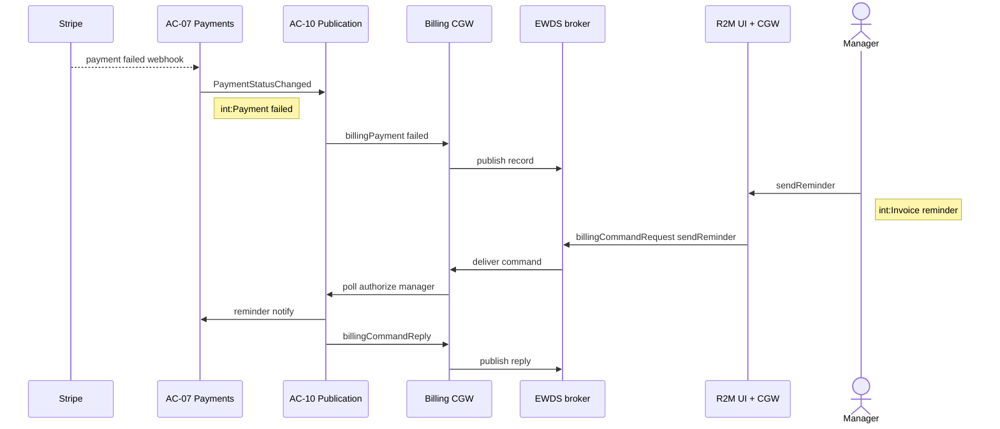

| Step | Ontology objects |
|---|---|
| Failure publish | `int:Payment` |
| Reminder | references `int:Invoice` / `int:Actor` |

**Trace:** REQ-016, REQ-017, REQ-046, REQ-061.

---

## S10 — Payout / withdrawal

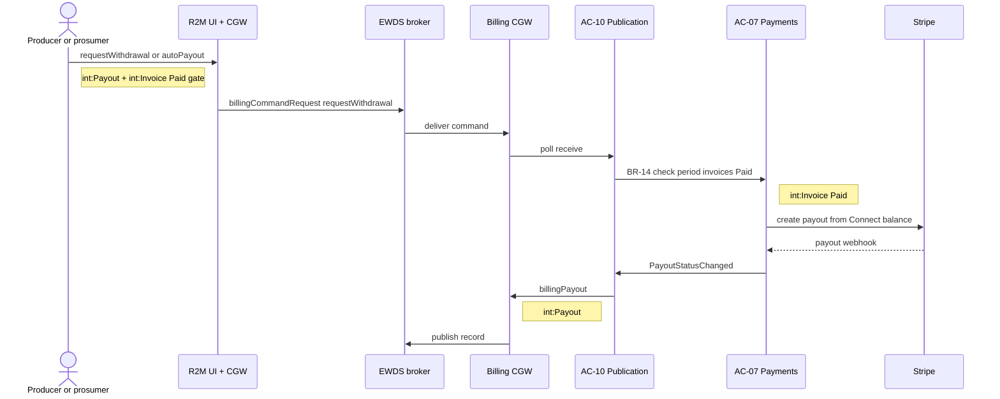

| Step | Ontology objects |
|---|---|
| Gate BR-14 | `int:Invoice` (producer, Paid) |
| Result | `int:Payout` on `billingPayout` |

**Trace:** REQ-015, REQ-060, BR-14.

---

## S11 — Manager invoice status change

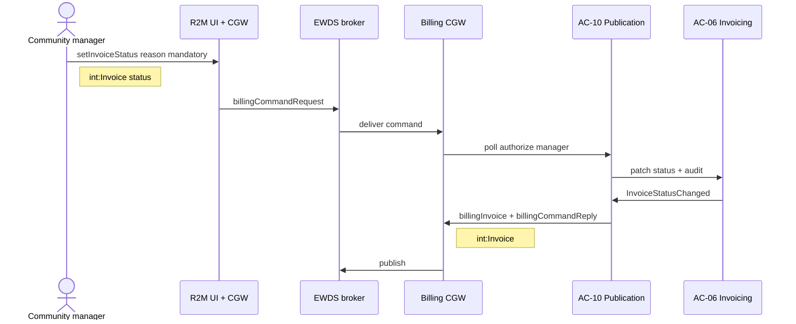

| Step | Ontology objects |
|---|---|
| Command / publish | `int:Invoice` |

**Trace:** REQ-044, US-041.

---

## S12 — Data-subject erasure

Erasure can start from the compliance portal (reference `/v1`) or from an EWDS erasure intake. The EWDS path still goes through **Billing CGW**.

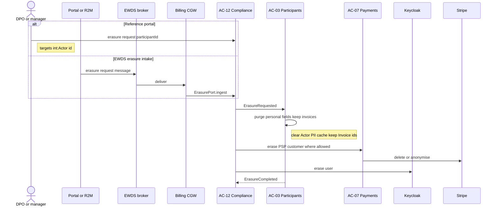

| Step | Ontology objects |
|---|---|
| Target | `int:Actor` / UserAccount personal cache |
| Retained | `int:Invoice` identifiers for legal retention |
| Not erased from history | published billing records already purged by retention (REQ-053) |

**Trace:** REQ-013, NFR-015 (ids only in logs/events).

---

## S13 — Command channel (authorization layers)

Commands arrive on EWDS, are read by **Billing CGW**, then authorized/dispatched in AC-10.

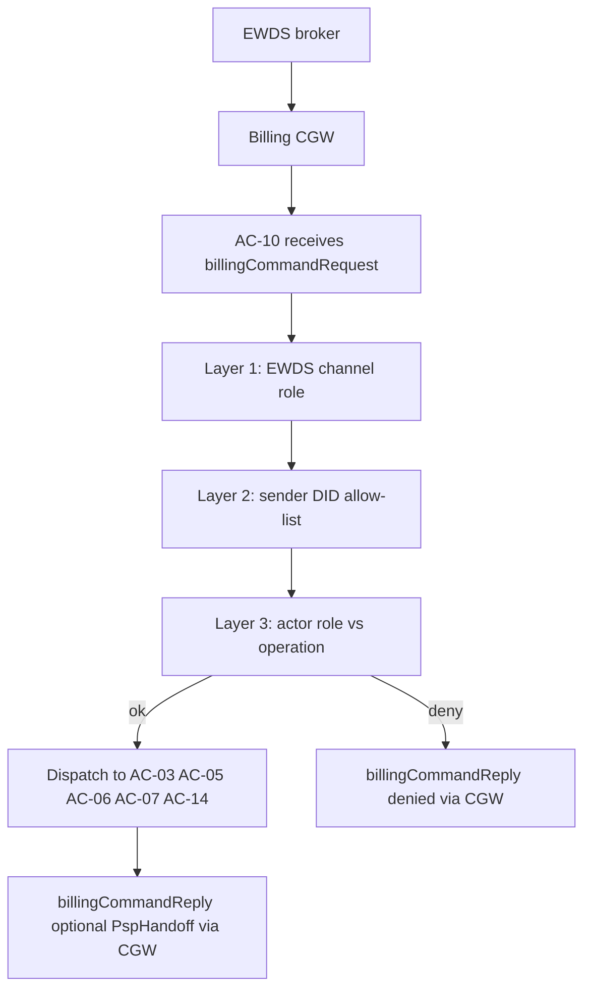

| Operation | Ontology objects touched |
|---|---|
| `acceptTerms` | `int:UserAccount` T&C |
| `startKyc` / `setupPaymentMethod` | `int:UserAccount.kycVerified` |
| `startPayment` | `int:Invoice`, `int:Payment` |
| `requestWithdrawal` | `int:Payout`, gated by `int:Invoice` |
| `setInvoiceStatus` | `int:Invoice` |
| `sendReminder` | references `int:Invoice` / `int:Actor` |
| `triggerBillingRun` | `int:Community` → produces `int:Billing` + `int:Invoice` |
| Actor create/update | **not a command** — topic `actor` / `int:Actor` |

**Trace:** REQ-052.

---

## S14 — Publication purge (≤ 7 days)

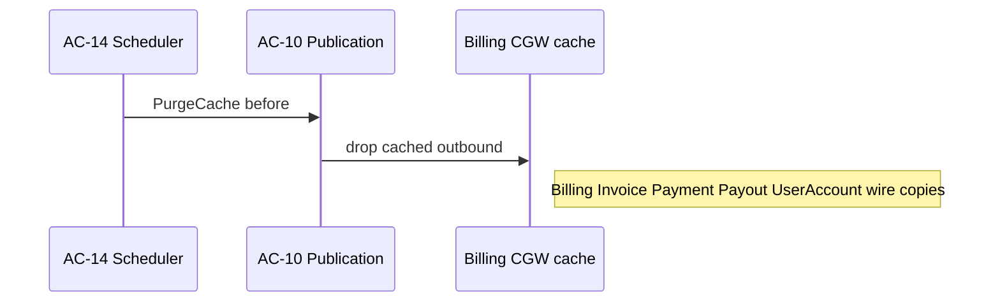

| Step | Ontology objects |
|---|---|
| Cached outbound | wire copies of `int:Billing`, `int:Invoice`, `int:Payment`, `int:Payout`, `int:UserAccount` |

**Trace:** REQ-053.

---

## Index by requirement / UAT

| Scenario | Primary REQ / UAT | Main ontology |
|---|---|---|
| S1 Onboard | REQ-008 / UAT-008 | `int:Actor` |
| S2 Profile update | REQ-009 / UAT-009 | `int:Actor` |
| S3 Terms | REQ-050 / UAT-062 | `int:UserAccount` |
| S4 KYC / PM | REQ-051 / REQ-040 | `int:UserAccount` |
| S5 Readiness | REQ-045 | `int:Actor`, `int:UserAccount` |
| S6 Trades | REQ-001 | `int:EnergyTrade` |
| S7 Billing run | REQ-054 / REQ-059 | `int:Billing`, `int:Invoice` |
| S8 Pay | REQ-014 | `int:Payment`, `int:Invoice` |
| S9 Failure | REQ-016 / REQ-061 | `int:Payment`, `int:Invoice` |
| S10 Payout | REQ-015 | `int:Payout` |
| S11 Invoice status | REQ-044 | `int:Invoice` |
| S12 Erasure | REQ-013 | `int:Actor`, `int:UserAccount`, `int:Invoice` |
| S13 Commands | REQ-052 | `int:Actor`, `int:UserAccount`, `int:Invoice`, `int:Payment`, `int:Payout`, `int:Billing`, `int:Community` |
| S14 Purge | REQ-053 | `int:Billing`, `int:Invoice`, `int:Payment`, `int:Payout`, `int:UserAccount` |
