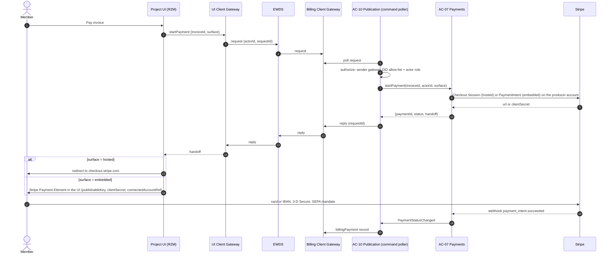

# EWDS / DDHub Client Gateway — Blooo instance (INT-306)

Status: **Deployed (INT-308)**, mTLS enabled with the EWF-signed client certificate (INT-309, see [`docs/release/ddhub-client-gateway.md`](../release/ddhub-client-gateway.md)); API keys and topic/role grants pending EWAG. Sources: Energy Web official docs + D3.1 briefing + NFR-017.

> **Billing adapters** for trades, Actor data, erasure requests, commands and publication are real and selected by environment variables; **mock stays the code default** until the grants land (A8). Deployed environments switch adapters live (A8-live). UAT results on the mock path are labelled `mock` (see [`docs/testing/v6.1-rerun.md`](../testing/v6.1-rerun.md)).

## Official documentation (Energy Web)

Entry point:

- [DDHub Client Gateway](https://docs.energyweb.org/energy-solutions/digital-spine-by-energy-web/component-guides/ddhub-client-gateway)

Key pages for our work:

| Topic | URL |
|---|---|
| Preparing to set up | [preparing-to-set-up-a-client-gateway](https://docs.energyweb.org/energy-solutions/digital-spine-by-energy-web/component-guides/ddhub-client-gateway/deployment-guide/preparing-to-set-up-a-client-gateway) |
| Prerequisites (Postgres, vault, Helm) | [understand-and-prepare-the-prerequisites](https://docs.energyweb.org/energy-solutions/digital-spine-by-energy-web/component-guides/ddhub-client-gateway/deployment-guide/self-hosted/understand-and-prepare-the-prerequisites) |
| Deploy with Kubernetes | [deploy-with-kubernetes](https://docs.energyweb.org/energy-solutions/digital-spine-by-energy-web/component-guides/ddhub-client-gateway/deployment-guide/self-hosted/deploy-with-kubernetes) / [deploy-the-client-gateway](https://docs.energyweb.org/energy-solutions/digital-spine-by-energy-web/component-guides/ddhub-client-gateway/deployment-guide/self-hosted/deploy-with-kubernetes/deploy-the-client-gateway) |
| Integration (REST / WebSocket, `x-api-key`) | [integration-options](https://docs.energyweb.org/energy-solutions/digital-spine-by-energy-web/component-guides/ddhub-client-gateway/technical-guide/integration-options) |
| Configure mTLS (post-deploy) | [configure-mtls](https://docs.energyweb.org/energy-solutions/digital-spine-by-energy-web/component-guides/ddhub-client-gateway/deployment-guide/post-deployment/configure-mtls) |
| Auth / key vault | [authentication-and-authorization](https://docs.energyweb.org/energy-solutions/digital-spine-by-energy-web/component-guides/ddhub-client-gateway/technical-guide/authentication-and-authorization) |

Helm (EWC defaults, chart `1.3.0-ewc`):

- OCI: `oci://ewfcontainerregistry.azurecr.io/helm/ddhub-client-gateway-api`
- Chart source: [energywebfoundation/ddhub-client-gateway-helm @ v.1.3.0-ewc](https://github.com/energywebfoundation/ddhub-client-gateway-helm/tree/v.1.3.0-ewc)
- Helm repo hint: `https://ewfcontainerregistry.azurecr.io/helm/v1/repo`

## Constraints (docs + D3.1 briefing)

| Constraint | Implication |
|---|---|
| Not for public / end-user access; secured enterprise env only | Deploy in EU private network; no public Ingress for the API without control |
| One Gateway per participant | Our own CG; Message Broker via mTLS (`dsb_base_url` → `https://ddhub-ewc.energyweb.org`) |
| UI **or** system API integration (docs: typically not both) | Prefer **API-only** for Billing; keep UI admin-only / off public DNS |
| Auth strategies **disabled by default** | Enable API auth at deploy; REST uses header `x-api-key` |
| Components: UI (React), API (NestJS), Scheduler (NestJS), Storage (PostgreSQL), Key Vault | Dedicated Postgres + vault (HashiCorp Vault / Azure KV / AWS SM — OpenBao as Vault-compatible) |
| Scheduler caches/fetches/cleans messages | Billing still persists payloads as system of record (REQ-053 / A26 ≤ 7 days) |
| WebSocket uses subprotocol `ddhub-protocol` | Optional; Blooo default proposal remains **REST short polling** for workers |

## Blooo-side checklist (INT-429)

| Gate | Status |
|---|---|
| CG packaged & deployed (INT-308) | yes |
| mTLS (EWF-signed client cert, INT-309) | yes |
| API key minted (`USER_AUTH_ENABLED`) | **pending** (INT-309) |
| `topiccreator` / channel roles | **pending** EWAG |
| GSY subscriber roles | **pending** EWAG (A12) |
| Configured / Verified (EWAG) | **pending** |

Open assumptions: **A12** (GSY topic schemas / roles), **A26** (≤ 7 day cache — REQ-053). Mock remains the code default (A32 / A8) until those land; deployed envs still set adapters to `ewds` and alert when blocked.

## What we need from EWAG (docs-aligned)

Per [preparing-to-set-up](https://docs.energyweb.org/energy-solutions/digital-spine-by-energy-web/component-guides/ddhub-client-gateway/deployment-guide/preparing-to-set-up-a-client-gateway) and [configure-mtls](https://docs.energyweb.org/energy-solutions/digital-spine-by-energy-web/component-guides/ddhub-client-gateway/deployment-guide/post-deployment/configure-mtls):

1. **CSR → EWF-signed mTLS certificate** (done for INT-309; renewals still with EWAG).
2. **Outbound IP whitelist** for our cluster egress toward the Message Broker.
3. **EWT faucet** (or transfer) so we can fund the EWC wallet with ≥ 1 EWT and record the Gateway DID.
4. **Enterprise user-role enrolment** (Message Broker user, `topiccreator`; GSY subscriber roles when A12 closes).

Blooo owns the rest without asking EWAG: REST short polling, API-only + `x-api-key` in OpenBao, topic schema registration from [`ewds-topics/`](ewds-topics/), retention ≤ 7 days (REQ-053).

## Deployment phases

### Phase 0 — Unblock EWAG (INT-307)

Operator sends the unblock mail outside Git (copy not stored in the repo). Ask EWAG only for: CSR signing, outbound IP whitelist, EWT faucet (≥ 1 EWT), Message Broker user-role enrolment.

### Phase 1 — Infra (GitOps only, INT-157) — **packaged (INT-308)**

| Piece | Path |
|---|---|
| Namespace | `ddhub` (Argo `CreateNamespace`) |
| CNPG | `deploy/charts/cnpg-ddhub` → Argo `platform-cnpg-ddhub` |
| Secret + NetworkPolicy | `deploy/charts/ddhub-gateway-secret` → `platform-ddhub-gateway-secret` |
| Gateway values | `deploy/platform/ddhub-client-gateway/values.yaml` |
| Gateway chart / Argo | `deploy/charts/ddhub-client-gateway` → `platform-ddhub-client-gateway` (Blooo manifests; EW images) |
| Operator notes | [`docs/release/ddhub-client-gateway.md`](../release/ddhub-client-gateway.md) |

Pinned Phase 1 values (API auth later — INT-309):

- `clientgateway.config.mtls_enabled: true` (INT-309)
- `USER_AUTH_ENABLED: "false"` until API keys are minted
- `clientgateway.ui.enabled: false`, `ingress.enabled: false`
- `clientgateway.config.dsb_base_url: https://ddhub-ewc.energyweb.org`
- `clientgateway.config.websocket: NONE`
- `secret_engine_endpoint` → OpenBao `platform-openbao.openbao.svc.cluster.local:8200`
- Scheduler fetch / cleanup crons enabled; align cleanup with REQ-053 when EWAG confirms

**TP-2:** upstream GPL-3.0 accepted as separate unmodified service (TD-1), same rule as OpenBao / SonarQube.

### Phase 2 — Enrolment

1. Fund EWC wallet (≥ 1 EWT); record Gateway DID.
2. CSR → EWF-signed mTLS certificate; configure via post-deploy mTLS guide.
3. VCs: Message Broker user; `topiccreator`; GSY subscriber roles when A12 closes.
4. Enable API auth; store `x-api-key` only in OpenBao (`ddhub/api-key`).

### Phase 3 — Topics and Billing persistence

1. Register `billingInvoice` / `billingPayment` / statement / payout / KYC / command topics (and GSY channels when published).
2. Durable inbound message store in Billing (CG cache is not the system of record).
3. Purge after successful ingest; hard max **7 days** (REQ-053).

### Phase 4 — Adapter cut-over

1. Real P-DS (AC-10) and P-MKT (AC-04) adapters selected by configuration; **mock remains the code default**.
2. First slice: REST short-polling consumer + publish path for invoice/payment.
3. Operator alerts: broker disconnect, mTLS expiry, silence threshold (REQ-029).
4. Re-execute UATs listed in [`docs/testing/v6.1-rerun.md`](../testing/v6.1-rerun.md) against live CG (`*_ADAPTER=ewds`) before changing `v1_mode`.

## Proposed Blooo decisions (pending EWAG)

| Topic | Proposal |
|---|---|
| Transport | REST short polling; `websocket: NONE` initially |
| Mode | System/API integration (not human UI messaging) |
| Auth | API key required; UI not on the public internet |
| Retention | Purge after ingest; hard max 7 days |
| Hosting | Helm chart `1.3.0-ewc` on Scaleway `nl-ams`; OpenBao; GitOps only |

## Command channel — hosted or embedded (D4 / A7-bis)

Project-UI actions never hit billing `/v1`. **No end-user JWT travels on the wire (INT-463):** the member's OIDC session stays on R2M; the command carries `actorId` and is signed by the R2M Client Gateway DID. Commands travel EWDS request/reply; replies carry a Stripe handoff (`url` for hosted, or `clientSecret` + `publishableKey` for embedded). Card/IBAN/identity stay in the user's browser ↔ Stripe.

## Traceability

| Spec | Role |
|---|---|
| NFR-017 | Own CG in EU, API key, vault, EWF mTLS |
| REQ-001 | Ingest trades via CG (GSY channels) |
| REQ-048 | Publish invoice/payment via CG |
| REQ-053 | Purge ≤ 7 days |
| REQ-029 | Alerts on silence / disconnect / cert expiry |
| A12 / A26 / A32 | Schema dependency / retention / V1 mock |

## Related packaging (in Git — INT-308)

- `deploy/charts/cnpg-ddhub/`, `deploy/charts/ddhub-gateway-secret/`, `deploy/charts/ddhub-client-gateway/`
- `deploy/platform/ddhub-client-gateway/values.yaml`
- `deploy/argocd/platform/cnpg-ddhub.yaml`, `ddhub-gateway-secret.yaml`, `ddhub-client-gateway.yaml`

Do not commit secret values. Operator kubeconfig stays outside the repository.
