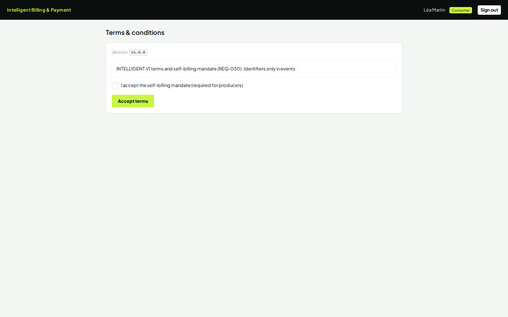
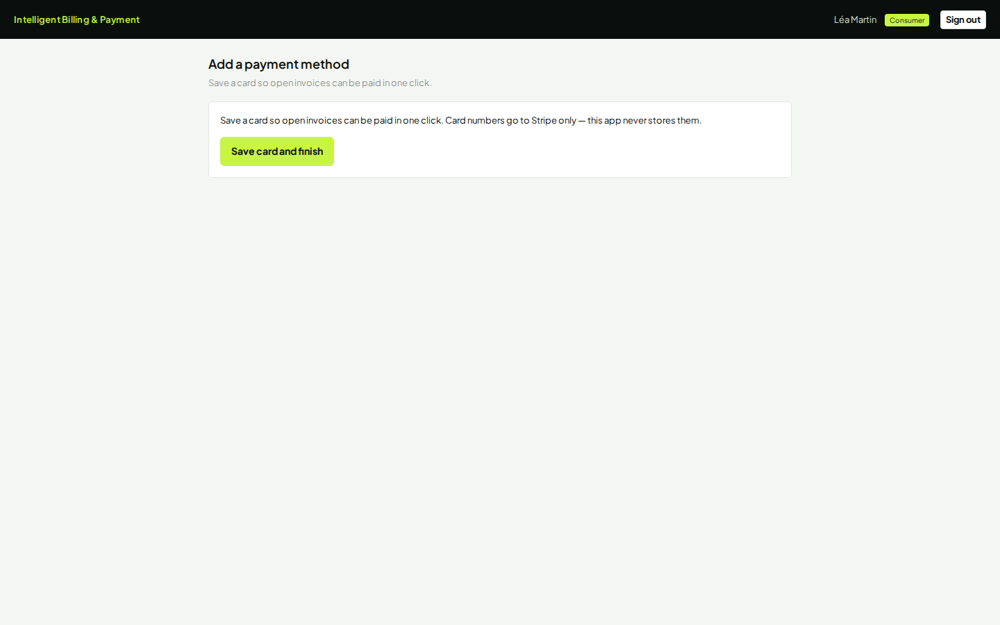
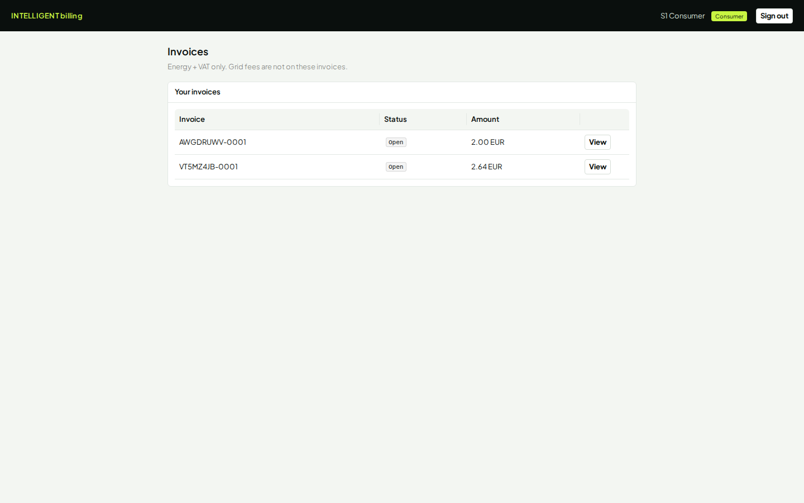
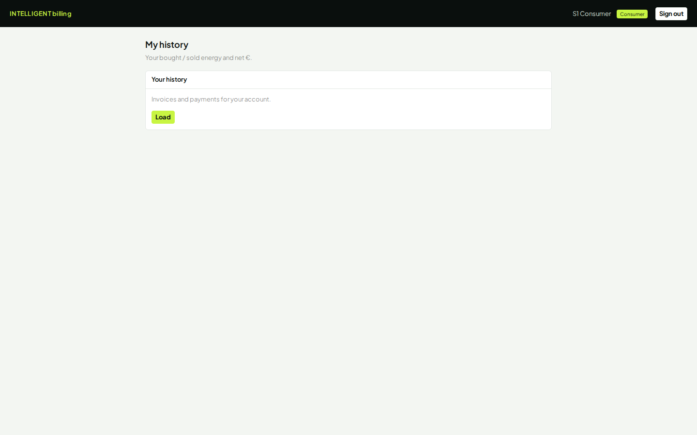

# Cahier de tests — Intelligent Billing & Payment

**Produit :** Intelligent Billing & Payment  
**Environnement :** https://app.dev.intelligent-eu-bp.blooo.dev  
**IdP :** Keycloak realm `int`  
**Mot de passe (tous les comptes) :** `Intelligent-UAT-2026!`  
**Communauté démo :** **Horizon Energy**  
**Public :** testeurs / support démo  
**Tickets :** INT-282 / INT-283 / INT-284  

> Ouvrir ce fichier sur GitHub (`develop`) ou dans l’IDE en mode aperçu Markdown pour voir **toutes les captures** ci-dessous.

---

## Personas (accès)

| Persona | Rôle | Login | E-mail |
|---|---|---|---|
| **Léa Martin** | Consommatrice | `lea.martin` | `lea.martin@example.invalid` |
| **Thomas Bernard** | Producteur A | `thomas.bernard` | `thomas.bernard@example.invalid` |
| **Claire Dubois** | Productrice B | `claire.dubois` | `claire.dubois@example.invalid` |
| **Marie Leroy** | Gestionnaire | `marie.leroy` | `marie.leroy@example.invalid` |
| **Paul Nguyen** | Opérateur | `paul.nguyen` | `paul.nguyen@example.invalid` |

Comptes UAT (onboarding from Invited) : `hugo.petit` / `sofia.garcia` — même mot de passe.

**Convention :** une fenêtre privée (ou **Sign out**) par persona.

---

## 1. Connexion (commun)

| # | Action | Attendu | Pass |
|---|---|---|---|
| 1.1 | Ouvrir l’URL | Marque **Intelligent Billing & Payment** | [ ] |
| 1.2 | **Continue with community IdP** | Formulaire Keycloak | [ ] |
| 1.3 | Login persona + mdp | App authentifiée, **Sign out** visible | [ ] |

### Écran — Login marque

---

## 2. Léa Martin — Consommatrice

**Parcours :** login → home / onboarding → profil → CGU → carte → soldes → factures → privacy → historique.

| Champ carte Stripe (test) | Valeur |
|---|---|
| Numéro | `4242 4242 4242 4242` |
| Expiration | `12/34` |
| CVC | `123` |
| CP | `75002` |

### 2.1 Login Keycloak

### 2.2 Home

- [ ] Nom **Léa Martin**, badge Consumer (ou Member)  
- [ ] Communauté **Horizon Energy** (si affichée)  

### 2.3 Onboarding

### 2.4 Profil

| Champ | Valeur |
|---|---|
| Nom | `Léa Martin` |
| Adresse | `12 rue de la Paix, 75002 Paris` |
| E-mail | `lea.martin@example.invalid` |

### 2.5 CGU / Terms

- [ ] Acceptation CGU OK  

### 2.6 Moyen de paiement

- [ ] Carte test enregistrée / statut prêt  

### 2.7 Soldes

### 2.8 Factures (PDF / Pay)

- [ ] Factures Open après run Marie  
- [ ] **Open PDF** sans frais réseau (A20)  
- [ ] **Pay** → Paid  

### 2.9 Privacy

### 2.10 My history

**Checklist Léa**

- [ ] Login `lea.martin`  
- [ ] Onboarding / profil / CGU / carte  
- [ ] Factures + PDF + Pay  
- [ ] Privacy  

---

## 3. Thomas Bernard — Producteur A (KYC)

**Parcours :** login → home → payout / KYC Connect → factures émises → historique.

### Données KYC Stripe Connect (test)

| Champ | Valeur |
|---|---|
| Business type | `Individual` |
| Business profile URL | `https://accessible.stripe.com` |
| MCC | `5734` |
| First name | `Thomas` |
| Last name | `Bernard` |
| Email | `thomas.bernard@example.invalid` |
| Phone | `+33600000001` |
| DOB | `1` / `1` / `1902` |
| Address | `address_full_match` |
| City / CP / Country | `Paris` / `75002` / `FR` |
| Identity file id | `file_identity_document_success` |
| IBAN | `FR1420041010050500013M02606` |
| Agreement | **coché** |

### 3.1 Login

### 3.2 Home

- [ ] **Thomas Bernard**, badge Producer, **Horizon Energy**  

### 3.3 Payout / KYC

- [ ] KYC soumis sans erreur ; compte prêt ou pending puis ready  

### 3.4 Factures émises

### 3.5 My history

---

## 4. Claire Dubois — Productrice B (KYC)

Même KYC que Thomas avec :

| Champ | Valeur |
|---|---|
| Login | `claire.dubois` |
| First / Last | `Claire` / `Dubois` |
| Email | `claire.dubois@example.invalid` |
| Phone | `+33600000002` |

### 4.1 Login

### 4.2 Home

### 4.3 Payout / KYC

- [ ] KYC Claire OK  
- [ ] Sign out  

---

## 5. Marie Leroy — Gestionnaire

**Parcours :** login → home → settings → members → billing run → payments → reports.

| Action billing run | Valeur |
|---|---|
| Type | **Early** |
| Period | vide |

### 5.1 Login

### 5.2 Home (console manager)

- [ ] **Marie Leroy**, badge Manager, **Horizon Energy**  

### 5.3 Community settings

- [ ] Paramètres communauté visibles / sauvegardables  

### 5.4 Members

- [ ] Léa, Thomas, Claire, Marie listés **par nom** (pas d’UUID en colonne principale)  

### 5.5 Billing runs

- [ ] Early **Start run** → status **completed**  

### 5.6 Payments overview

### 5.7 Community reports

**Checklist Marie**

- [ ] Settings / Members / Early run / Payments  

---

## 6. Paul Nguyen — Opérateur

**Parcours :** login → home → operator tools → reports.

### 6.1 Login

### 6.2 Home

- [ ] **Paul Nguyen**, badge Operator  
- [ ] Pas de menus manager membres  

### 6.3 Operator desk

- [ ] Jobs / anomalies / reconciliation visibles  
- [ ] Léa **ne voit pas** Operator tools  

### 6.4 Reports

---

## 7. Ordre démo recommandé (15–25 min)

1. **Thomas** + **Claire** — KYC payout (§3–4)  
2. **Marie** — Early billing run (§5.5)  
3. **Léa** — carte si besoin → Invoices → PDF → Pay (§2)  
4. **Marie** — Payments overview (§5.6)  
5. **Paul** — Operator (§6)  
6. **Léa** — Privacy (§2.9)  

---

## 8. Données métier S1 (référence)

| Élément | Valeur |
|---|---|
| Community | Horizon Energy (`c0ffee00-1234-4abc-8def-0123456789ab`) |
| Consumer participantId | `11111111-2222-4333-8444-555555555555` |
| Producer A | `66666666-7777-4888-9999-aaaaaaaaaaaa` |
| Producer B | `bbbbbbbb-cccc-4ddd-8eee-ffffffffffff` |
| Manager | `dddddddd-eeee-4fff-8000-111111111111` |
| Trade A / B | `0x8f3a…` (~€2,00) / `0x1a2b…` (~€2,64) |

---

## 9. Pass / Fail global

| Zone | Pass si… |
|---|---|
| Marque | Intelligent Billing & Payment |
| Identités | Logins `prénom.nom`, noms cohérents |
| Producteurs | KYC Thomas + Claire OK |
| Manager | Early run completed, Members par nom |
| Consommatrice | Factures, PDF, Pay, sans frais réseau |
| Opérateur | Operator tools pour Paul seulement |

---

## 10. Fichiers liés

| Fichier | Rôle |
|---|---|
| [`docs/testing/README.md`](./README.md) | Index testing |
| [`assets/demo-workbook/`](./assets/demo-workbook/) | PNG sources |
| [`manual-s1-portal-journey.md`](./manual-s1-portal-journey.md) | Parcours argent S1 (texte) |
| `scripts/capture-demo-workbook.mjs` | Recapture des écrans |
