# Cahier de tests — Intelligent Billing & Payment

**Produit :** Intelligent Billing & Payment  
**Environnement :** https://app.dev.intelligent-eu-bp.blooo.dev  
**IdP :** Keycloak realm `int` (thème Volt INT-332)  
**Mot de passe (tous) :** `Intelligent-UAT-2026!`  
**Communauté démo :** **Horizon Energy**  
**Tickets :** INT-282 … INT-285 · refresh captures INT-333 · appels API INT-398 · captures API INT-399  


> Ouvrir en aperçu Markdown (GitHub / IDE) pour voir les captures.  
> Version imprimable : [`cahier-de-tests-demo-intelligent-billing-and-payment.pdf`](./cahier-de-tests-demo-intelligent-billing-and-payment.pdf).

---

## Comment lire ce cahier

Trois parcours **sur la même communauté** Horizon Energy :

| Parcours | Persona | État seed | Objectif démo |
|---|---|---|---|
| **A — Onboarding complet** | Hugo Moreau | `Invited` (seed) | Profil → CGU → carte (wizard from scratch) |
| **B — Argent** | Léa / Thomas / Claire / Marie | Léa `TermsAccepted` ; producteurs Ready | KYC, run, factures, Pay |
| **C — Invite live** | Marie → nouvel invité | — | CSV Invite (REQ-008) → Mailpit → 1ʳᵉ connexion |

### Subtilité UI — barre latérale (INT-254)

Un **membre** (pas manager/operator) **sans statut Ready** n’a **pas de sider** : seulement le header + le contenu (« setup chrome »).  
Dès que le payment setup est Ready, le menu gauche apparaît.

Ce n’est **pas** un bug si Léa ou Hugo voient Invoices / Balances sans menu.

### Empty states vs bugs

- Message du type « No unbilled balances yet » / « No payments yet » = **état vide attendu**.  
- Un **spinner** seul = capture trop tôt ou API lente — **pas** l’écran final.

### Deux exécutions par scénario (INT-398)

Chaque scénario se joue de deux façons, avec les mêmes données.

1. **Formulaire** — les écrans déjà décrits. Les captures ne changent pas.
2. **API** — le lien **API** est dans l’en-tête de chaque écran connecté (captures ci-dessous). Il ouvre https://app.dev.intelligent-eu-bp.blooo.dev/api. Coller le JSON, ou envoyer la requête sur `https://api.dev.intelligent-eu-bp.blooo.dev` avec le jeton de cette session.

Il n’y a pas d’opération de login. La connexion Keycloak (§1) fournit le jeton. Un **403** veut dire que ce persona n’a pas le droit d’appeler cette opération. Les numéros de carte et le jeton Stripe `ct_…` / `pm_…` ne sont pas des champs du contrat : la carte reste dans le composant Stripe, l’API reçoit l’identifiant que Stripe renvoie.

| Identifiant | Valeur |
|---|---|
| Communauté Horizon Energy | `c0ffee00-1234-4abc-8def-0123456789ab` |
| Hugo Moreau | `e1000000-0000-4000-8000-000000000001` |
| Léa Martin | `11111111-2222-4333-8444-555555555555` |
| Thomas Bernard | `66666666-7777-4888-9999-aaaaaaaaaaaa` |
| Claire Dubois | `bbbbbbbb-cccc-4ddd-8eee-ffffffffffff` |
| Marie Leroy | `dddddddd-eeee-4fff-8000-111111111111` |

Tous les chemins ci-dessous commencent par `/v1`.

---

## Personas Horizon Energy

| Persona | Login | Rôle | État attendu au login |
|---|---|---|---|
| **Hugo Moreau** | `hugo.moreau` | Consommateur Invited | Wizard étape 1 — profil à saisir |
| **Léa Martin** | `lea.martin` | Consommatrice | Profil + CGU déjà OK ; payment à finir |
| **Thomas Bernard** | `thomas.bernard` | Producteur A | Ready (KYC fait) + sider |
| **Claire Dubois** | `claire.dubois` | Productrice B | Ready + sider |
| **Marie Leroy** | `marie.leroy` | Gestionnaire | Console manager + sider |
| **Paul Nguyen** | `paul.nguyen` | Opérateur | Operator desk (communauté UAT IdP ; outils plateforme) |

UAT (e2e uniquement, autre communauté) : `hugo.petit` / `sofia.garcia` — **ne pas utiliser pour la démo Horizon Energy**.

---

## 1. Connexion

| # | Action | Attendu | Pass |
|---|---|---|---|
| 1.1 | Ouvrir l’URL | **Intelligent Billing & Payment** (écran AC-01) | [ ] |
| 1.2 | Continue with community IdP | Keycloak Volt : titre **INTELLIGENT Billing & Payment Login** au-dessus du form centré, CTA lime | [ ] |
| 1.3 | Login + mdp | **Sign out** visible | [ ] |

La connexion reste sur le formulaire Keycloak. Ensuite, `GET /v1/me` confirme le persona (200, `communityId` Horizon Energy).

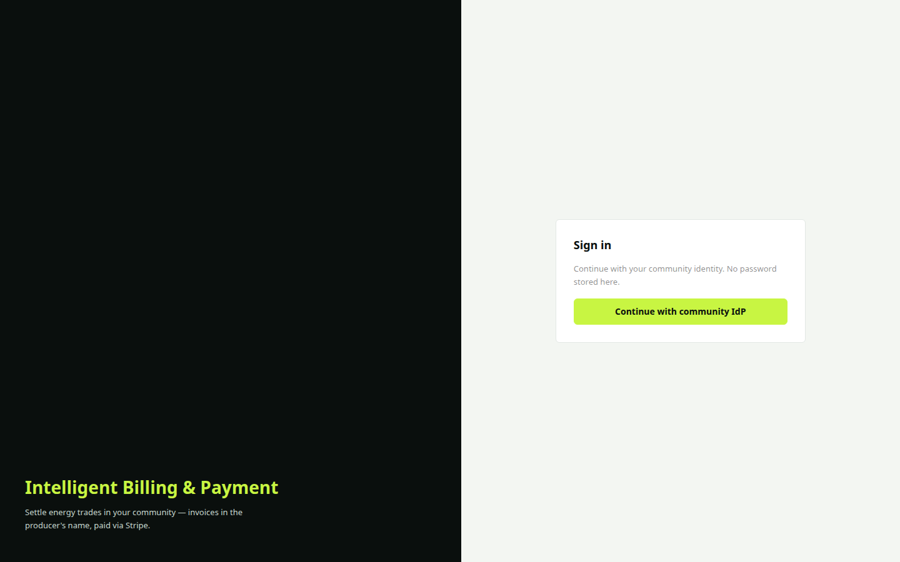

> IdP (après Continue) : fond ink, titre lime centré au-dessus de la carte blanche — **pas** l’ancien thème PatternFly bleu / marque à droite.

---

## 2. Parcours A — Hugo Moreau (onboarding from scratch)

**Pourquoi Hugo et pas Léa :** le seed S1 pré-accepte profil/CGU pour Léa afin d’enchaîner factures/Stripe. Hugo est un **2ᵉ consommateur Invited** sur Horizon Energy (INT-285), sans toucher Léa.

### Données à saisir

| Étape | Champ | Valeur |
|---|---|---|
| Profil | Nom | `Hugo Moreau` |
| Profil | Adresse | `8 avenue Victor Hugo, 75016 Paris` |
| Profil | E-mail | `hugo.moreau@example.invalid` |
| CGU | Acceptation | cocher version affichée |
| Carte | Numéro | `4242 4242 4242 4242` |
| Carte | Exp / CVC / CP | `12/34` / `123` / `75016` |

### 2.1 Login


### 2.2 Home — Get ready (rien de pré-coché)

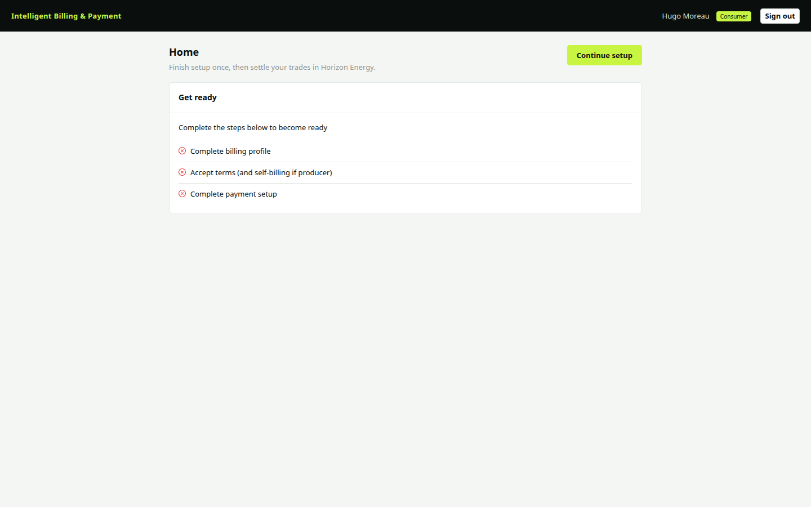

- [ ] Checklist : profil / terms / payment **pas** déjà verts  
- [ ] **Pas de sider** (setup chrome)  
- [ ] Communauté Horizon Energy (si affichée) ou parcours Get ready  

### 2.3 Onboarding wizard

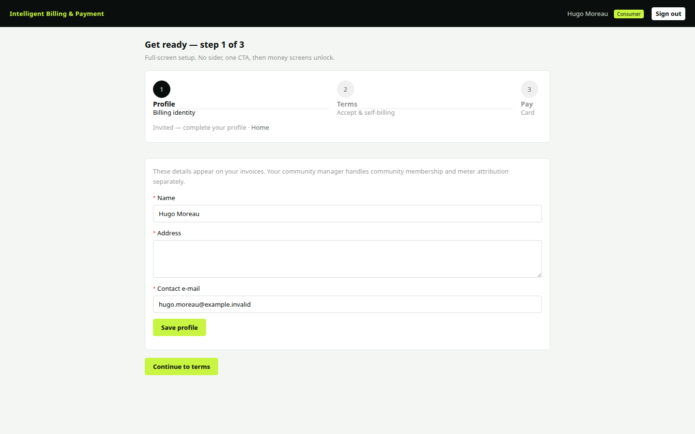

- [ ] Étape 1 Profile active, formulaire à remplir  

### 2.4 Profil

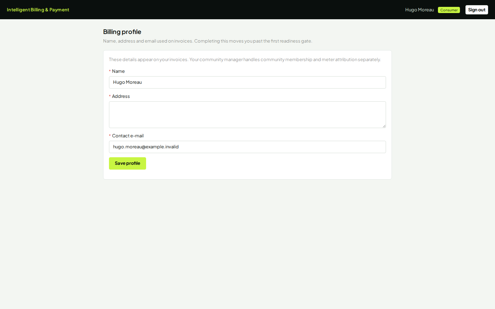

- [ ] Save profile → étape Terms  

### 2.5 Terms

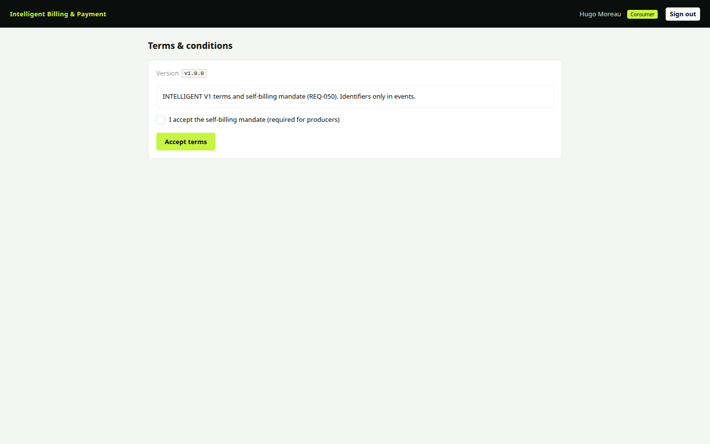

- [ ] Accept → étape Pay  

### 2.6 Payment setup

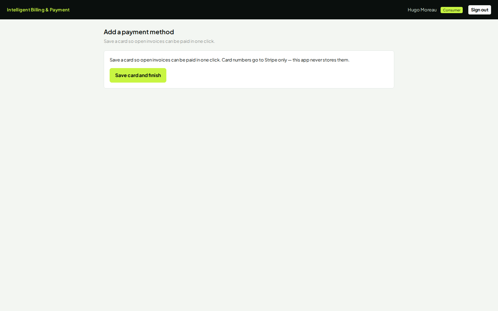

- [ ] Carte enregistrée → Ready → **sider apparaît**  

**Checklist Hugo**

- [ ] Parcours Invited → Ready sans étapes déjà cochées  
- [ ] Sign out  

### Appel API — Hugo (`hugo.moreau`)

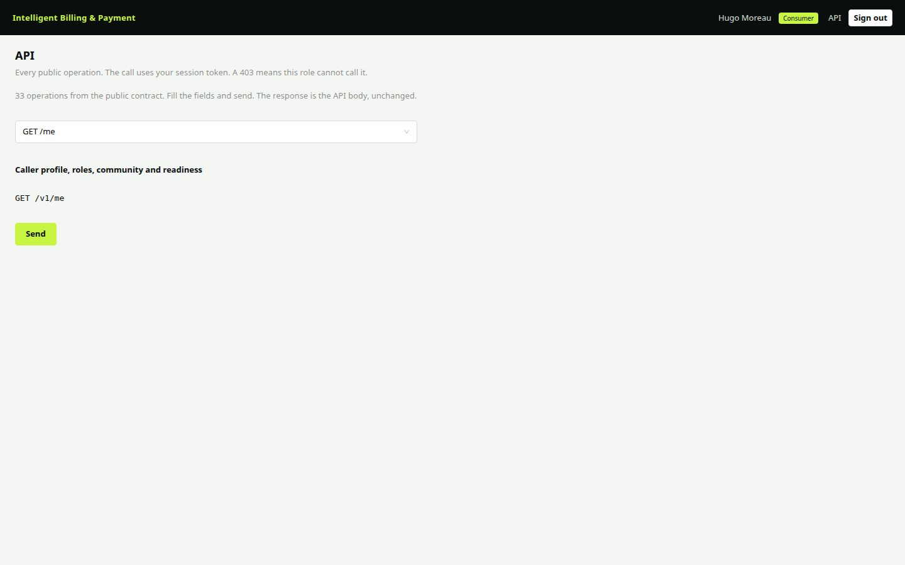

Le lien **API** est dans l’en-tête, y compris sans sider. Les captures formulaire §2.2–2.6 restent celles du seed Invited (Hugo a déjà le profil et les CGU sur le cluster).

Même ordre que le wizard. `GET /v1/terms/current` renvoie la version à accepter (`termsVersion` = `v1.0.0`).

`PUT /v1/me/profile` — 200

```json
{
  "name": "Hugo Moreau",
  "address": "8 avenue Victor Hugo, 75016 Paris",
  "email": "hugo.moreau@example.invalid"
}
```

`POST /v1/me/terms-acceptance` — 201

```json
{
  "termsVersion": "v1.0.0",
  "selfBillingMandate": false
}
```

`POST /v1/me/payment-account/onboarding` — pas de corps, 200, `mode` = `elements` et un `clientSecret`. La carte `4242 4242 4242 4242`, exp `12/34`, CVC `123`, CP `75016` se saisit dans Stripe. Stripe renvoie un `pm_…`.

`POST /v1/me/payment-account/payment-method` — 200

```json
{
  "paymentMethodId": "pm_…"
}
```

`GET /v1/me` — 200, `readiness` = `Ready`.

---

## 3. Parcours B — Léa Martin (argent / payment restant)

**État seed :** profil + CGU **déjà OK** ; seul « Complete payment setup » reste.  
Ne pas refaire le profil/CGU — ce n’est pas le parcours onboarding.

### 3.1 Login

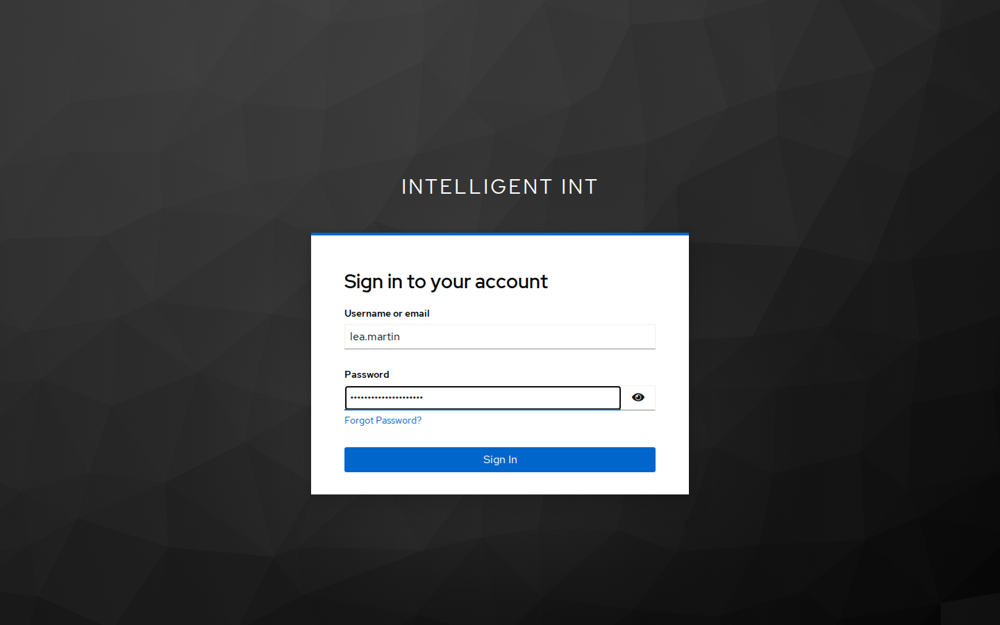

### 3.2 Home — deux checks verts, payment rouge

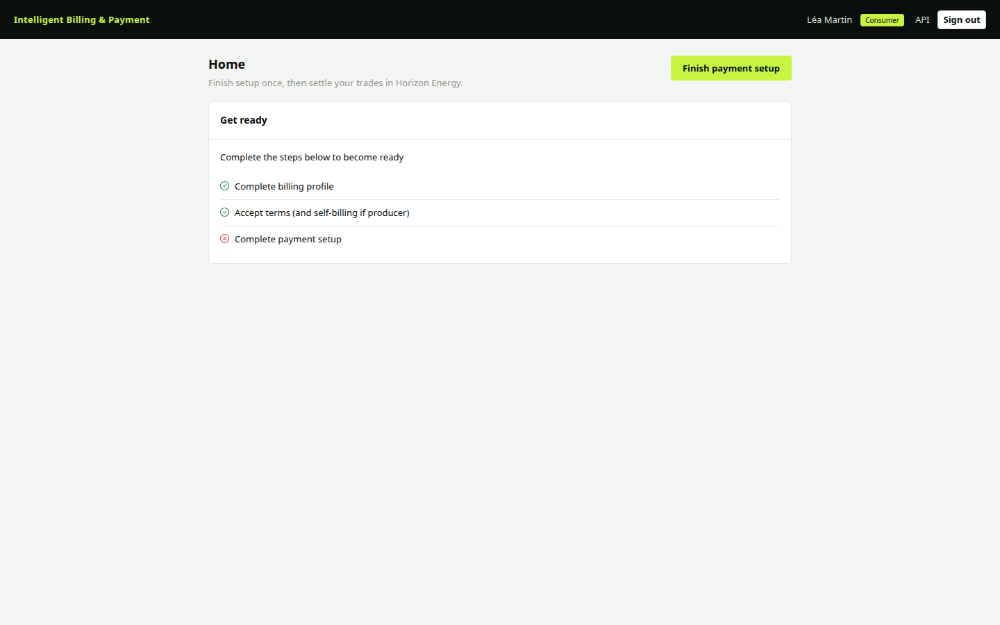

- [ ] **Léa Martin** / Consumer  
- [ ] Pas de sider tant que non Ready  
- [ ] CTA Finish payment setup  

### 3.3 Onboarding (raccourci payment)

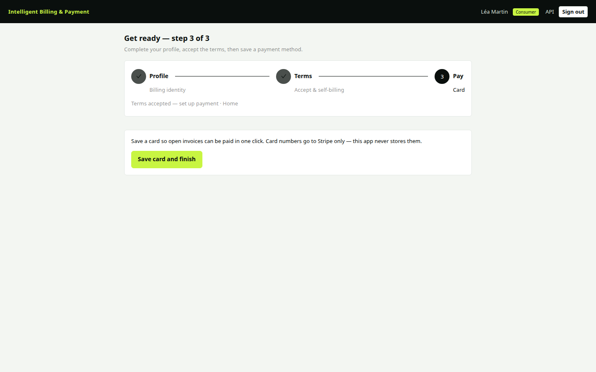

### 3.4 Payment setup

| Champ | Valeur |
|---|---|
| Carte | `4242 4242 4242 4242` |
| Exp / CVC | `12/34` / `123` |

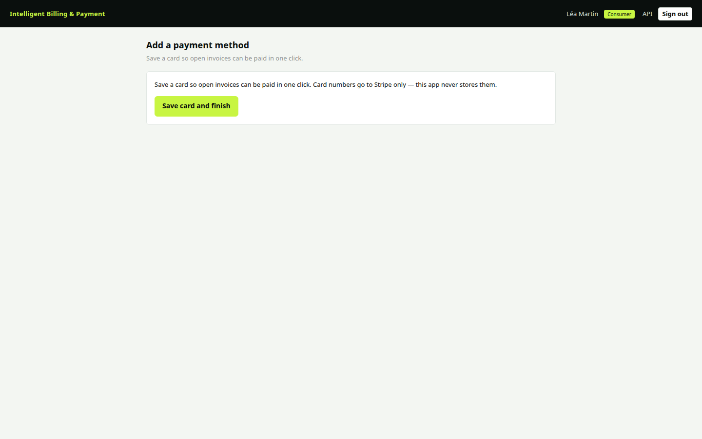

- [ ] Payment method ready  

### 3.5 Balances (empty state possible)

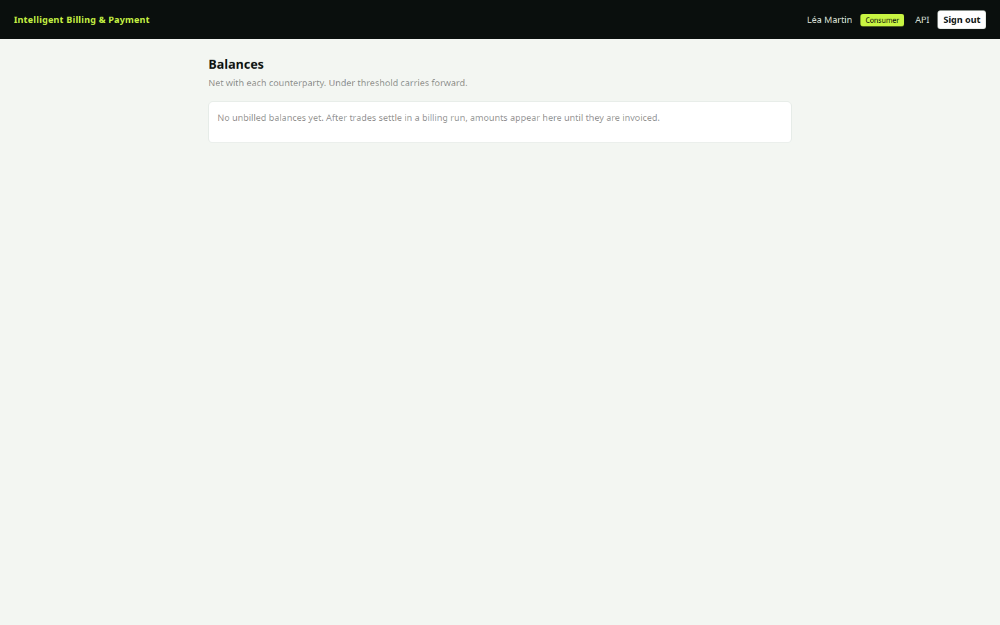

> Si « No unbilled balances yet » après un run qui a tout facturé → **normal**.

### 3.6 Factures / PDF / Pay

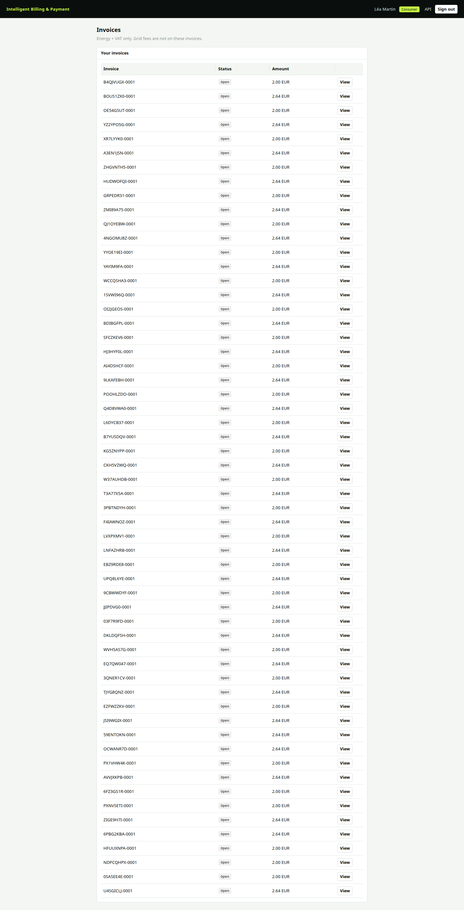

- [ ] Factures Open (après run Marie) ≈ 2,00 € et 2,64 €  
- [ ] Sans sider si encore non Ready ; avec sider une fois Ready  
- [ ] Open PDF — **pas de frais réseau** (A20)  
- [ ] Pay → Paid  

### 3.7 Privacy

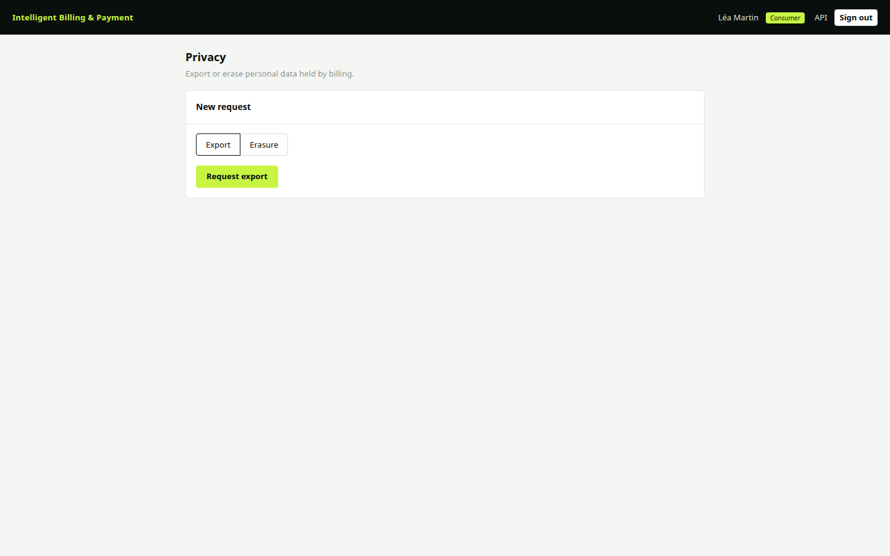

### 3.8 My history

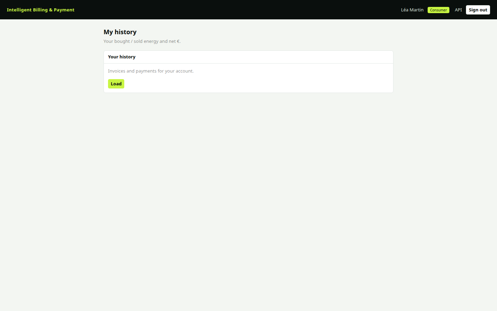

**Checklist Léa**

- [ ] Payment setup (seul step manquant au seed)  
- [ ] Factures + PDF + Pay  
- [ ] Privacy  

### Appel API — Léa (`lea.martin`)

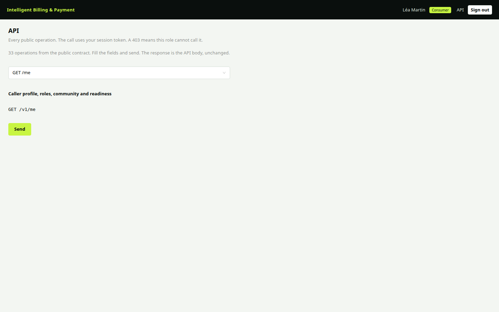

`GET /v1/me` — 200. Le seed a déjà le profil et les CGU : `readiness` = `TermsAccepted`, `participantId` = `11111111-2222-4333-8444-555555555555`. Ne pas renvoyer le profil ni les CGU.

`POST /v1/me/payment-account/onboarding` — pas de corps, 200. Puis, avec le `pm_…` de la carte test :

`POST /v1/me/payment-account/payment-method` — 200

```json
{
  "paymentMethodId": "pm_…"
}
```

`GET /v1/me/balances` — 200. Un tableau vide est l’état « No unbilled balances yet » après un run qui a tout facturé.

`GET /v1/me/invoices` — 200. Tableau. Après le run de Marie, deux factures Open, totaux `2.00` et `2.64` :

```json
[
  {
    "invoiceId": "copier cet id",
    "producerId": "66666666-7777-4888-9999-aaaaaaaaaaaa",
    "consumerId": "11111111-2222-4333-8444-555555555555",
    "currency": "EUR",
    "status": "Open",
    "amounts": { "energy": "2.00", "vat": "0.00", "total": "2.00" }
  },
  {
    "invoiceId": "copier cet id",
    "producerId": "bbbbbbbb-cccc-4ddd-8eee-ffffffffffff",
    "consumerId": "11111111-2222-4333-8444-555555555555",
    "currency": "EUR",
    "status": "Open",
    "amounts": { "energy": "2.64", "vat": "0.00", "total": "2.64" }
  }
]
```

Pour chaque `invoiceId` copié :

- `GET /v1/invoices/{invoiceId}` — 200, même objet, sans ligne de frais de réseau (A20).
- `GET /v1/invoices/{invoiceId}/document` — 200, `application/pdf`.
- `POST /v1/invoices/{invoiceId}/payments` — pas de corps, 201, puis `status` = `Paid` au `GET` suivant.

`POST /v1/data-subject-requests` — 201 (écran Privacy, export)

```json
{
  "type": "export"
}
```

La réponse contient `requestId`. `GET /v1/data-subject-requests/{requestId}` — 200.

`GET /v1/participants/11111111-2222-4333-8444-555555555555/history` — 200 (écran My history).

---

## 4. Thomas Bernard — Producteur A (KYC)

Ready → **sider visible**.

### KYC Stripe test

| Champ | Valeur |
|---|---|
| Business type | Individual |
| URL | `https://accessible.stripe.com` |
| MCC | `5734` |
| First / Last | `Thomas` / `Bernard` |
| Email | `thomas.bernard@example.invalid` |
| Phone | `+33600000001` |
| DOB | `1` / `1` / `1902` |
| Address / City / CP | `address_full_match` / `Paris` / `75002` |
| Identity file | `file_identity_document_success` |
| IBAN | `FR1420041010050500013M02606` |
| Agreement | coché |


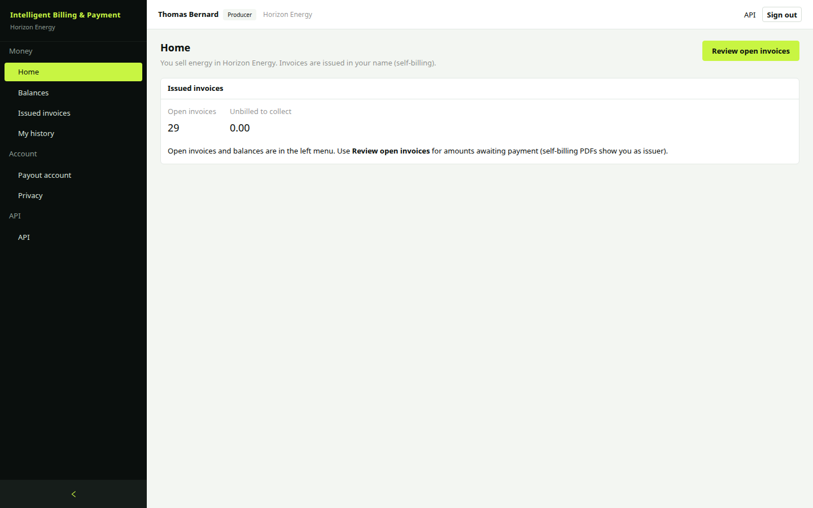

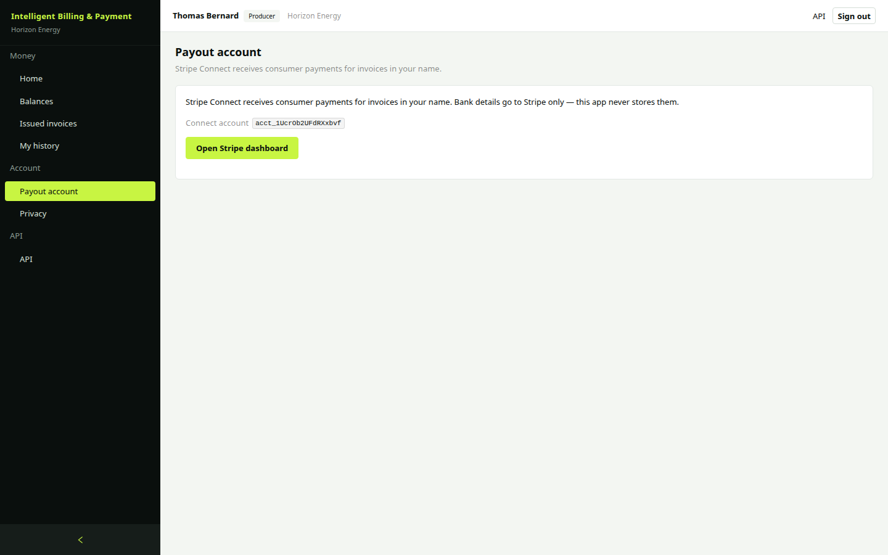

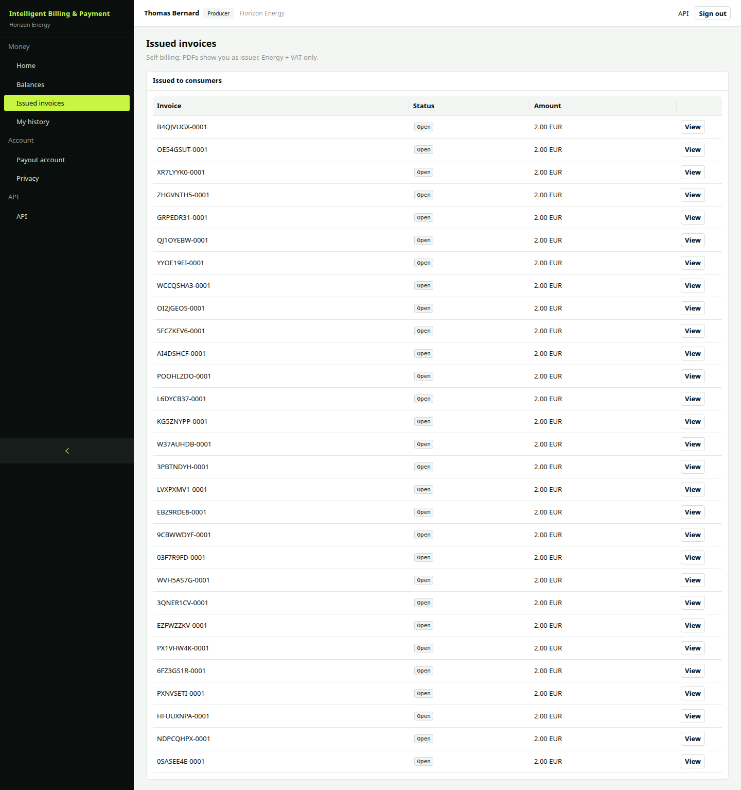

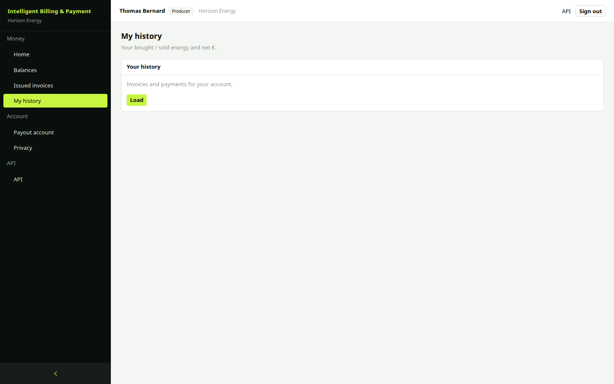

- [ ] KYC OK ; sider présent ; factures vendeur  

### Appel API — Thomas (`thomas.bernard`)

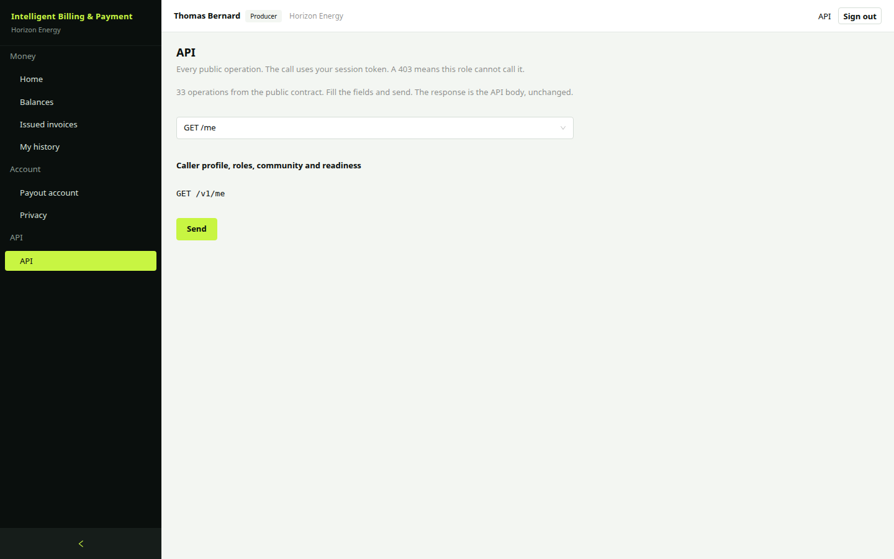

`GET /v1/me` — 200, `participantId` = `66666666-7777-4888-9999-aaaaaaaaaaaa`.

Le formulaire historique est le composant Stripe (INT-362). L’appel qui l’ouvre :

`POST /v1/me/payment-account/onboarding` — pas de corps, 200, `mode` = `embedded`.

L’équivalent direct du formulaire KYC, avec les valeurs du tableau :

`POST /v1/me/payment-account/onboarding/requirements` — 200. Remplacer `accountToken` par le `ct_…` que Stripe.js renvoie pour Thomas. Les autres champs sont ceux du tableau.

```json
{
  "accountToken": "ct_…",
  "country": "FR",
  "businessType": "individual",
  "businessProfileUrl": "https://accessible.stripe.com",
  "businessProfileMcc": "5734",
  "representative": {
    "firstName": "Thomas",
    "lastName": "Bernard",
    "email": "thomas.bernard@example.invalid",
    "phone": "+33600000001",
    "dob": { "day": 1, "month": 1, "year": 1902 },
    "address": {
      "line1": "address_full_match",
      "city": "Paris",
      "postalCode": "75002",
      "country": "FR"
    }
  },
  "identityDocumentFront": "file_identity_document_success",
  "identityDocumentAdditionalFront": "file_identity_document_success",
  "externalAccount": {
    "country": "FR",
    "currency": "eur",
    "accountNumber": "FR1420041010050500013M02606"
  },
  "tosAccepted": true
}
```

`GET /v1/me/payment-account` — 200, `status` = `complete`.

`GET /v1/me/invoices` — 200, factures dont `producerId` est Thomas.

`GET /v1/participants/66666666-7777-4888-9999-aaaaaaaaaaaa/history` — 200.

---

## 5. Claire Dubois — Productrice B

Même KYC avec Claire / Dubois / `claire.dubois@example.invalid` / `+33600000002`.


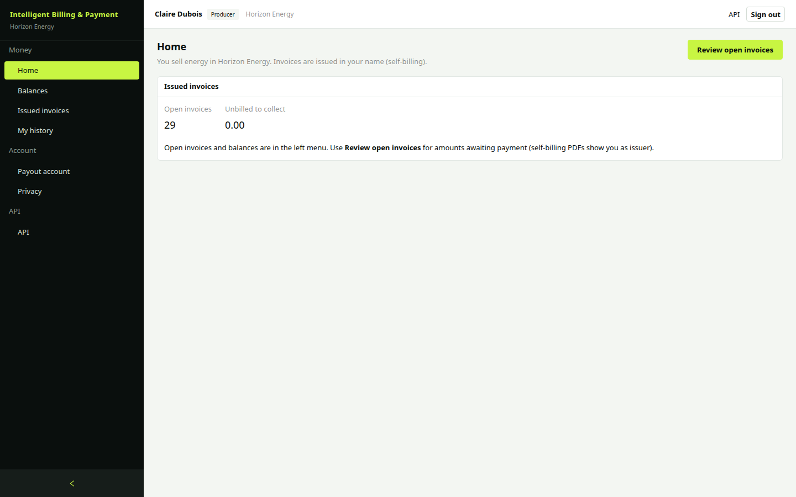

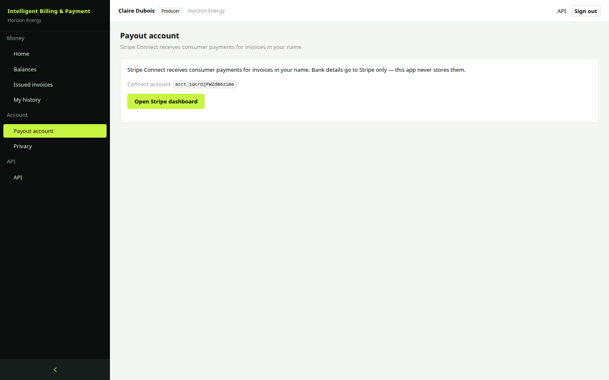

- [ ] KYC Claire OK  

### Appel API — Claire (`claire.dubois`)


Même séquence que Thomas. `participantId` = `bbbbbbbb-cccc-4ddd-8eee-ffffffffffff`.

`POST /v1/me/payment-account/onboarding` — pas de corps, 200.

`POST /v1/me/payment-account/onboarding/requirements` — 200. `accountToken` = le `ct_…` de Claire.

```json
{
  "accountToken": "ct_…",
  "country": "FR",
  "businessType": "individual",
  "businessProfileUrl": "https://accessible.stripe.com",
  "businessProfileMcc": "5734",
  "representative": {
    "firstName": "Claire",
    "lastName": "Dubois",
    "email": "claire.dubois@example.invalid",
    "phone": "+33600000002",
    "dob": { "day": 1, "month": 1, "year": 1902 },
    "address": {
      "line1": "address_full_match",
      "city": "Paris",
      "postalCode": "75002",
      "country": "FR"
    }
  },
  "identityDocumentFront": "file_identity_document_success",
  "identityDocumentAdditionalFront": "file_identity_document_success",
  "externalAccount": {
    "country": "FR",
    "currency": "eur",
    "accountNumber": "FR1420041010050500013M02606"
  },
  "tosAccepted": true
}
```

`GET /v1/me/payment-account` — 200, `status` = `complete`.

---

## 6. Marie Leroy — Gestionnaire

Titre Home = **Community pulse** (pas seulement « Home »).

### 6.1 Login / Home

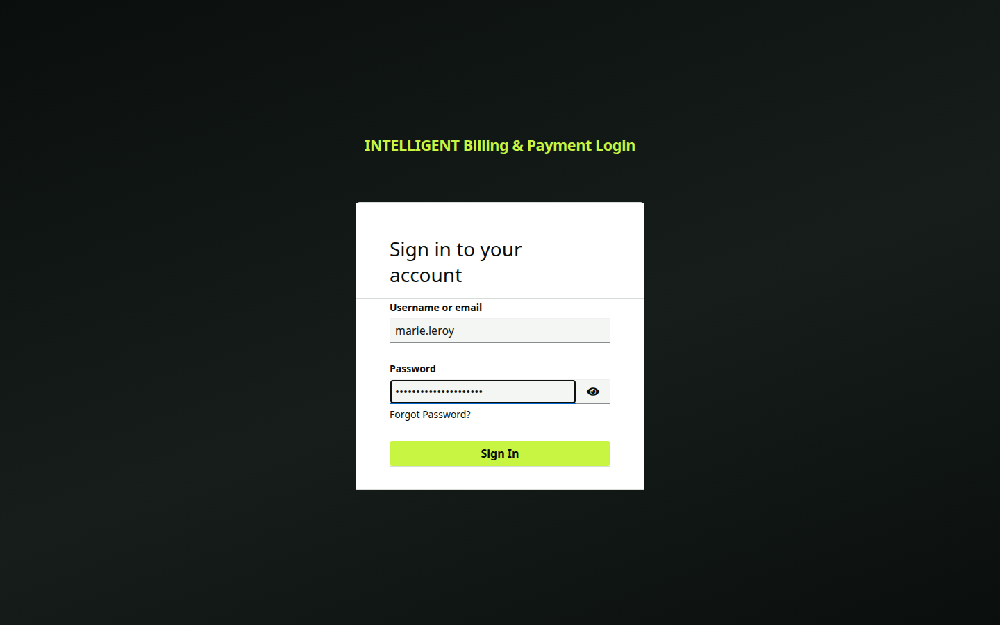

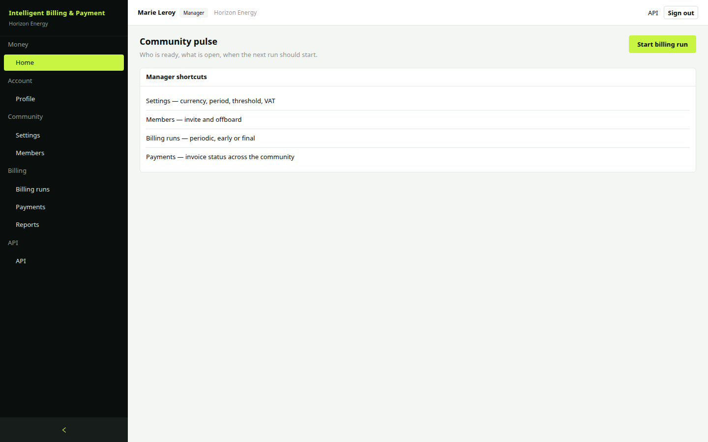

- [ ] Marie Leroy / Manager / Horizon Energy + sider  

### 6.2 Community settings (formulaire chargé)

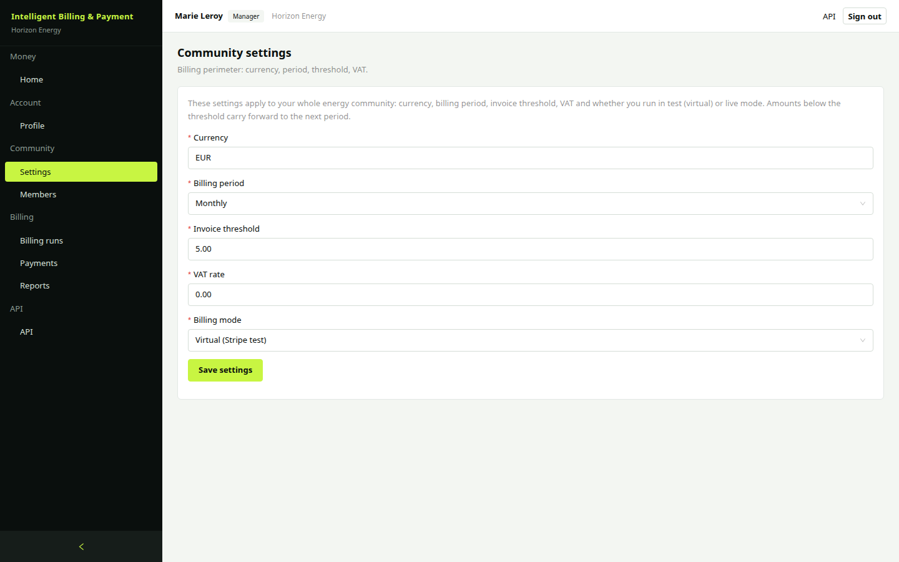

- [ ] Formulaire currency / period / threshold / VAT visible (**pas** un spinner)  

### 6.3 Members

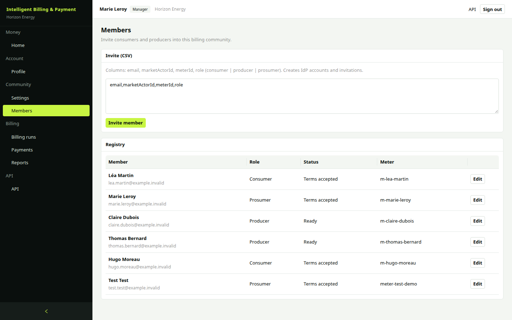

- [ ] Léa, Thomas, Claire, Marie, **Hugo Moreau** listés par nom  

### 6.4 Billing runs — Early

| Champ | Valeur |
|---|---|
| Type | Early |
| Period | vide |

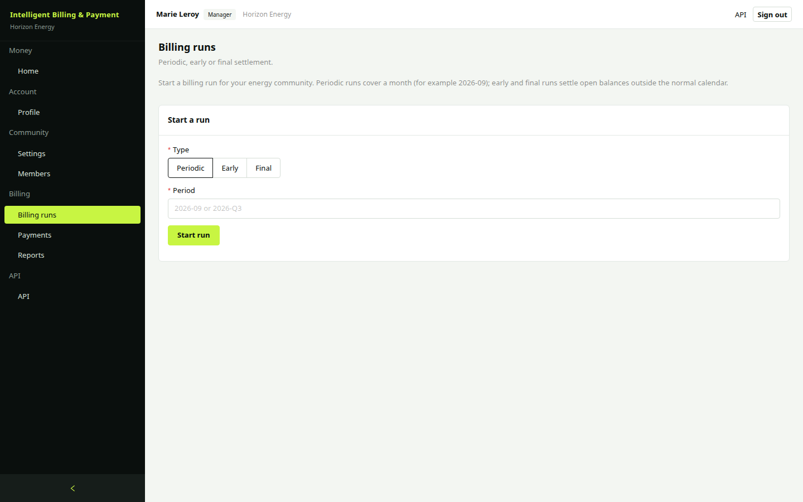

- [ ] Start run → **completed**  

### 6.5 Payments overview

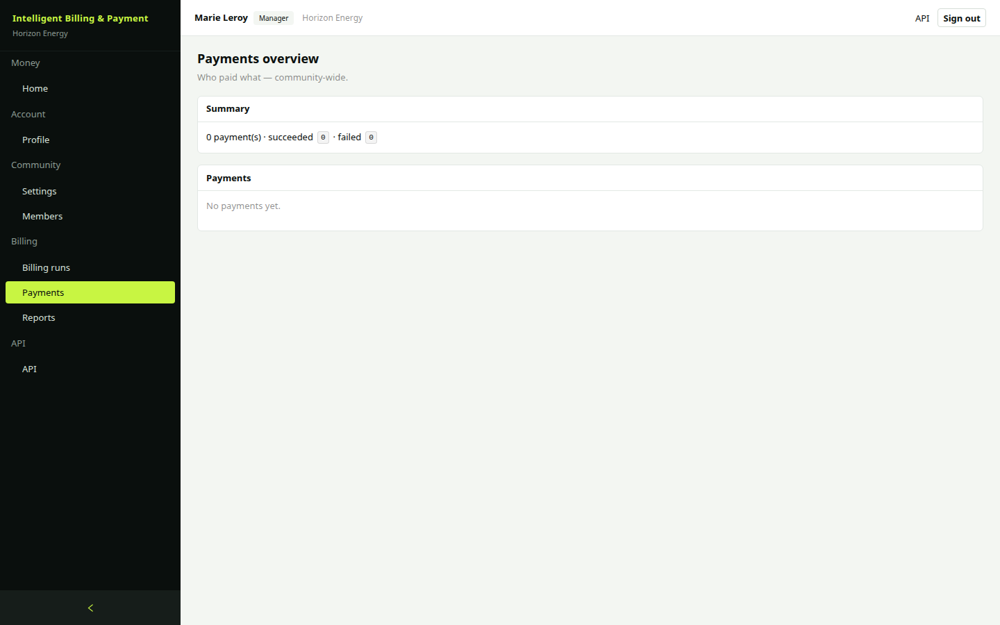

> « No payments yet » / compteurs à 0 = empty state **OK** tant qu’aucun Pay Léa.  
> Spinner seul = capture invalide.

### 6.6 Reports

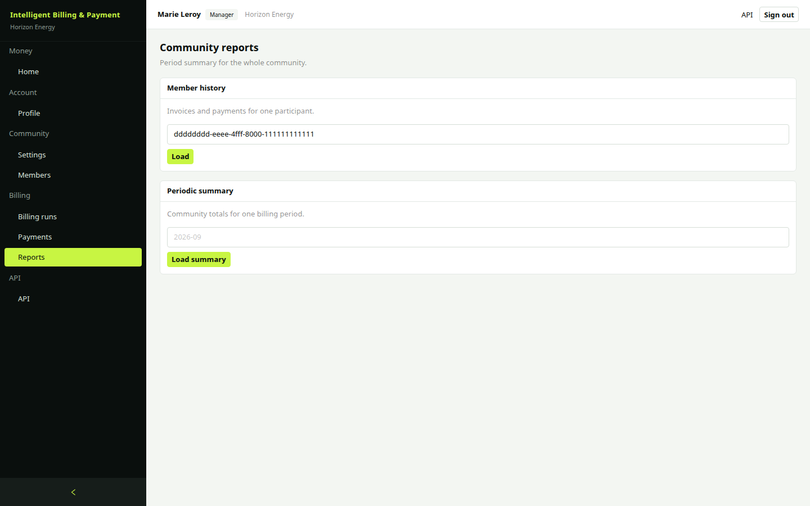

### Appel API — Marie (`marie.leroy`)

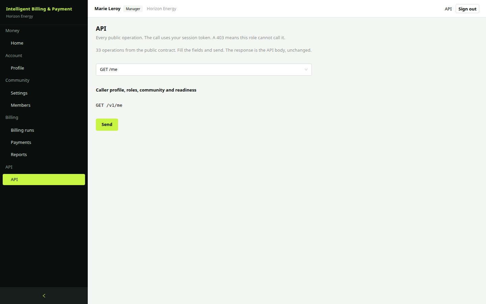

`GET /v1/me` — 200, `participantId` = `dddddddd-eeee-4fff-8000-111111111111`, rôle IdP `manager`.

`GET /v1/communities/c0ffee00-1234-4abc-8def-0123456789ab/settings` — 200. Corps obtenu (formulaire Settings) :

```json
{
  "communityId": "c0ffee00-1234-4abc-8def-0123456789ab",
  "currency": "EUR",
  "billingPeriod": "monthly",
  "threshold": "5.00",
  "vatRate": "0.00",
  "billingMode": "virtual"
}
```

Pour enregistrer sans changer ces valeurs, `PUT` le même objet **sans** `communityId`.

`GET /v1/communities/c0ffee00-1234-4abc-8def-0123456789ab/participants` — 200. La liste contient Léa, Thomas, Claire, Marie et Hugo Moreau.

`POST /v1/communities/c0ffee00-1234-4abc-8def-0123456789ab/billing-runs` — 202 (Early, period vide)

```json
{
  "type": "early"
}
```

La réponse contient `runId`. `GET /v1/billing-runs/{runId}` jusqu’à `status` = `Completed`.

`GET /v1/communities/c0ffee00-1234-4abc-8def-0123456789ab/payments-overview` — 200. Compteurs à 0 tant que Léa n’a pas payé.

`GET /v1/reports/summary?communityId=c0ffee00-1234-4abc-8def-0123456789ab&period=2026-Q4` — 200 (écran Reports).

---

## 7. Parcours C — Invite CSV (Marie → nouvel invité)

**REQ-008 / UAT-008.** La manager crée un compte IdP + envoie l’invitation ; le membre complète ensuite le même wizard que Hugo (parcours A).

### Prérequis

- Connexion **Marie Leroy** (`marie.leroy`)
- Accès Mailpit (catcher SMTP du cluster) pour lire le mail d’invitation :
  `kubectl -n int-apps port-forward svc/mailpit 8025:8025` puis http://127.0.0.1:8025
- E-mail **unique** (ne pas réutiliser un login déjà seedé)

### Données CSV (exemple)

Coller dans **Members → Invite (CSV)** (colonnes : `email,marketActorId,meterId,role`) :

```text
email,marketActorId,meterId,role
camille.rousseau@example.invalid,actor-camille-demo,meter-camille-demo,consumer
```

| Champ | Valeur démo |
|---|---|
| email | `camille.rousseau@example.invalid` (ou autre unused) |
| marketActorId | `actor-camille-demo` (unique) |
| meterId | `meter-camille-demo` (unique) |
| role | `consumer` (ou `producer` / `prosumer`) |

Le CSV n’a pas de colonne nom. REQ-008 : le membre saisit le nom de facturation dans le portail. Le champ **Name** est vide à la première connexion (ANO-012). Ce n’est pas un défaut d’invitation.

### Étapes

| # | Action | Attendu | Pass |
|---|---|---|---|
| C.1 | Marie → **Members** | Liste (Léa, Thomas, Claire, Marie, Hugo…) | [ ] |
| C.2 | Coller le CSV + **Invite member** | Message import OK ; nouvelle ligne **Invited** | [ ] |
| C.3 | Ouvrir Mailpit | Mail Keycloak (VERIFY_EMAIL / UPDATE_PASSWORD) vers l’e-mail CSV | [ ] |
| C.4 | Suivre le lien → définir mot de passe | Compte utilisable | [ ] |
| C.5 | Login app avec le nouvel e-mail | Home Invited / wizard (pas de sider — INT-254) | [ ] |
| C.6 | Profil : saisir le **Name** (vide), l’adresse et l’e-mail, puis CGU → carte test | Ready + sider (comme parcours A). Le nom n’est pas prérempli | [ ] |

**Points de contrôle IdP (INT-285)** — après invite, le user Keycloak doit avoir :

- attribut `community_id` = `c0ffee00-1234-4abc-8def-0123456789ab` (Horizon Energy)
- realm role `member` (pas le rôle marché consumer/producer — celui-ci reste dans le registry)

> En démo courte : s’arrêter à C.2–C.3 si le temps manque ; C.5–C.6 = rejoue A avec un compte créé live.

### Appel API — invite (Marie, puis le nouvel invité)

`POST /v1/communities/c0ffee00-1234-4abc-8def-0123456789ab/participants:import` — 201, session Marie. Pas de nom : le membre le saisit ensuite (ANO-012).

```json
{
  "participants": [
    {
      "email": "camille.rousseau@example.invalid",
      "marketActorId": "actor-camille-demo",
      "meterId": "meter-camille-demo",
      "role": "consumer"
    }
  ]
}
```

`GET /v1/communities/c0ffee00-1234-4abc-8def-0123456789ab/participants` — 200, une ligne `status` = `Invited` pour cet e-mail. Le mail et le mot de passe restent dans Mailpit / Keycloak (C.3–C.4).

Ensuite, connecté comme Camille, rejouer les appels de Hugo (§2) avec :

```json
{
  "name": "Camille Rousseau",
  "address": "12 rue de la Paix, 75002 Paris",
  "email": "camille.rousseau@example.invalid"
}
```

et `"selfBillingMandate": false`, `termsVersion` = `v1.0.0`.

---

## 8. Paul Nguyen — Opérateur


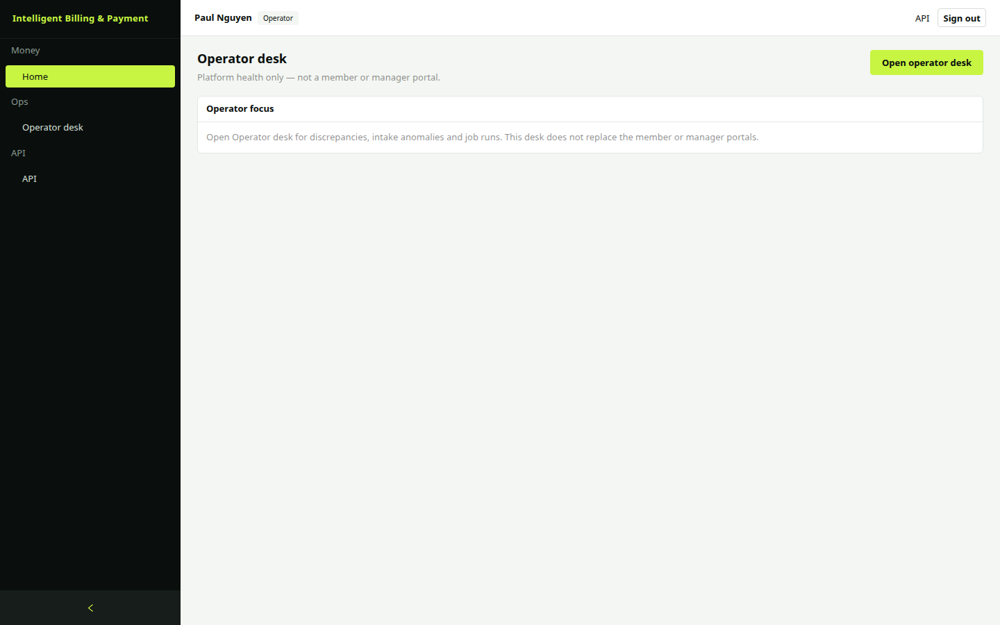

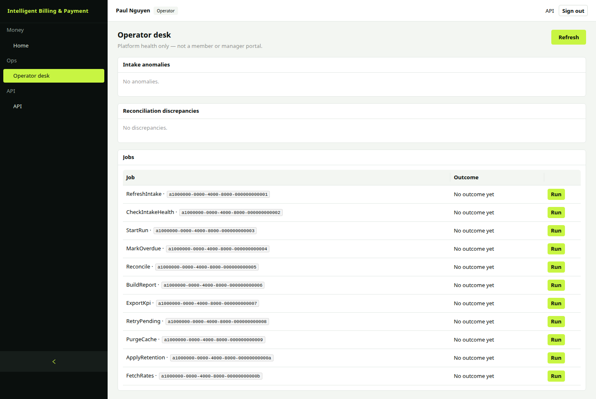

- [ ] Menu **Operator desk** seulement (INT-254). Pas de **My history** : cet écran est réservé au membre (Léa, §3.8). ANO-009  
- [ ] Jobs / anomalies visibles (pas spinner)  
- [ ] Membre Horizon Energy **ne voit pas** Operator desk

### Appel API — Paul (`paul.nguyen`)

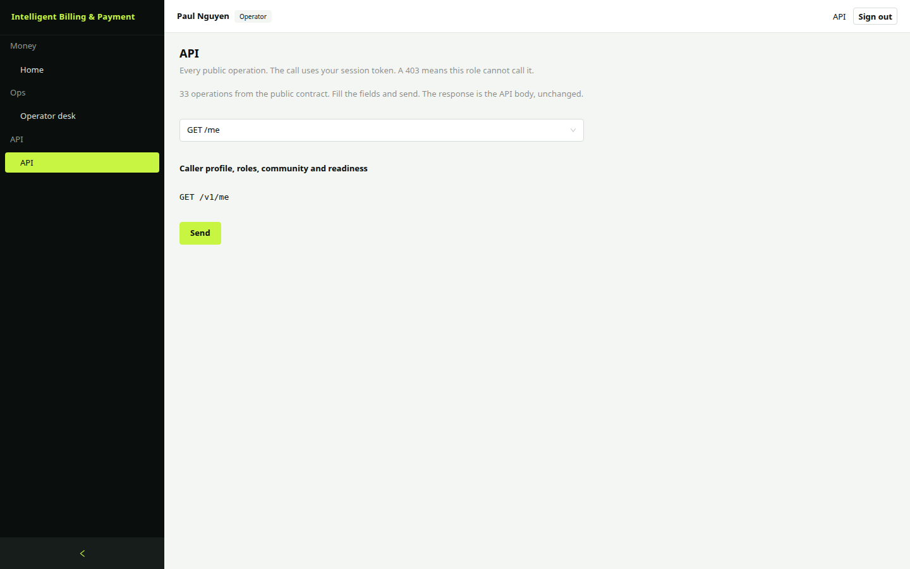

Session opérateur. Un membre qui envoie ces appels reçoit 403.

`GET /v1/reconciliation/discrepancies?communityId=c0ffee00-1234-4abc-8def-0123456789ab` — 200.

`GET /v1/intake/anomalies?communityId=c0ffee00-1234-4abc-8def-0123456789ab` — 200.

`GET /v1/jobs?communityId=c0ffee00-1234-4abc-8def-0123456789ab` — 200. Tableau de `{ "jobId", "name" }`.

`POST /v1/jobs/{jobId}:run` — pas de corps, 202. `{jobId}` est celui copié dans la liste.

---

## 9. Ordre démo recommandé (25–35 min)

1. **Hugo** — onboarding Invited → Ready (§2)  
2. **Thomas** + **Claire** — KYC si besoin (§4–5)  
3. **Marie** — Settings coup d’œil + Early run (§6)  
4. **Léa** — payment si besoin → Invoices → PDF → Pay (§3)  
5. **Marie** — Payments overview (§6.5)  
6. **Marie** — Invite CSV + Mailpit (§7, parcours C) — optionnel si temps  
7. **Paul** — Operator desk (§8)  

---

## 10. Référence métier

| Élément | Valeur |
|---|---|
| Community | Horizon Energy (`c0ffee00-1234-4abc-8def-0123456789ab`) |
| API | `https://api.dev.intelligent-eu-bp.blooo.dev/v1` · console `https://app.dev.intelligent-eu-bp.blooo.dev/api` |
| Hugo / Léa / Thomas / Claire / Marie | voir le tableau « Deux exécutions » |
| Terms | `v1.0.0`, `selfBillingMandate` false pour un consommateur |
| Trades démo | `0x8f3a…` (~€2,00) / `0x1a2b…` (~€2,64) |
| Invite CSV | Members → Invite (CSV) ; mail dans Mailpit (`svc/mailpit`) |

---

## 11. Pass / Fail global

| Zone | Pass si… |
|---|---|
| Onboarding | Hugo part de Invited, aucune case déjà verte |
| Argent | Léa paie des factures Open après run Marie |
| Invite | CSV → ligne Invited + mail Mailpit + `community_id` IdP |
| Setup chrome | Pas de sider avant Ready ; sider après |
| IdP Volt | Titre **INTELLIGENT Billing & Payment Login** au-dessus du form centré (CTA lime) |
| Captures | Pas de spinner présenté comme écran final |
| Members | Noms humains dont Hugo Moreau |

---

## 12. Fichiers

| Fichier | Rôle |
|---|---|
| [`README.md`](./README.md) | Index |
| [`assets/demo-workbook/`](./assets/demo-workbook/) | PNG |
| `scripts/capture-demo-workbook.mjs` | Recapture (`wait` anti-spinner, lien API) — INT-333 / INT-399 |
| `scripts/export-cahier-pdf.mjs` | Régénération PDF A4 — INT-333 |
| [`manual-s1-portal-journey.md`](./manual-s1-portal-journey.md) | Parcours argent (texte) |
