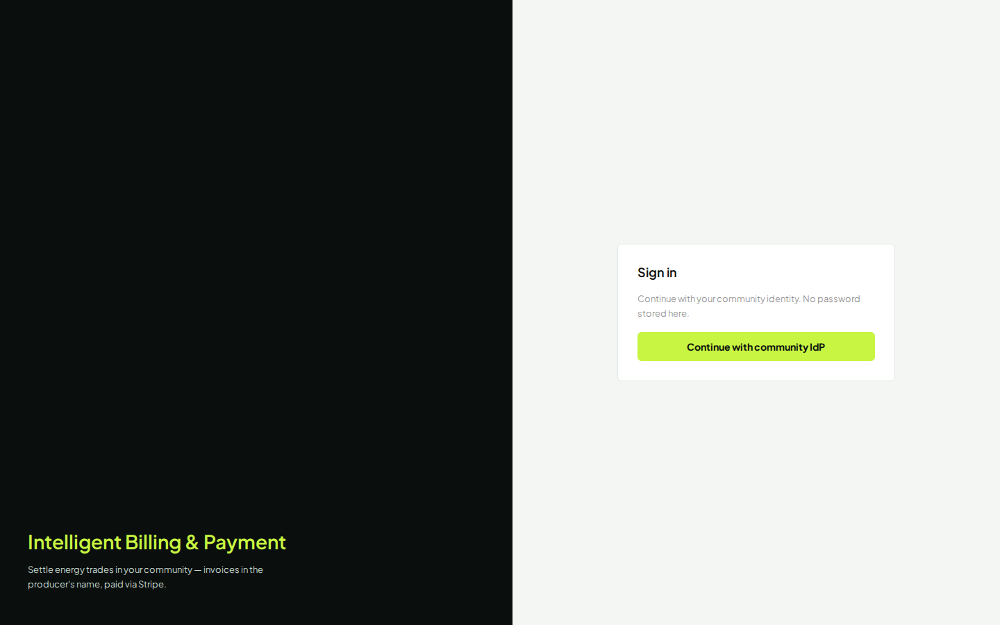

# Cahier de tests — Intelligent Billing & Payment

**Produit :** Intelligent Billing & Payment  
**Environnement :** `dev` — https://app.dev.intelligent-eu-bp.blooo.dev  
**IdP :** Keycloak realm `int`  
**Mot de passe (tous les comptes démo) :** `Intelligent-UAT-2026!`  
**Mode Stripe :** test uniquement (BR-12)  
**Public :** testeurs / support démo live  
**Ticket :** INT-282  

Les captures d’écran sont dans `docs/testing/assets/demo-workbook/`.  
Relancer la capture : `node scripts/capture-demo-workbook.mjs`.

> **Marque :** l’écran de connexion et le menu affichent **Intelligent Billing & Payment** après déploiement de INT-282.  
> Capture de référence (build local) :  
> 

---

## 0. Comptes et personas

Communauté démo S1 (billing) : `c0ffee00-1234-4abc-8def-0123456789ab`

| Persona | Rôle métier | Login | E-mail | Mot de passe |
|---|---|---|---|---|
| **Léa Martin** | Consommatrice (membre) | `lea.martin` | `lea.martin@example.invalid` | `Intelligent-UAT-2026!` |
| **Thomas Bernard** | Producteur A | `thomas.bernard` | `thomas.bernard@example.invalid` | `Intelligent-UAT-2026!` |
| **Claire Dubois** | Productrice B | `claire.dubois` | `claire.dubois@example.invalid` | `Intelligent-UAT-2026!` |
| **Marie Leroy** | Gestionnaire de communauté | `marie.leroy` | `marie.leroy@example.invalid` | `Intelligent-UAT-2026!` |
| **Paul Nguyen** | Opérateur système | `paul.nguyen` | `paul.nguyen@example.invalid` | `Intelligent-UAT-2026!` |

Comptes UAT (autre communauté, parcours e2e / onboarding from Invited) :

| Persona | Rôle | Login | E-mail |
|---|---|---|---|
| Hugo Petit | Membre UAT | `hugo.petit` | `hugo.petit@example.invalid` |
| Sofia Garcia | Manager UAT | `sofia.garcia` | `sofia.garcia@example.invalid` |

**Convention démo :** une fenêtre privée (ou **Sign out**) par persona.

---

## 1. Connexion (commun à toutes les personas)

| # | Action | Données | Attendu | Capture |
|---|---|---|---|---|
| 1.1 | Ouvrir l’app | URL ci-dessus | Écran Sign in + marque **Intelligent Billing & Payment** | `00-login-brand-ibp.png` |
| 1.2 | Cliquer **Continue with community IdP** | — | Formulaire Keycloak | `_login-<persona>.png` |
| 1.3 | Saisir login / mot de passe | voir §0 | Bouton **Sign out** visible | `p*-01-home.png` |

**Pass / Fail**

- [ ] Marque correcte sur l’écran de login  
- [ ] Connexion OK avec le login **humain** (plus de `s1-consumer`)  
- [ ] Mauvais mot de passe → erreur IdP, pas d’accès app  

---

## 2. Persona Léa Martin — Consommatrice

**Objectif démo :** onboarding / profil / CGU / carte / factures / paiement / soldes / privacy.

### 2.1 Accueil & navigation membre

| # | Action | Attendu | Capture |
|---|---|---|---|
| 2.1.1 | Après login | Home membre ; badge rôle Consumer (ou équivalent) | `p1-lea-martin-01-home.png` |
| 2.1.2 | Menu latéral (si Ready) | Home, Balances, Invoices, Payment method/setup, Privacy, My history | — |

### 2.2 Onboarding « Get ready » (si non Ready)

Utiliser aussi **Hugo Petit** (`hugo.petit`) si Léa est déjà Ready (seed S1).

| # | Action | Données à saisir | Attendu | Capture |
|---|---|---|---|---|
| 2.2.1 | Ouvrir `/onboarding` | — | Assistant étapes | `p1-lea-martin-02-onboarding.png` |
| 2.2.2 | Profil | Nom : `Léa Martin` ; adresse : `12 rue de la Paix, 75002 Paris` ; e-mail : `lea.martin@example.invalid` | Étape validée | `p1-lea-martin-03-profile.png` |
| 2.2.3 | CGU / Terms | Cocher acceptation version affichée | Étape Terms OK | `p1-lea-martin-04-terms.png` |
| 2.2.4 | Moyen de paiement | Voir §2.3 | Compte prêt | `p1-lea-martin-05-payment-setup.png` |

### 2.3 Moyen de paiement (carte test Stripe)

| Champ | Valeur |
|---|---|
| Numéro | `4242 4242 4242 4242` |
| Expiration | `12/34` (ou toute date future) |
| CVC | `123` |
| Code postal | `75002` (si demandé) |

**Pass / Fail**

- [ ] **Start payment setup** puis enregistrement carte sans erreur  
- [ ] Statut prêt (Payment method ready / last4 visible)  

### 2.4 Soldes, factures, PDF, paiement

Prérequis : run de facturation lancé par Marie (§4) si la liste est vide.

| # | Action | Attendu | Capture |
|---|---|---|---|
| 2.4.1 | `/balances` | Soldes non facturés ou vide après paiement | `p1-lea-martin-06-balances.png` |
| 2.4.2 | `/invoices` | Factures Open (≈ 2,00 € et 2,64 € après early run) | `p1-lea-martin-07-invoices.png` |
| 2.4.3 | **View** puis **Open PDF** | Détail + PDF/host Stripe ; **pas de frais de réseau** (A20) | — |
| 2.4.4 | **Pay** sur une facture Open | Statut → Paid ; Pay désactivé | — |

### 2.5 Privacy (export / erasure)

| # | Action | Attendu | Capture |
|---|---|---|---|
| 2.5.1 | `/privacy` | Écran Privacy / droits | `p1-lea-martin-08-privacy.png` |
| 2.5.2 | Demande d’export (si bouton) | Accusé / statut visible | — |
| 2.5.3 | `/reports` (My history) | Historique membre | `p1-lea-martin-09-reports.png` |

**Checklist Léa**

- [ ] Login `lea.martin`  
- [ ] Profil / CGU / carte  
- [ ] Facture + PDF + Pay  
- [ ] Privacy accessible  

---

## 3. Persona Thomas Bernard — Producteur A (KYC / payout)

**Objectif démo :** onboarding producteur Stripe Connect + factures émises.

| # | Action | Données | Attendu | Capture |
|---|---|---|---|---|
| 3.1 | Login `thomas.bernard` | mdp §0 | Home producteur | `p2-thomas-bernard-01-home.png` |
| 3.2 | `/payment-setup` → Start | — | Formulaire KYC | `p2-thomas-bernard-02-payment-setup.png` |
| 3.3 | Soumettre KYC test | tableau ci-dessous | Compte Connect en cours / ready | — |
| 3.4 | `/invoices` | — | Factures où Thomas est vendeur | `p2-thomas-bernard-03-invoices.png` |
| 3.5 | `/reports` | — | Historique | `p2-thomas-bernard-04-reports.png` |

### Données KYC Stripe Connect (test)

| Champ | Valeur |
|---|---|
| Business type | `Individual` |
| Business profile URL | `https://accessible.stripe.com` |
| MCC | `5734` |
| First name | `Thomas` |
| Last name | `Bernard` |
| Email | `thomas.bernard@example.invalid` |
| Phone | `+33600000001` |
| DOB | `1` / `1` / `1902` |
| Address line | `address_full_match` |
| City | `Paris` |
| Postal code | `75002` |
| Country | `FR` |
| Identity document file id | `file_identity_document_success` |
| Bank currency | `eur` |
| IBAN | `FR1420041010050500013M02606` |
| Stripe Connected Account Agreement | **coché** |

**Pass / Fail**

- [ ] Soumission sans erreur API rouge  
- [ ] Statut payout prêt (ou pending puis ready après 30–60 s + refresh)  

---

## 4. Persona Claire Dubois — Productrice B

Même parcours que Thomas avec :

| Champ | Valeur |
|---|---|
| Login | `claire.dubois` |
| First / Last | `Claire` / `Dubois` |
| Email | `claire.dubois@example.invalid` |
| Phone | `+33600000002` |
| Autres champs KYC | identiques à Thomas (tokens test Stripe) |

| Capture | Contenu |
|---|---|
| `p3-claire-dubois-01-home.png` | Home |
| `p3-claire-dubois-02-payment-setup.png` | KYC / payout |

- [ ] KYC Claire OK  
- [ ] Sign out  

---

## 5. Persona Marie Leroy — Gestionnaire

**Objectif démo :** paramètres communauté, participants, billing run, paiements, rapports.

| # | Action | Données | Attendu | Capture |
|---|---|---|---|---|
| 5.1 | Login `marie.leroy` | mdp §0 | Console manager | `p4-marie-leroy-01-home.png` |
| 5.2 | `/community-settings` | Seuil / devise / TVA selon écran | Sauvegarde OK | `p4-marie-leroy-02-community-settings.png` |
| 5.3 | `/participants` | — | Léa, Thomas, Claire, Marie listés | `p4-marie-leroy-03-participants.png` |
| 5.4 | `/billing-runs` → Start run | Type **Early** ; période vide | Status **completed** + `runId` | `p4-marie-leroy-04-billing-runs.png` |
| 5.5 | `/payments-overview` | — | Vue paiements communauté | `p4-marie-leroy-05-payments-overview.png` |
| 5.6 | `/reports` | — | Rapports communauté | `p4-marie-leroy-06-reports.png` |

**Pass / Fail**

- [ ] Communauté affichée = `c0ffee00-1234-4abc-8def-0123456789ab`  
- [ ] Early run **completed**  
- [ ] Pas de menus opérateur sensibles hors rôle  

Si aucune facture n’apparaît chez Léa après un run completed : trades déjà facturés — demander à un opérateur le reset fixture une fois (hors produit normal).

---

## 6. Persona Paul Nguyen — Opérateur

| # | Action | Attendu | Capture |
|---|---|---|---|
| 6.1 | Login `paul.nguyen` | Operator desk | `p5-paul-nguyen-01-home.png` |
| 6.2 | `/operator` | Jobs / outils opérateur | `p5-paul-nguyen-02-operator.png` |
| 6.3 | Déclenchement manuel (si proposé) | Job accepté / statut visible | — |
| 6.4 | `/reports` | Vue opérateur | `p5-paul-nguyen-03-reports.png` |

**Pass / Fail**

- [ ] Accès Operator tools  
- [ ] Membre (`lea.martin`) **ne voit pas** Operator tools  

---

## 7. Scénario démo enchaîné (ordre recommandé)

1. **Thomas** + **Claire** — KYC payout (§3–4)  
2. **Marie** — Early billing run (§5.4)  
3. **Léa** — carte (si besoin) → Invoices → PDF → Pay (§2)  
4. **Marie** — Payments overview (§5.5)  
5. **Paul** — Operator (§6)  
6. **Léa** — Privacy (§2.5)  

Durée indicative démo parlée : 15–25 minutes selon profondeur KYC.

---

## 8. Données métier de référence (S1)

| Élément | Valeur |
|---|---|
| Community id | `c0ffee00-1234-4abc-8def-0123456789ab` |
| Consumer participantId | `11111111-2222-4333-8444-555555555555` |
| Producer A participantId | `66666666-7777-4888-9999-aaaaaaaaaaaa` |
| Producer B participantId | `bbbbbbbb-cccc-4ddd-8eee-ffffffffffff` |
| Manager participantId | `dddddddd-eeee-4fff-8000-111111111111` |
| Trade A | `0x8f3a1c2b4d5e6f708192a3b4c5d6e7f8` (~€2,00) |
| Trade B | `0x1a2b3c4d5e6f708192a3b4c5d6e7f809` (~€2,64) |

---

## 9. Synthèse Pass / Fail globale

| Zone | Pass si… |
|---|---|
| Marque | « Intelligent Billing & Payment » visible |
| Identités | Logins prénom.nom ; noms affichés cohérents |
| Producteurs | KYC test OK pour Thomas et Claire |
| Manager | Early run completed sur communauté S1 |
| Consommatrice | Factures Open, PDF, Pay → Paid, sans frais réseau |
| Opérateur | Écran operator accessible à Paul seulement |
| Privacy | Écran privacy / droits accessible à Léa |

---

## 10. Hors périmètre de ce cahier

- Stripe live / documents KYC réels  
- Mutations cluster hors GitOps  
- Scripts opérateur CLI (`stripe-fresh-billing-run.mjs`) sauf secours  

Parcours S1 historique (mis à jour personas) : `docs/testing/manual-s1-portal-journey.md`.
